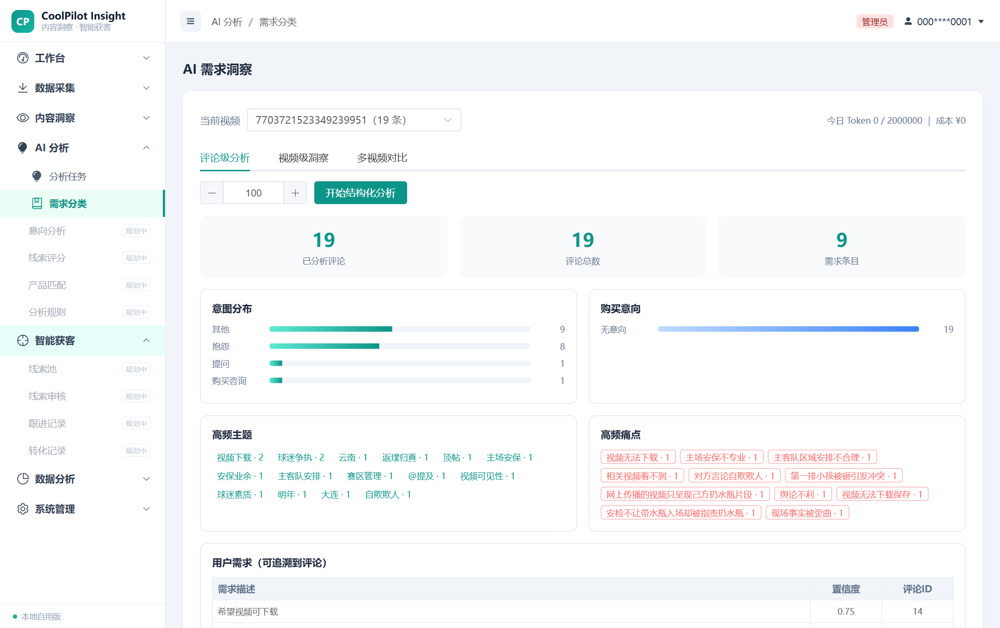

# CoolPilot Insight

> **AI 驱动的多平台内容洞察与智能获客系统**
> AI-Powered Social Intelligence & Lead Generation

从短视频、社交媒体和公开互联网信息中发现用户需求，通过 AI 识别潜在客户、分析购买意向，
并将有效需求转化为可跟进的销售线索。

```
数据采集  →  需求识别  →  用户画像  →  线索评分  →  客户转化
```

> 📌 **当前状态**：链路的第 1 环（数据采集）目前只覆盖**抖音**；需求识别与 AI 分析已可用；
> **用户画像、线索评分、客户转化尚未实现**。目标形态与实现度对照见
> [产品定位与能力矩阵](docs/product/01-positioning.md)，本文档只描述已落地的功能。

> ⚠️ **部署前必读（安全）**
> 仓库内的数据库密码、JWT 密钥均为**本地开发默认值**，仅供开箱即用，**不可用于生产环境**。
> 部署前请复制 `.env.example` 为 `.env`，并至少替换：
> - `DB_PASSWORD`（默认 `root`）
> - `JWT_SECRET`（默认值已公开，可伪造登录态，务必改为随机串，如 `openssl rand -hex 32`）
>
> 建库脚本中的管理员账号为占位凭据，首次部署后请立即登录修改密码。

---

## 📖 项目简介

CoolPilot Insight 面向**个人知识产品与技术服务的经营者**：从公开内容中发现「谁可能需要我的课程、
源码或技术服务」，把内容里的需求信号转变为可跟进的线索。

产品目标链路是 `数据采集 → 需求识别 → 用户画像 → 线索评分 → 客户转化`。
目前已落地的是其中第一段的完整闭环（以抖音为唯一来源）：

**抖音视频链接 → 评论采集 → 清洗（情感/去重） → AI 需求与话题分析 → 人工复核 → 报告导出**

也就是说：**采集与分析已经能跑通，从需求到线索的转化还未建设。**
`docs/audit/` 里有逐项的实现度判定与证据，`docs/product/01-positioning.md` 有目标架构与路线图。

### 能力现状（诚实版）

| 环节 | 状态 |
|---|---|
| 数据采集 | ✅ 抖音评论（含楼中楼、IP 归属地）· 其他平台待接入 |
| 需求识别 | ◐ 评论级意图/痛点/购买意向分析可用，缺线索评分与产品匹配 |
| 用户画像 | ❌ 未实现（仅保留作者公开标识字段） |
| 线索评分 | ❌ 未实现 |
| 客户转化 | ❌ 未实现 |

---

## 🧭 信息架构

左侧按七个业务中心组织，对应获客链路 `数据采集 → 需求识别 → 用户画像 → 线索评分 → 客户转化`：

```
CoolPilot Insight
├── 工作台        获客驾驶舱 · 今日需求(规划) · 待处理事项
├── 数据采集      数据源管理(规划) · 平台账号(规划) · 关键词管理 · 采集任务 · 采集记录 · 数据清洗
├── 内容洞察      内容库 · 评论库 · 用户公开资料(规划) · 需求信号(规划) · 热点趋势(规划)
├── AI 分析       分析任务 · 需求分类 · 意向分析(规划) · 线索评分(规划) · 产品匹配(规划) · 分析规则(规划)
├── 智能获客      线索池(规划) · 线索审核(规划) · 跟进记录(规划) · 转化记录(规划)
├── 数据分析      渠道分析(规划) · 需求趋势(规划) · 产品机会(规划) · 获客效果(规划) · 分析报告
└── 系统管理      用户与权限 · 模型配置(规划) · 任务配置(规划) · 数据保留策略(规划) · 操作审计(规划)
```

**关于「规划中」**：标了 `(规划中)` 的菜单项在本版本中**禁用不可点**，只作为目标结构的占位。
这样界面能表达完整的业务版图，同时不会让人误以为这些功能已经可用。
菜单配置集中在 `src/config/menu.js`，新增页面时改这一处即可。



> 两处对原始 IA 的补充：`数据采集 → 数据清洗`（采集流水线的一环）与
> `数据分析 → 分析报告`（结果输出）——原 IA 未列出这两个已有页面，无处安放会变成孤儿页。

---

## ✨ 功能介绍

### 数据采集（Collect）
- 通过 DrissionPage 自动化浏览器采集抖音视频评论
- **多视频批量采集**：一次提交多个链接，任务内串行执行（受 Chrome 单实例约束）
- **流式落盘**：每页立即追加写入，中断不再丢失已采数据
- **幂等去重**：`cid` + 本地指纹双唯一键，重复采集同一视频不产生重复行
- **采集用户标识**：抖音号(unique_id)、抖音 UID、安全 UID(sec_uid)、IP 归属地
  - 注：抖音出于隐私保护**不返回用户真实 IP**，只能拿到 IP 归属地标签（如"辽宁""广东"）
- **楼中楼回复**：接口返回的嵌套回复一并入库（`parent_cid` / `is_reply`）

### 任务中心（Tasks）
- 采集任务持久化：主任务 + 子任务 + 执行日志 + 断点，容器重启后仍可查询
- 状态机：PENDING / RUNNING / SUCCESS / PARTIAL_SUCCESS / FAILED / CANCELLED
- **并发防护**：同一视频不允许两个活动任务（`uk_video_active` + 条件更新领取）
- 支持取消、失败重试、按状态筛选、实时日志查看

### 关键词发现（Keywords）
- 关键词 CRUD（按用户隔离，归一化后去重）
- 关键词搜索 → 自动发现候选视频 → 落 `video` / `keyword_video` / `discovery_task_item`
- 发现任务与采集任务解耦：发现不自动触发采集，避免无谓资源消耗

### AI 需求洞察（Insight）
- **评论级结构化分析**：情感 / 意图 / 主题 / 痛点 / 用户需求 / 购买意向 / 场景 / 竞品提及 / 置信度
  - 强制 JSON Schema 输出，失败可重试；同一版本重复分析自动跳过与覆盖
- **视频级洞察**：需求 / 痛点 / 产品机会 / 亮点 / 购买意向，每条结论附 `evidence_comment_ids`
- **证据可追溯**：所有结论落 `analysis_evidence`，可定位到原始评论
- **多视频对比**：并排对比多个视频的需求/痛点，自动识别共性痛点
- **成本治理**：每次调用写 `usage_record`（唯一权威源），日 Token 预算护栏 + 并发上限

### 报告中心（Reports）
- 基于已有洞察归档为版本化报告，**不重复调用 AI，不产生额外费用**
- 报告含数据范围、样本量、证据数、生成时间
- **导出 PDF / Excel / Markdown**：PDF 用 reportlab 内置 CID 中文字体，Excel 为多 Sheet 工作簿

### 人工复核（Review）
- AI 结果逐条复核：**通过 / 驳回 / 纠正**
- 队列默认低置信优先，支持按状态与低置信筛选
- 纠正会覆盖 `comment_analysis` 供看板使用，同时把 **before/after 快照**写入 `analysis_review`，AI 原始结论不丢
- 复核统计（待复核/已通过/已纠正/已驳回）纳入运营概览

### 运营概览（Overview）
- 跨视频汇总：视频数、评论数、参与用户、已分析、待复核
- 近 14 天评论趋势、全库高频痛点 Top12、评论量 Top10 视频
- 复核进度与当日 AI 成本一览

### 评论树（Comment Tree）
- 一级评论 + 嵌套回复的可视化展开
- 基于 `parent_cid` 组装，父节点缺失时自动降级为一级，不丢数据

### 数据清洗（Clean）
- 自动去重、过滤无效评论
- **情感分析引擎**：SnowNLP + 529 词情感词典二次判定（灰区纠偏），阈值可配置
- 清洗结果一键入库（MySQL，`ON DUPLICATE KEY UPDATE` 幂等）

### 总览大屏（Dashboard）
- **统计卡片**：评论总数、参与用户数、总点赞数、平均点赞数
- **地区分布**：基于用户归属地的 ECharts 地图可视化（visualMap 渐变着色）
- **情感分析**：积极/中性/消极占比饼图
- **评论时间趋势**：日级别评论数量折线图
- **词云**：基于 jieba 分词的评论高频词可视化
- **桑基图**：地区 → 情感 → 话题 的评论流向分析
- **核心话题**（AI 驱动）：
  - DeepSeek AI 综合分析多维数据（关键词、情感分布、地区、高赞代表评论）
  - 自动生成结构化分析报告
  - AI 不可用时自动降级为统计报告，保证页面不崩溃
- **高赞评论排行**：Top 20 高赞评论列表（含抖音号）

### 用户系统
- 手机号注册/登录，**密码统一 BCrypt**（不再产生 MD5）
- JWT Token 认证；管理员账号由环境变量 `ADMIN_INIT_PASSWORD` 首次初始化，库内不存明文
- 数据授权三层：视频基础信息（公开）/ 评论数据（管理员、任务发起人、显式授权）/ 分析结果（跟随评论）
- 管理员后台：用户管理（管理员专用）

---

## 🛠️ 技术栈

| 层 | 技术 |
|----|------|
| 数据采集 | Python 3.10+（容器内 3.10.12）+ DrissionPage 4.x |
| 数据清洗 | Python 3.10+ + jieba + 自定义情感词典 || AI Agent | DeepSeek API (`deepseek-chat`) + OpenAI SDK |
| 分词服务 | Flask 3.x + jieba（常驻服务，50ms 级响应） |
| 后端 | Spring Boot **4.1** + MyBatis 3.5 + HikariCP + MySQL 8.0（**JDK 21**） |
| API 文档 | springdoc-openapi 3.x (Swagger UI) |
| 前端 | Vue 3.3 + Vite 5 + Element Plus 2.4 + ECharts 5.4 + Pinia |
| 词云图 | echarts-wordcloud |
| 认证 | JWT Token + 内存 TokenStore |
| 缓存 | 内存 MemoryCache（TTL 30 分钟 / 分析缓存 5 分钟） |
| 数据库迁移 | **Flyway 11.x**（`db/migration` V1~V8，唯一结构变更入口） |
| 可观测性 | Actuator + Micrometer（HikariCP 池指标）+ p6spy（可选 SQL 打印） |

---

## 🗄️ 数据库设计（V1.1 冻结版）

25 张业务表，按领域划分：

| 领域 | 表 |
|------|----|
| 用户与治理 | `user`、`system_config`、`audit_log` |
| 关键词与视频 | `keyword`、`video`、`keyword_video`、`discovery_task`、`discovery_task_item` |
| 评论采集 | `comment`、`collection_task`、`collection_task_item`、`collection_checkpoint`、`collection_task_log` |
| AI 分析 | `analysis_profile`、`analysis_task`、`analysis_task_batch`、`analysis_task_item`、`comment_analysis`、`video_insight`、`analysis_evidence` |
| 授权/文件/报告 | `video_grant`、`file_asset`、`report`、`report_version`、`usage_record` |

**三个关键设计**：

1. **视频独立建模**：`video.id` 是内部主键，`aweme_id` 是平台标识；`comment.video_id` 指向内部 ID。
2. **评论双唯一键**：`uk_platform_cid (platform, cid)` + `uk_platform_dedup (platform, dedup_key)`。
   `cid` 允许 NULL（历史数据），`dedup_key` 恒非空（无 cid 时用本地指纹兜底）。
   > 实测本平台评论接口 **确实返回 cid**，19/19 条命中，策略为 `CID`。
3. **活动任务唯一**：`collection_task_item.uk_video_active (video_id, active_flag)`，
   终态把 `active_flag` 置 NULL（MySQL 唯一索引对 NULL 不生效）。

**迁移机制**：容器启动时 Flyway 自动执行 `V1~V8`，禁止 `baselineOnMigrate`。
MySQL 的 DDL 隐式提交意味着**迁移失败无法回滚**，失败后需按备份或全量重建恢复。

> `V8` 为 `analysis_evidence` 补 `source_level` 列（`INSIGHT` / `COMMENT_ANALYSIS`）。
> 该列在实体里早已存在但建表时遗漏，导致评论级分析写证据时报
> `Unknown column 'source_level'`，整批评论被判 FAILED。Flyway 是唯一迁移入口，
> 补列请继续新增 `V9+`，不要手工改表。

### 新增环境变量

| 变量 | 说明 |
|------|------|
| `ADMIN_INIT_PASSWORD` | 首次启动把哨兵管理员置为可用密码；留空则账号保持不可登录 |
| `FLASK_INTERNAL_TOKEN` | Java→Flask 服务间令牌；配置后 Flask 拒绝无令牌请求 |
| `FLYWAY_ENABLED` | 默认 true；仅在调试时可临时关闭 |
| `SENTIMENT_POS` / `SENTIMENT_NEG` | 情感判定阈值（默认 0.6 / 0.4） |
| `AI_MAX_CONCURRENCY` | AI 调用并发上限（默认 3） |
| `DEEPSEEK_API_KEY` | 未配置时 AI 洞察不可用，其余统计功能正常 |

---

## 📁 项目结构

```
coolpilot-insight/
│
├── frontend/                        # Vue 3 前端
│   ├── src/
│   │   ├── api/                     # Axios 封装与接口定义
│   │   ├── components/              # 布局与图表组件（AppLayout 等）
│   │   ├── config/menu.js           # 侧边栏信息架构（单一数据源）
│   │   ├── router/                  # 路由与登录守卫
│   │   ├── stores/                  # Pinia 状态
│   │   ├── utils/                   # ECharts 组合式函数等
│   │   └── views/                   # 页面（登录、驾驶舱、采集、评论、洞察、复核、报告、管理）
│   └── package.json
│
├── backend/                         # Spring Boot 4.1 / JDK 21
│   ├── pom.xml
│   └── src/
│       ├── main/java/com/coolpilot/insight/
│       │   ├── controller/           # 12 个 REST 控制器
│       │   ├── service/              # 业务逻辑（采集调度、清洗、AI 分析、报告、鉴权）
│       │   ├── mapper/               # MyBatis 接口（SQL 在 resources/mapper/*.xml）
│       │   ├── entity/               # 25 张表对应的实体
│       │   ├── config/               # 配置、拦截器、全局异常、启动引导
│       │   └── utils/                # JWT、TokenStore、内存缓存、链接解析
│       ├── main/resources/
│       │   ├── application.yml
│       │   ├── db/migration/         # Flyway V1~V8（唯一结构变更入口）
│       │   └── mapper/               # 25 个 Mapper XML
│       └── test/java/                # 17 个集成测试（Testcontainers MySQL）
│
├── collection-service/              # 采集侧（Python）
│   ├── app/adapters/
│   │   ├── base.py                  # 平台适配器契约（目标：discover/collect/normalize）
│   │   └── douyin/
│   │       ├── comment.py           # 抖音评论采集（DrissionPage）
│   │       ├── search.py            # 抖音搜索（能力待验证）
│   │       └── browser.py           # Chrome 启动配置
│   ├── datas/                       # 采集原始 CSV（容器挂载）
│   └── tests/                       # 工具脚本
│
├── ai-service/                      # 清洗与 AI 侧（Python / Flask）
│   ├── app/
│   │   ├── server.py                # Flask 常驻服务（分词、话题分析、报告渲染）
│   │   ├── clean.py                 # 清洗入库（去重 + 情感标注）
│   │   ├── analysis_engine.py       # 词典情感分析引擎
│   │   ├── wordcloud_gen.py         # 词云数据生成
│   │   └── sentiment_dict/          # 情感词典
│   └── requirements.txt
│
├── deploy/
│   ├── compose/docker-compose.yml   # 编排定义（根目录 compose.yaml 通过 include 引用）
│   ├── docker/                      # 三个 Dockerfile + nginx.conf + maven-settings.xml
│   └── ...（部署指南见 docs）
│
├── docs/
│   ├── product/                     # 产品定位、能力矩阵、界面截图
│   ├── audit/                       # 工程基线审计（六篇 + 历史快照）
│   ├── migration/                   # 技术栈升级记录（Boot 4 / JDK 21 / MyBatis）
│   └── integration/                 # 外部系统集成说明
│
├── tools/                           # 迁移与校验脚本（代码生成、表结构漂移检查）
├── compose.yaml                     # 统一入口：include deploy/compose/docker-compose.yml
├── .env.example                     # 环境变量模板（复制为 .env）
├── coolpilot_insight.sql            # 建库建表 SQL（历史方案，正式以 Flyway 为准）
└── README.md
```

> `frontend/` `backend/` `collection-service/` `ai-service/` 是**目标组织方式**，
> Java 根包已迁移为 `com.coolpilot.insight`；业务模块尚未按 `source/collection/content/analysis/lead/...`
> 拆分模块——那属于 P1 阶段工作，见 `docs/audit/06-migration-recommendations.md`。

---

## 🔄 数据流

```
用户输入抖音链接
    ↓
Java CollectUtils 解析链接 → Python 爬虫采集 CSV
    ↓
前台勾选 CSV 文件 → Python clean_main 清洗入库
  （jieba 分词 → 情感词典判定 → MySQL 写入）
    ↓
总览大屏选择视频 → 后端 6 维度并行分析
  │
  ├── 地区分布    ← 按 region 分组统计
  ├── 情感分析    ← sentiment 聚合 + 趋势判定
  ├── 时间趋势    ← 按 publish_time 日聚合
  ├── 词云        ← Flask 分词服务 (50ms)
  ├── 桑基图      ← 地区 → 情感 → 话题 流向
  ├── 核心话题    ← AI 深度分析
  │    └── Java 计算 5 维度 → Flask POST → DeepSeek API → 结构化报告
  └── 高赞排行    ← 按 likes DESC LIMIT 20
    ↓
ECharts 渲染 → 总览大屏展示
```

### AI Agent 核心话题 — 架构说明

```
                            ┌─ 关键词 (wordcloud) ─┐
                            ├─ 情感分布            │
Java 后端计算 5 维度数据 ────┼─ 话题共现            │──→ Map<String, Object>
                            ├─ 用户动机            │
                            └─ 句子结构            │
                                    ↓
                          HTTP POST / JSON (localhost:5000)
                                    ↓
                    Flask wordcloud_service.py (analyze_topic 端点)
                                    ↓
                          DeepSeek API (deepseek-chat)
                                    ↓
                    结构化 Markdown 报告（数据概览 → 核心话题 → 建议）
                                    ↓
                          Java 缓存 30 分钟 → 前端展示

    容错机制: DeepSeek 不可用 → 自动降级为旧版统计报告 (buildFallbackReport)
              评论为空      → 跳过不调 Agent
```

---

## 🚀 快速启动

### 方式一：Docker 一键启动（推荐）

```bash
cp .env.example .env          # 可选：按需修改端口/密码
docker compose up -d --build
```

启动后访问：

| 服务 | 地址 |
|------|------|
| 前端页面 | http://localhost:5173 |
| 后端 API | http://localhost:8080/api |
| Swagger 文档 | http://localhost:8080/swagger-ui.html |

> 本机 3306 / 3000 端口已被占用，故 MySQL 映射至 3307、前端映射至 5173。
> 完整说明见 **[Docker 部署指南](deploy/docker/DOCKER部署指南.md)**。

### 方式二：本地开发

#### 1. 环境要求

- JDK 21+
- Node.js 18+
- Python 3.10+
- MySQL 8.0

### 2. 数据库

```sql
-- 直接执行项目根目录下的建库建表脚本
source coolpilot_insight.sql;
```

或手动执行：
```sql
CREATE DATABASE IF NOT EXISTS coolpilot_insight DEFAULT CHARSET utf8mb4;
use coolpilot_insight;
-- 然后执行 coolpilot_insight.sql 中的建表语句
```

插入管理员（可选）：
```sql
INSERT INTO coolpilot_insight.user (username, phone, password, role, created_at)
VALUES ('管理员', '13800000000', MD5('123456'), 1, NOW());
```

### 3. 配置 DeepSeek API Key（AI 话题分析）

```bash
# 方式一：编辑 ai-service/.env 文件
# 已创建，填入你的 API Key 即可
DEEPSEEK_API_KEY=sk-your-key-here

# 方式二：设置系统环境变量
# Windows: set DEEPSEEK_API_KEY=sk-your-key-here
```

> 不配置 API Key 不影响平台使用，核心话题将自动回退为传统统计分析报告。

### 4. 安装依赖 & 启动服务

```bash
# 终端1: AI 服务依赖（清洗 / 分词 / 话题分析）
cd ai-service
python -m pip install -r requirements.txt

# 终端2: 后端（自动拉起 Flask 服务 + 启动 Spring Boot）
cd backend
mvn -s ../deploy/docker/maven-settings.xml spring-boot:run

# 终端3: 前端
cd frontend
npm install
npm run dev
```

### 5. 访问

| 服务 | 地址 |
|------|------|
| 前端页面 | `http://localhost:3000` |
| 后端 API | `http://localhost:8080` |
| Swagger 文档 | `http://localhost:8080/swagger-ui.html` |
| Flask 分词服务 | `http://127.0.0.1:5000`（内部分调用，无需直接访问） |

> **提示**：所有路径与外部地址均已支持环境变量覆盖，本地开发无需任何额外配置。
> 常用变量清单见 [Docker 部署指南 · 关键设计说明](deploy/docker/DOCKER部署指南.md)。

---

## 🧩 已实现的优化（v2.0+）

1. **AI 核心话题分析** — DeepSeek 驱动，5 维度综合分析 + 结构化报告输出
2. **BCrypt 密码加密** — 新密码 BCrypt 加盐，老 MD5 兼容过渡
3. **useECharts 组合式函数** — 消除图表组件 90% 重复代码
4. **SLF4J 日志 + 全局异常** — 结构化日志 + 统一错误追踪
5. **Swagger API 文档** — 接口在线查看和调试
6. **Flask 常驻分词服务** — jieba 预加载，响应从 2s 降到 50ms
7. **3 层容错降级** — AI Agent 不可用时自动回退，页面永不崩溃
8. **Markdown 格式化报告** — 标准 Markdown 渲染，支持 Emoji 层级、加粗、列表

---

## ✅ AI 全链路验证记录（2026-11-04）

配置真实 `DEEPSEEK_API_KEY` 后，端到端跑通并留下可复核的基线数据：

| 环节 | 结果 |
|------|------|
| 评论级结构化分析 | 19/19 成功，输入 659 / 输出 1503 tokens，成本 ¥0.0133 |
| 视频级洞察 | 1 条 OVERVIEW，26 条证据落库（`source_level=INSIGHT`） |
| 报告生成 | 基于洞察归档，0 次额外 AI 调用 |
| PDF 导出 | 3 页，`STSong-Light` 中文字体，6.7 KB |
| XLSX 导出 | 8 个 Sheet（概览/需求/痛点/机会/亮点/情感/地区/趋势） |
| 页面冒烟 | 8 个页面 0 控制台报错（登录→看板→概览→洞察→报告→评论→复核→任务） |

**同轮修复的三个缺陷**：

1. `analysis_task` 的 token/成本汇总用 `tokensByTask/2` 对半分，导致 `input==output` 且
   `cost_amount` 恒为 0 —— 改为分别按 `usage_record` 聚合输入/输出/成本。
2. 洞察证据写入用 `catch (Exception ignore)` 静默吞异常，缺列时证据全部丢失且无日志 ——
   改为 `log.warn` 记录，并让评论级证据重跑时先清理旧行，避免证据表无限堆积。
3. 前端头部导航 9 项挤压右侧用户区（「管理员」换行、手机号被裁切）；
   `contentMd` / 核心话题直接插值导致 Markdown 标记原样显示 —— 已压缩导航留白、
   固定用户区宽度，并新增零依赖 `renderMarkdown`（默认转义 HTML）渲染。

---

## 🔜 后续优化方向

| 优先级 | 优化项 | 预期收益 |
|--------|--------|----------|
| P1 | 评论表预聚合 + 物化视图 | 分析查询 500ms → 20ms |
| P1 | Access Token + Refresh Token 续期 | 安全性提升 |
| P2 | 多模块 Maven 拆分 | 代码隔离、可复用 |
| P2 | API 限流 (Sentinel) | 防刷保护 |
| P2 | 单元测试 + 集成测试 | 回归保障 |
| P3 | 配置中心 (Nacos) | 动态配置 |
| P3 | 对象存储替代本地 CSV | 文件持久化 |
| P3 | 暗色模式 + Design Token | 视觉体验 |
| P3 | Docker Compose 一键部署 | 运维简化 |

---

## 🧪 测试

```bash
cd backend && mvn -s ../deploy/docker/maven-settings.xml test
```

集成测试用 Testcontainers 起真实 MySQL（需本机 Docker），首个测试类启动约 20 秒。
当前覆盖：Mapper CRUD 语义与评论幂等、采集任务原子领取、注册登录鉴权，共 17 个用例。

---

## 📄 相关文档

- [需求设计文档](需求设计（抖音多视频评论分析与可视化平台）.md) — 完整的需求分析、功能设计、数据表设计
- [Docker 部署指南](deploy/docker/DOCKER部署指南.md) — 一键容器化启动、架构说明、常见问题
- [爬虫维护笔记](抖音爬虫维护笔记.md) — 爬虫故障排查指南
- [简洁版使用指南](简洁版使用指南.txt) — 快速上手指南
> ⚠️ **架构重构进行中**：common/system/source/collection 已模块化，content/analysis/lead/conversion/analytics 尚未迁移，
> 数据库仍为旧结构（新基线已就绪未切换）。进度与交接见 [重构状态](docs/architecture/refactor/STATUS-handover.md)。

- [产品定位与能力矩阵](docs/product/01-positioning.md) — 目标形态、八大中心、路线图与产品边界
- [工程基线审计](docs/audit/01-project-baseline.md) — 升级前的技术栈、模块、API、采集能力与风险清单（6 篇）
- [仓库结构说明](docs/architecture/01-repo-structure.md) — 目录职责、依赖方向、compose include 的原因与未完成项
- [Boot 4 迁移记录](docs/migration/2026-11-15-boot4-jdk21-mybatis.md) — Spring Boot 4 + JDK 21 + 原生 MyBatis 的变更、语义陷阱与验证结果
