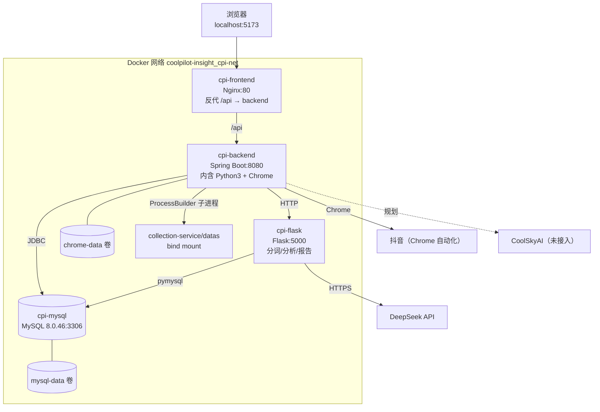

# R0-06 · 部署与基础设施审计

编排入口：根 `compose.yaml`（`include` → `deploy/compose/docker-compose.yml`）
运行时：Docker Compose **v5.5.1**，四个容器，单一桥接网络

## 1. 容器清单（实测）

| 容器 | 镜像 | 宿主端口 | 状态 |
|---|---|---|---|
| `cpi-mysql` | `mysql:8.0`（实际 8.0.46） | **3307** → 3306 | healthy |
| `cpi-flask` | `coolpilot-insight-flask`（Python 3.10 + Flask） | 无对外端口（内部 5000） | healthy |
| `cpi-backend` | `coolpilot-insight-backend`（JDK 21 + Python + Chrome） | **8080** → 8080 | healthy |
| `cpi-frontend` | `coolpilot-insight-frontend`（Nginx） | **5173** → 80 | Up |

## 2. 服务依赖与启动顺序

| 服务 | depends_on | 条件 |
|---|---|---|
| `mysql` | — | — |
| `flask` | mysql | `service_healthy` |
| `backend` | mysql（healthy）、flask（started） | — |
| `frontend` | backend | — |

启动顺序：`mysql → flask → backend → frontend`。`backend` 只在 mysql 健康后启动，避免 Flyway 连不上库。

## 3. 端口

| 服务 | 容器端口 | 宿主 | 说明 |
|---|---|---|---|
| mysql | 3306 | 3307 | 避开本机已有 3306 |
| backend | 8080 | 8080 | REST + Swagger |
| frontend | 80 | 5173 | 避开本机 3000 |
| flask | 5000 | **不暴露** | 仅集群内可达 |

## 4. 数据卷

| 卷 | 类型 | 内容 | 重建风险 |
|---|---|---|---|
| `coolpilot-insight_mysql-data` | named | MySQL 数据文件 | **R3 会重建此卷内数据** |
| `coolpilot-insight_chrome-data` | named | Chrome 用户目录（抖音登录态） | **不应删除**（删除需重新登录） |
| `../../collection-service/datas` | bind | 采集 CSV | 可清空 |

## 5. 网络

- 用户自定义桥接网络 `coolpilot-insight_cpi-net`（compose 创建）
- 同机另有 `coolpilot_default`、`coolpilotx_*` 网络，属**其他项目**，不得干预

## 6. 健康检查

| 服务 | 检查方式 | 间隔/次数 |
|---|---|---|
| mysql | `mysqladmin ping` | 10s / 20 次 |
| flask | Python `urllib` 请求 `127.0.0.1:5000/health` | 默认 |
| backend | `curl -fsS /api/health` | 默认 |
| frontend | 无 | — |

> `backend` 的健康检查同时校验 DB 连通（`/api/health` 返回 `db: UP`），是四者中最有信息量的。

## 7. 部署拓扑

> 图中 `BE → CoolSkyAI` 为**目标依赖，当前未实现**（虚线）。

## 8. 当前部署问题

| 问题 | 影响 | 证据 |
|---|---|---|
| `backend` 容器同时承载 Java + Python + Chrome | 镜像 1.92 GB；Python 依赖升级需重建整个后端镜像 | `backend.Dockerfile` |
| Flask 无对外端口 | 无法单独压测/排障，只能 `docker exec` 进容器 | compose `flask` 无 `ports` |
| 无 Redis | 任务状态全在 MySQL，调度靠 `@Scheduled` 单实例轮询 | `CollectServiceImpl.dispatch()` |
| 无对象存储 | 报告文件与 CSV 落本地卷 | — |
| 无反向代理统一入口 | 前端 Nginx 兼做反代，8080 直接暴露 | `deploy/docker/nginx.conf` |
| 两份副本共用 `name: coolpilot-insight` | 与 `douyin_opinion_analysis` 互斥，误操作会互相影响 | 两处 compose 第 13 行 |
| `.env` 缺失时 `JWT_SECRET` 必填报错 | 新环境首次启动失败 | compose `${JWT_SECRET:?}` |

## 9. 目标部署建议（详见 R1-08）

1. **保留四容器结构**，不引入 K8s / 消息队列
2. `backend` 去掉 Python 运行时依赖（采集/AI 已独立为两个服务），预计镜像从 1.92 GB 降至 ~300 MB
3. `collection-service` 提升为一等容器（当前是 backend 内的脚本）
4. **不引入 Milvus**：当前无向量检索需求（无 Embedding 能力），R4 之后再评估
5. 引入 Redis 仅在需要跨实例调度时（首期单实例不必要）
