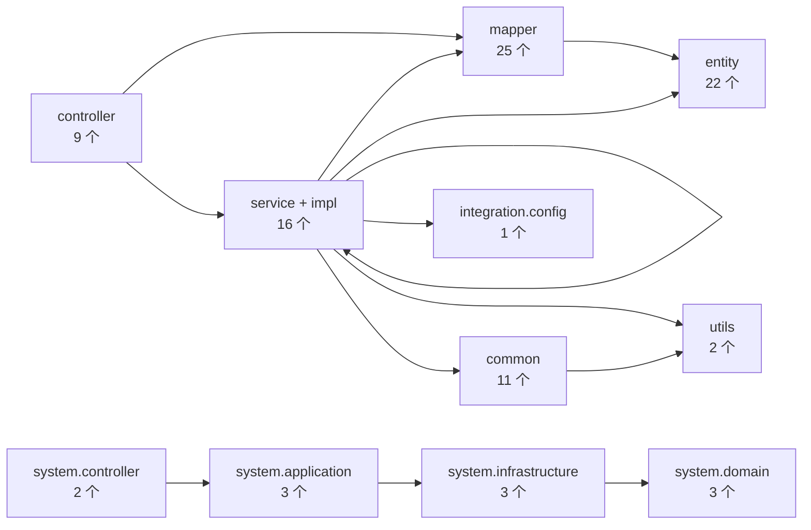
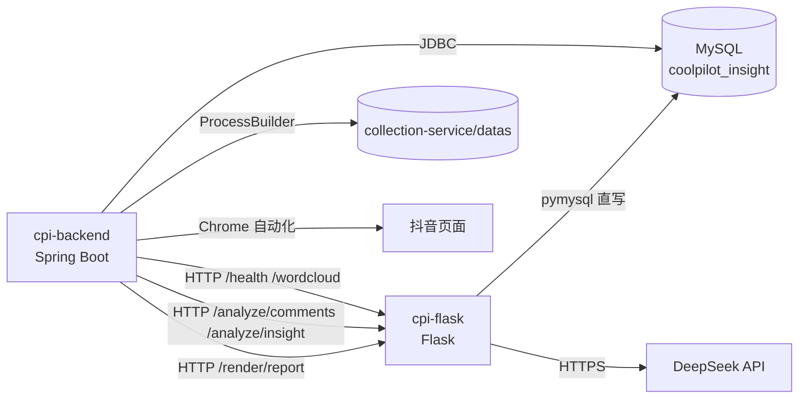
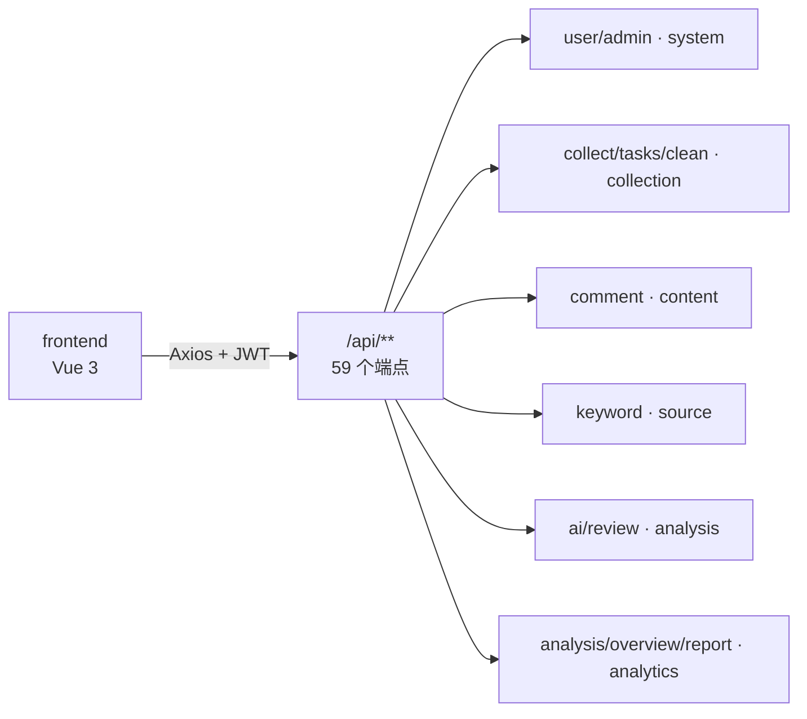

# R0-09 · 当前依赖关系图

图例：实线 = **源码中已确认存在**的依赖；虚线 = 推测或待确认。
本图只描述 CURRENT，不混入 TARGET。

## 1. Java 包级依赖（实测）

**已确认的事实**：

- `controller → service → mapper` 是主链路，但 `controller → mapper` **存在直连**（`AiController`）
- `service → service` 存在（8 个服务依赖 `GovernanceService`，7 个依赖 `VideoService`）
- `system` 与 `common` 已自成一体（R2 批次一），旧 `service` 层尚未接入它们，形成**两套并存**
- `integration` 目前只有配置类，**没有任何客户端实现**

**推测/待确认**：`utils → entity` 是否存在（`CollectUtils` 可能返回实体），未逐行核实。

## 2. Controller → Application → Mapper 调用关系（按业务域）

```mermaid
graph TB
    subgraph Auth["认证与系统"]
        UC["UserController"] --> US["UserServiceImpl"]
        US --> UM["UserMapper"]
        AC["AdminController"] --> UAS["UserAdminService"]
        UAS --> UM
        UAS --> TS["TokenStore"]
    end

    subgraph Content["内容"]
        CC["CommentController"] --> CS["CommentServiceImpl"]
        CS --> CM["CommentMapper"]
        CS --> GS["GovernanceService"]
        GS --> GM["VideoGrantMapper / CollectionTaskMapper / ..."]
    end

    subgraph Collection["采集"]
        COC["CollectController"] --> COS["CollectServiceImpl"]
        COS --> CTM["CollectionTask(Item/Log/Checkpoint)Mapper"]
        COS --> CLEAN["CleanService"]
        COS -.ProcessBuilder.-> PY1["comment.py"]
    end

    subgraph Analysis["AI 分析"]
        AIC["AiController"] --> AIA["AiAnalysisService"]
        AIC --> URM["UsageRecordMapper"]
        AIA --> CAM["CommentAnalysisMapper 等"]
        AIA -.HTTP.-> FL["Flask /analyze/*"]
        RC["ReviewController"] --> RS["ReviewService"]
        RS --> ARM["AnalysisReviewMapperExt"]
    end

    subgraph Analytics["统计与报告"]
        ANC["AnalysisController"] --> ANS["AnalysisServiceImpl"]
        OC["OverviewController"] --> OS["OverviewService"]
        RPC["ReportController"] --> RPS["ReportService"]
        RPS -.HTTP.-> FL2["Flask /render/report"]
    end
```

## 3. Java ↔ Python ↔ 数据库

**已确认**：
- Flask **直接写业务库**（`clean.py` 用 pymysql），绕过 Java 业务规则
- Java 对 Python 的调用有**两种形态**（HTTP 与子进程），无统一客户端
- 采集与 AI 的边界在代码里是模糊的（`CleanServiceImpl` 既调脚本又写库）

## 4. 前端 → 后端 API

**已确认**：13 个页面全部通过 `frontend/src/api/index.js` 的 58 个方法访问后端；
无任何页面直连 Python 服务。

## 5. 循环依赖分析

| 检查 | 结果 |
|---|---|
| Spring Bean 循环注入 | **未发现**（启动成功，无 `BeanCurrentlyInCreationException`） |
| 包级循环 | **存在潜在风险**：`service` 层内部互相引用（Governance ← 8 个服务，VideoService ← 7 个） |
| 模块级循环（目标） | 当前无模块概念；若直接按类名映射，`GovernanceService` 会同时落入 `content` 与 `system`，**必然形成双向依赖** |

结论：**当前无运行期循环依赖，但按目标模块切分时会出现**，必须在拆分 `GovernanceService` 时切断。

## 6. 与目标依赖图的差异（供 R1 对照）

| 现状 | 目标 |
|---|---|
| `controller → mapper` 直连 1 处（AiController） | 禁止 |
| `service → python` 4 处 ProcessBuilder + 3 处 HTTP | 全部经 `integration` |
| Python 直写业务库 | 只由 Java 写库，Python 返回结果 |
| 无模块边界，技术分层 | 10 模块，单向下游依赖 |
| 无版本化 API 前缀 | `/api/v1/{module}/...` |
