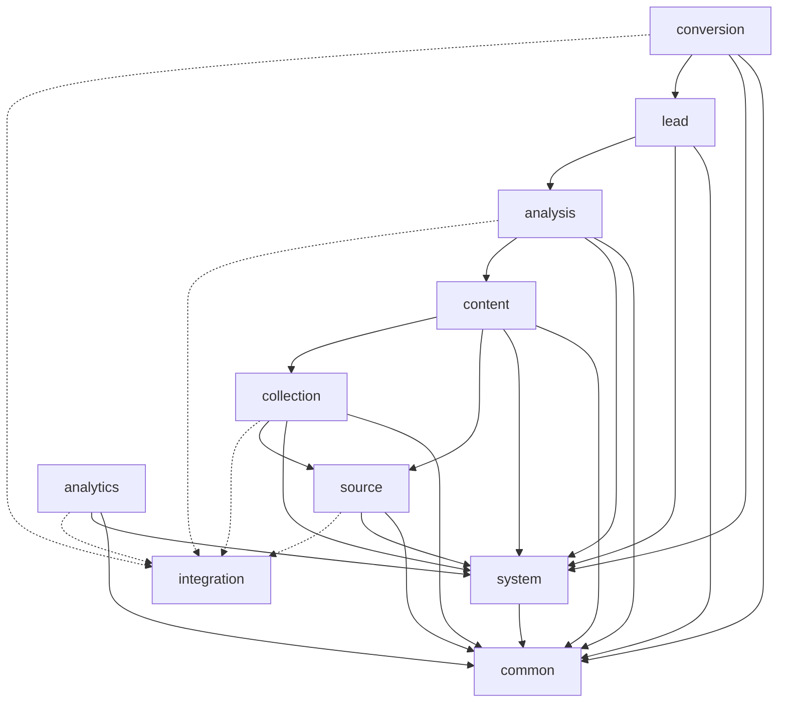

# R1-03 · 模块依赖矩阵

## 1. 依赖矩阵

行 = 调用方，列 = 被调用方。`✓` 允许（下游依赖上游），`—` 禁止，`Q` 允许但仅经只读查询接口。

| ↓调用 / →被调 | common | system | source | collection | content | analysis | lead | conversion | analytics | integration |
|---|---|---|---|---|---|---|---|---|---|---|
| **common** | — | — | — | — | — | — | — | — | — | — |
| **system** | ✓ | — | — | — | — | — | — | — | — | ✓ |
| **source** | ✓ | ✓ | — | — | — | — | — | — | — | ✓ |
| **collection** | ✓ | ✓ | ✓ | — | — | — | — | — | — | ✓ |
| **content** | ✓ | ✓ | ✓ | ✓ | — | — | — | — | — | ✓ |
| **analysis** | ✓ | ✓ | — | — | ✓ | — | — | — | — | ✓ |
| **lead** | ✓ | ✓ | — | — | Q | ✓ | — | — | — | ✓ |
| **conversion** | ✓ | ✓ | — | — | — | — | ✓ | — | — | ✓ |
| **analytics** | ✓ | ✓ | Q | Q | Q | Q | Q | Q | — | ✓ |
| **integration** | ✓ | — | — | — | — | — | — | — | — | — |

关键点：

- `common` **不依赖任何模块**（含 system）
- `integration` 不回指任何业务模块；业务模块依赖它，它不依赖业务
- `analytics` 只经 `Q`（查询接口）取数，**不访问其他模块的 Mapper**
- `lead` 对 `content` 只读（读评论原文/作者标识），不修改内容

## 2. 依赖图

> 图中 `analytics` 对 source/collection/content/analysis/lead/conversion 的只读依赖为保持可读性省略，
> 实际以 §1 矩阵的 `Q` 为准。

## 3. 跨模块边界规范

| 边界 | 允许的交互 | 禁止 |
|---|---|---|
| source ↔ collection | collection 调 `SourceCapabilityService` 判断平台是否可用；source 不感知任务 | source 直接改任务状态 |
| collection ↔ content | collection 产出原始数据后**发事件/调用** `ContentIngestService` 落库 | collection 直接写 `ct_*` 表 |
| content ↔ analysis | analysis 通过 `CommentQueryService` 取待分析评论 | analysis 直接查 `ct_comment` 表 |
| analysis ↔ lead | lead 订阅/拉取 `an_result` 生成信号 | lead 修改分析结果 |
| lead ↔ conversion | conversion 读线索、写成交；lead 只读成交状态用于状态流转 | conversion 改线索评分 |
| analytics ↔ 各模块 | 只调用各模块 `*QueryService` | analytics 直连任何 Mapper |
| integration ↔ Python | 只出站 HTTP；返回 DTO | integration 内含业务判断 |

## 4. 事务边界

| 场景 | 策略 |
|---|---|
| 单模块内多表写 | 本模块 `application` 层 `@Transactional`，**只包本模块表** |
| 跨模块写（如采集完成 → 内容入库） | **不用大事务**。采集侧先提交任务状态，再调 ingest；ingest 失败由重试/补偿处理 |
| 分析任务批处理 | 按批次提交；单条失败不回滚整批（保留已有结果，失败项置 FAILED 可重试） |
| 线索生成 | 幂等键 `(result_id, signal_type)`，重复消费不重复建线索 |
| 报告生成 | 报告 + 版本同事务（同属 analytics） |

**禁止**：一个事务里同时写 `col_*` 与 `ct_*`（跨模块），跨模块失败无法用数据库回滚表达。

## 5. 领域事件

只在**确实需要解耦且允许最终一致**处引入，不机械使用。

| 事件 | 发布方 | 消费方 | 一致性要求 |
|---|---|---|---|
| `CollectionItemCompleted` | collection | content（触发 ingest） | 最终一致，可重放 |
| `ContentIngested` | content | analysis（可选：自动建分析任务） | 最终一致，需人工开关 |
| `AnalysisCompleted` | analysis | lead（生成需求信号） | 最终一致，幂等 |
| `LeadConverted` | conversion | lead（状态流转）、analytics（增量统计） | 最终一致 |

首期实现方式：**同步方法调用 + 幂等键**，不引入消息中间件。
若后续需要异步，替换为本地事件表 + 定时投递（不引入 Kafka）。

## 6. 与 CURRENT 的差异（GAP）

| 现状 | 目标 | 风险 |
|---|---|---|
| `GovernanceService` 横跨权限与内容可见性，被 8 个服务依赖 | 拆 `system.PermissionService` + `content.ContentAccessService` | **必然产生 content ↔ system 依赖**，方向定为 content → system（单向），权限判定在 system，可见性规则在 content |
| `service` 之间直接注入 | 只允许经 `application` 或 `Q` 接口 | 拆解时易形成循环，需逐个改 |
| 无模块概念，104 个类平铺 | 10 模块 | 迁移期存在"新旧并存"，以提交批次为单位消除 |
