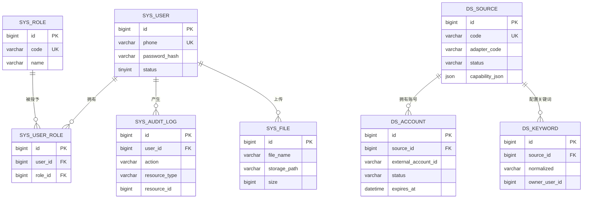
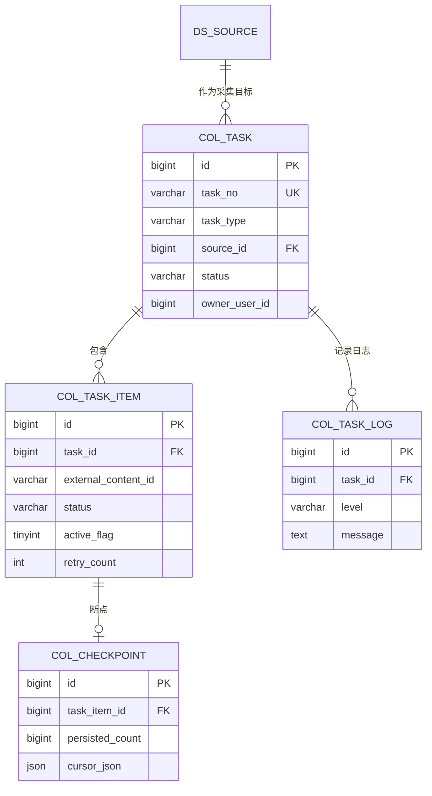
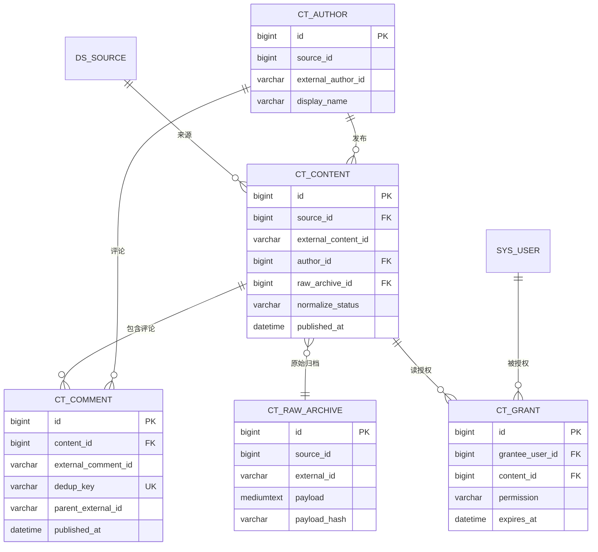
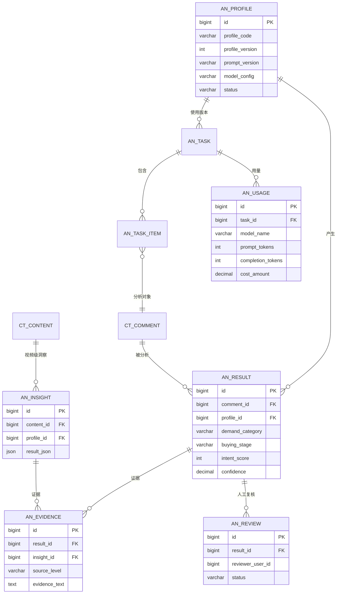
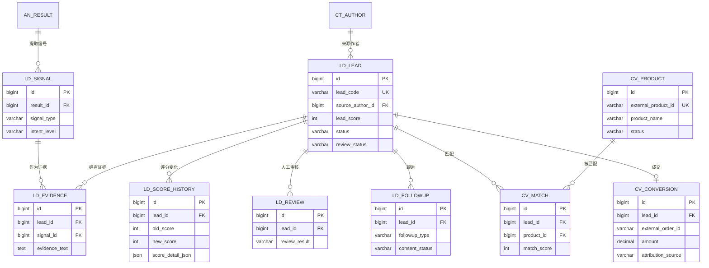
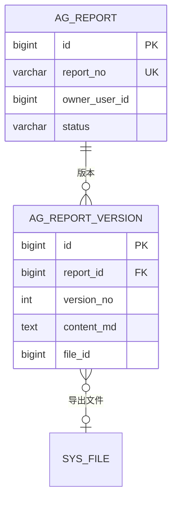

# R1-05 · 数据库 ER 图

基于 R1-04 的 37 张表。为可读性按模块分图，虚线表示跨模块的逻辑关联（无物理外键）。

## 1. 系统与数据源



## 2. 采集（collection）



> `COL_TASK_ITEM` **不外键到内容表**：采集先于入库，content 依赖 collection（R1-03 方向约束）。

## 3. 内容（content）



## 4. 分析（analysis）



## 5. 线索与转化（lead / conversion）



## 6. 分析（analytics）



## 7. 追溯链（关键验收项）

```
原始响应 ct_raw_archive
      ↓ raw_archive_id
标准化内容 ct_content ← ct_comment
      ↓ comment_id              ↓ content_id
   an_result ────────────→ an_insight
      ↓ result_id               ↓ insight_id
   ld_signal              an_evidence
      ↓ signal_id
   ld_evidence ←── lead_id ──→ ld_lead
                                  ↓ lead_id
                            cv_match / cv_conversion
                                  ↓ external_order_id
                            （CoolSkyAI 订单，不入库）
```

任一条线索都能沿此链回溯到：哪条评论/视频 → 哪次分析（哪个 Profile 版本）→ 哪段原文证据。
