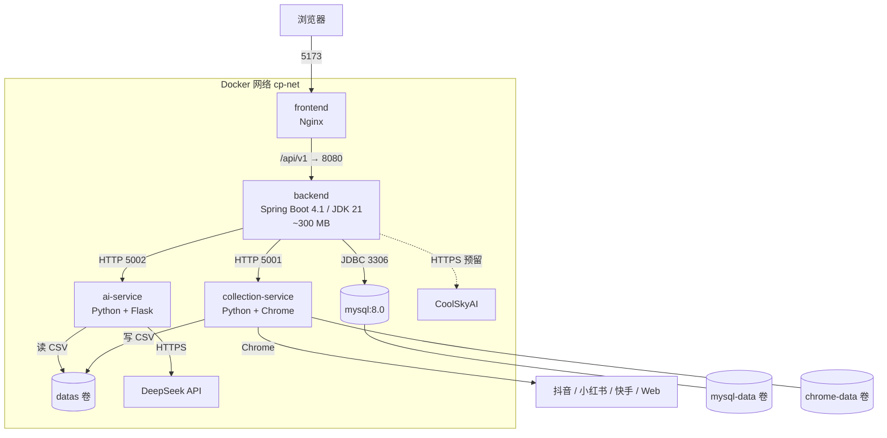

# R1-08 · 部署架构

## 1. 目标拓扑



## 2. 服务清单

| 服务 | 镜像基础 | 对外端口 | 依赖 | 健康检查 |
|---|---|---|---|---|
| `mysql` | `mysql:8.0` | 3307→3306 | — | `mysqladmin ping` |
| `collection-service` | `python:3.10-slim` + Chrome | 无（内部 5001） | mysql（读配置，可选） | `GET /health` |
| `ai-service` | `python:3.10-slim` | 无（内部 5002） | — | `GET /health` |
| `backend` | `eclipse-temurin:21-jre` | 8080 | mysql、collection、ai | `GET /api/v1/health` |
| `frontend` | `nginx:alpine` | 5173→80 | backend | 无（静态） |

**关键变化**：`backend` 镜像**不再包含 Python 与 Chrome**。
现状 1.92 GB 中约 1.6 GB 是 Chrome + Python 依赖，移出后预计 ≤ 400 MB，构建时间从 5 分钟降到 ~1.5 分钟。

## 3. 启动顺序

```
mysql (healthy) → collection-service (healthy) + ai-service (healthy) → backend (healthy) → frontend
```

`backend` 用 `depends_on: condition: service_healthy` 等待 mysql 与两个 Python 服务；
Python 服务若未就绪，backend 仍应能启动（降级模式），但采集与分析接口返回 503。
**决策**：`depends_on` 用 `service_started` 而非 `service_healthy`，避免 Python 服务异常导致整个后端起不来。

## 4. 端口规划

| 服务 | 容器端口 | 宿主端口 | 说明 |
|---|---|---|---|
| frontend | 80 | **5173** | 避开本机 3000 |
| backend | 8080 | **8080** | REST + Swagger |
| collection-service | 5001 | 不映射 | 仅网络内 |
| ai-service | 5002 | 不映射 | 仅网络内 |
| mysql | 3306 | **3307** | 避开本机 3306 |

## 5. 数据卷

| 卷 | 类型 | 内容 | 备份策略 |
|---|---|---|---|
| `cp-mysql-data` | named | MySQL 数据 | `mysqldump` 定期导出 |
| `cp-chrome-data` | named | Chrome 登录态（采集用） | 可重建（需重新登录） |
| `cp-datas` | named 或 bind | 采集 CSV、报告文件 | 按需 |
| `cp-logs` | bind | 应用日志 | 轮转 |

> 现状的 `coolpilot-insight_chrome-data` 需**迁移到 collection-service**（Chrome 只在采集侧使用）。
> 迁移时不要删除旧卷，先确认登录态可用再清理。

## 6. 环境变量规划

| 变量 | 服务 | 必填 | 说明 |
|---|---|---|---|
| `JWT_SECRET` | backend | **是** | 缺失则拒绝启动 |
| `DB_HOST/PORT/NAME/USER/PASSWORD` | backend | 是 | — |
| `COLLECTION_BASE_URL` | backend | 是 | `http://collection-service:5001` |
| `AI_BASE_URL` | backend | 是 | `http://ai-service:5002` |
| `INTERNAL_TOKEN` | backend + 两个 Python | 是 | 服务间鉴权 |
| `DEEPSEEK_API_KEY` | ai-service | 否 | 缺失时降级 |
| `MYSQL_HOST_PORT` / `BACKEND_HOST_PORT` / `FRONTEND_HOST_PORT` | compose | 否 | 默认 3307/8080/5173 |

**全部密钥只从 `.env` 注入**，不进镜像、不进 Git。

## 7. Milvus 评估

**首期不引入。** 依据：

- 当前无 Embedding 能力（R0-05：`/v1/embeddings` 未实现）
- 检索需求为「关键词 + 结构化过滤」，MySQL 全文/前缀索引足够（数据量级：百至十万条）
- Milvus 单机版常驻内存 ≥ 2 GB，与「个人自用、32 GB 机器同时跑 ComfyUI」的资源约束冲突

**触发条件**（满足其一再评估）：语义搜索成为核心需求、内容量 > 50 万、需要相似内容去重。

## 8. 开发环境 vs 部署环境

| 项 | 开发 | 部署 |
|---|---|---|
| 前端 | `vite dev` :5199，代理到 8080 | Nginx 静态托管 + 反代 |
| 后端 | `mvn spring-boot:run`，可直连宿主 MySQL 3307 | 容器内，连 `mysql:3306` |
| Python | 直接 `python app/server.py` | 独立容器 |
| Chrome | 宿主 Chrome | 容器内 Chrome（collection-service） |
| 配置 | `.env` + 环境变量 | 同左（同一份 `.env.example`） |

## 9. 部署风险

| 风险 | 影响 | 缓解 |
|---|---|---|
| 两个项目共用 `name: coolpilot-insight`（与旧副本） | 容器名/卷冲突，误删数据 | R3 前确定唯一副本；新卷改用 `cp-` 前缀 |
| `chrome-data` 迁移丢登录态 | 需重新登录抖音 | 先复制卷再切换，保留旧卷一周 |
| backend 去 Python 后本地开发不便 | 本地需手动起两个 Python 进程 | 提供 `scripts/dev-up.sh` 一键起 |
| 无 Redis，单实例调度 | 无法水平扩展 | 首期单实例，明确不支持多副本 |
