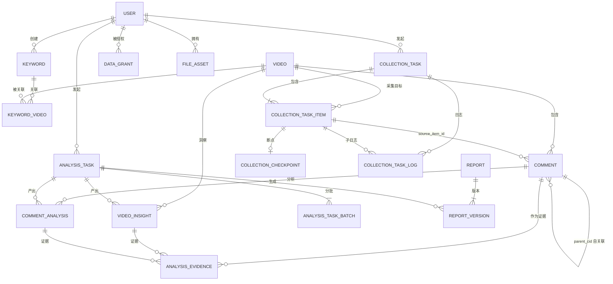

# 20 · 目标数据库完整设计与 Flyway 初始化架构

**任务编号**：M1-B
**执行模式**：READ ONLY
**设计日期**：2026-11-03
**依据**：ADR-001～ADR-005 + 01～19 号审计文档
**状态**：**设计稿，未授权实施**

> 证据等级标注：**A** = 代码/DB/配置直接验证；**B** = 由代码调用关系推导；**C** = 架构建议或未验证假设。
> 本文不含任何已执行的结构变更。所有 DDL 均为设计稿，不具备执行效力。

---

## 零、执行前核查

| 检查项 | 结果 |
|---|---|
| `20_TARGET_DATABASE_DESIGN.md` 是否已存在 | **不存在**，可安全创建 |
| Spring Boot 2.7.18 管理的 Flyway 版本 | **8.5.13**（A 级，核自 `spring-boot-dependencies-2.7.18.pom`） |
| 同 POM 管理的 MySQL Connector 版本 | **8.0.33**（A 级） |
| 当前 Flyway / Liquibase | 均不存在（A 级，见 #18） |
| 当前业务表 | 3 张（A 级） |

---

## 一、目标数据库总体架构

### 1.1 设计原则

| 原则 | 落地方式 |
|---|---|
| 事实与洞察分离 | `comment` 只存原始事实；AI 结果进 `comment_analysis` / `video_insight` |
| 平台标识与内部标识分离 | `video.aweme_id`（平台）vs `video.id`（内部）；`comment.video_id` 只指内部 |
| 任务与数据分离 | 谁采集（`collection_task.owner_user_id`）≠ 数据归属（共享模型，见 ADR-004） |
| 可追溯 | 每条洞察通过 `analysis_evidence` 指向原始 `comment` |
| 版本化 | 分析结果带 `prompt_version` / `schema_version` / `taxonomy_version`，可并存多版本 |
| 幂等 | `UNIQUE(platform, cid)` 保证重复采集不重复入库 |
| 不做过度设计 | 不引入 permission/role_permission 三表（理由见 2.1） |

### 1.2 领域划分（6 域 / 21 表）

| 域 | 表 | 数量 |
|---|---|---|
| 用户与权限 | `user`、`data_grant` | 2 |
| 关键词与视频 | `keyword`、`video`、`keyword_video` | 3 |
| 评论采集 | `comment`、`collection_task`、`collection_task_item`、`collection_checkpoint`、`collection_task_log` | 5 |
| AI 分析 | `analysis_task`、`analysis_task_batch`、`comment_analysis`、`video_insight`、`analysis_evidence` | 5 |
| 文件与报告 | `file_asset`、`report`、`report_version` | 3 |
| 系统治理 | `system_config`、`usage_record`、`audit_log` | 3 |

**合计 21 张表**。旧 `analysis_result` **不进入目标模型**（理由见 2.5）。

### 1.3 关键设计决策速览

| 决策 | 选择 | 理由 |
|---|---|---|
| 评论归属 | **共享事实 + 授权表** | ADR-004；避免 A/B 用户看到不同数据 |
| 防重复采集 | `UNIQUE(video_id, active_flag)` 技巧 | MySQL 无部分索引，用 NULL 绕过（见 4.2） |
| video_id 类型 | `BIGINT` 指向 `video.id` | ADR-003 |
| `region` 列名 | **改为 `ip_region`** | 语义准确；前端本就要改，一次改对 |
| `analysis_result` | **废弃不建** | #18 实测其统计字段无人读取 |
| RBAC | **只保留 `user.role` 枚举** | 无多角色业务需求 |

---

## 二、完整表清单

| # | 表名 | 中文名 | 领域 | 核心职责 | 生命周期 | 核心表 |
|---|---|---|---|---|---|---|
| 1 | `user` | 系统用户 | 权限 | 登录身份与角色 | 长期，软删除 | ✅ |
| 2 | `data_grant` | 数据授权 | 权限 | 共享数据的可见性授权 | 可撤销 | ✅ |
| 3 | `keyword` | 关键词 | 内容 | 关键词定义与归属 | 可停用 | ✅ |
| 4 | `video` | 视频 | 内容 | 平台视频实体 | 长期 | ✅ |
| 5 | `keyword_video` | 关键词视频关联 | 内容 | 多对多发现关系 | 随任务新增 | 否 |
| 6 | `comment` | 评论 | 采集 | 评论事实数据 | **永久保留** | ✅ |
| 7 | `collection_task` | 采集主任务 | 采集 | 批量采集批次 | 永久保留 | ✅ |
| 8 | `collection_task_item` | 采集子任务 | 采集 | 单视频采集执行 | 永久保留 | ✅ |
| 9 | `collection_checkpoint` | 采集断点 | 采集 | 中断续采位置 | 随子任务 | 否 |
| 10 | `collection_task_log` | 任务日志 | 采集 | 状态与事件留痕 | 可归档 | 否 |
| 11 | `analysis_task` | AI 分析任务 | AI | 一次分析请求 | 永久保留 | ✅ |
| 12 | `analysis_task_batch` | 分析批次 | AI | 分批执行与计费 | 永久保留 | 否 |
| 13 | `comment_analysis` | 评论级分析 | AI | 单评论结构化结果 | 版本并存 | ✅ |
| 14 | `video_insight` | 视频级洞察 | AI | 视频聚合洞察 | 版本并存 | ✅ |
| 15 | `analysis_evidence` | 分析证据 | AI | 洞察↔评论的引用 | 随洞察 | ✅ |
| 16 | `file_asset` | 文件资产 | 文件 | 上传/导出文件元数据 | 可过期清理 | 否 |
| 17 | `report` | 报告 | 报告 | 报告主体 | 长期 | ✅ |
| 18 | `report_version` | 报告版本 | 报告 | 报告内容快照 | 版本并存 | 否 |
| 19 | `system_config` | 系统配置 | 治理 | 可热改配置 | 长期 | 否 |
| 20 | `usage_record` | 用量记录 | 治理 | Token 与成本明细 | 长期 | ✅ |
| 21 | `audit_log` | 审计日志 | 治理 | 关键操作留痕 | 可归档 | 否 |

### 2.1 关于 RBAC：为什么只有 `user.role` + `data_grant`

任务卡要求评估 `role` / `permission` / `user_role` / `role_permission`。**评估结论：第一版不建这四张表。**

| 依据 | 事实（A 级） |
|---|---|
| 现有角色数 | 仅 2 种（`role=0` 普通、`role=1` 管理员），`user.role` 已表达 |
| 权限点数量 | 实际只有「是否管理员」一个判断，散落在 5 处代码 |
| 无多角色需求 | 无「运营」「审核」等中间角色 |
| 建表成本 | 4 张表 + 关联查询 + 缓存，收益在当前规模下为负 |

**触发建表的条件**（写清楚，避免以后争论）：
1. 出现 3 种以上角色，或同一用户需多角色；
2. 出现「部分管理员只能管某些视频」的需求；
3. 需要按操作类型（读/写/删/导出）细分授权。

**当前真正缺的不是 RBAC，而是数据授权**——ADR-004 要求「共享评论数据 + 明确授权规则」。所以新增 `data_grant`，解决「普通用户能看到哪些视频的评论」这个真实问题。

---

## 三、完整字段设计

> 所有表统一：`ENGINE=InnoDB DEFAULT CHARSET=utf8mb4 COLLATE=utf8mb4_0900_ai_ci`
> 时间字段统一 `DATETIME`（非 TIMESTAMP，避免 2038 与时区隐式转换）；计数统一 `BIGINT`/`INT`；金额统一 `DECIMAL`。

### 3.1 `user`

| 字段 | 类型 | NULL | 默认 | 约束 | 说明 |
|---|---|---|---|---|---|
| `id` | BIGINT | N | AI | PK | 用户 ID |
| `username` | VARCHAR(50) | N | — | | 显示名 |
| `phone` | VARCHAR(11) | N | — | UK `uk_phone` | 登录手机号 |
| `password_hash` | VARCHAR(100) | N | — | | **仅 BCrypt（60 字符）** |
| `role` | TINYINT | N | 0 | IDX `idx_role` | 0=普通 1=管理员 |
| `status` | TINYINT | N | 1 | | 1=正常 0=禁用 |
| `must_change_pwd` | TINYINT | N | 0 | | 首次登录强制改密（ADR-005） |
| `last_login_at` | DATETIME | Y | NULL | | 最后登录 |
| `created_at` | DATETIME | N | CURRENT_TIMESTAMP | | |
| `updated_at` | DATETIME | N | CURRENT_TIMESTAMP ON UPDATE | | |
| `deleted_at` | DATETIME | Y | NULL | IDX `idx_deleted` | 软删除 |

**相对旧表的变更**：`password` → `password_hash`（改名，避免误用）；新增 `status` / `must_change_pwd` / `last_login_at` / `updated_at` / `deleted_at`。

### 3.2 `data_grant`

用于 ADR-004 的共享数据授权。

| 字段 | 类型 | NULL | 默认 | 约束 | 说明 |
|---|---|---|---|---|---|
| `id` | BIGINT | N | AI | PK | |
| `grantee_user_id` | BIGINT | N | — | FK→user, IDX | 被授权用户 |
| `resource_type` | VARCHAR(32) | N | — | | `VIDEO` / `KEYWORD` / `TASK` |
| `resource_id` | BIGINT | N | — | | 资源 ID |
| `permission` | VARCHAR(16) | N | `READ` | | `READ` / `WRITE` |
| `granted_by` | BIGINT | N | — | | 授权人 |
| `created_at` | DATETIME | N | CURRENT_TIMESTAMP | | |
| `expires_at` | DATETIME | Y | NULL | | 过期时间 |

唯一索引：`uk_grant (grantee_user_id, resource_type, resource_id, permission)`

### 3.3 `keyword`

| 字段 | 类型 | NULL | 默认 | 约束 | 说明 |
|---|---|---|---|---|---|
| `id` | BIGINT | N | AI | PK | |
| `keyword` | VARCHAR(128) | N | — | | 原始输入 |
| `normalized` | VARCHAR(128) | N | — | UK `uk_owner_norm` | 归一化后（小写、去空格、全角转半角） |
| `description` | VARCHAR(512) | Y | NULL | | |
| `owner_user_id` | BIGINT | N | — | FK→user | 创建者 |
| `status` | TINYINT | N | 1 | | 1=启用 0=停用 |
| `created_at` / `updated_at` | DATETIME | N | | | |

唯一索引：`uk_owner_norm (owner_user_id, normalized)` —— **同用户不可重复，不同用户可建同名**（C 级建议，可调整）。

### 3.4 `video`

| 字段 | 类型 | NULL | 默认 | 约束 | 说明 |
|---|---|---|---|---|---|
| `id` | BIGINT | N | AI | PK | **内部主键** |
| `platform` | VARCHAR(16) | N | `douyin` | UK 一部分 | 平台 |
| `aweme_id` | VARCHAR(64) | N | — | UK `uk_platform_aweme` | **平台视频 ID** |
| `title` | VARCHAR(512) | Y | NULL | | |
| `author_name` | VARCHAR(128) | Y | NULL | | |
| `author_id` | VARCHAR(128) | Y | NULL | | 作者 sec_uid |
| `cover_url` | VARCHAR(1024) | Y | NULL | | |
| `publish_time` | DATETIME | Y | NULL | IDX `idx_publish_time` | |
| `digg_count` | BIGINT | N | 0 | | 点赞 |
| `comment_count` | BIGINT | N | 0 | | 平台显示评论数 |
| `share_count` | BIGINT | N | 0 | | |
| `status` | TINYINT | N | 1 | | 1=正常 0=下架/删除 |
| `first_discovered_at` | DATETIME | N | CURRENT_TIMESTAMP | | 首次发现 |
| `last_collected_at` | DATETIME | Y | NULL | IDX `idx_last_collected` | 最近采集成功时间 |
| `metadata_json` | JSON | Y | NULL | | 仅放非查询用扩展字段 |
| `created_at` / `updated_at` | DATETIME | N | | | |

唯一索引：`uk_platform_aweme (platform, aweme_id)`

### 3.5 `keyword_video`

| 字段 | 类型 | NULL | 默认 | 约束 | 说明 |
|---|---|---|---|---|---|
| `id` | BIGINT | N | AI | PK | |
| `keyword_id` | BIGINT | N | — | FK→keyword | |
| `video_id` | BIGINT | N | — | FK→video, IDX | |
| `discovery_task_id` | BIGINT | Y | NULL | | 来源发现任务（未建表前可为空） |
| `discovered_at` | DATETIME | N | CURRENT_TIMESTAMP | | |

唯一索引：`uk_kw_video (keyword_id, video_id)`；普通索引 `idx_video (video_id)`

### 3.6 `comment`（核心）

| 字段 | 类型 | NULL | 默认 | 约束 | 说明 |
|---|---|---|---|---|---|
| `id` | BIGINT | N | AI | PK | 内部 ID |
| `platform` | VARCHAR(16) | N | `douyin` | UK 一部分 | |
| `cid` | VARCHAR(64) | N | — | UK `uk_platform_cid` | **平台评论唯一 ID（见 5.1 风险）** |
| `video_id` | BIGINT | N | — | FK→video | **内部 video.id** |
| `parent_cid` | VARCHAR(64) | Y | NULL | IDX `idx_parent` | 父评论 cid |
| `root_cid` | VARCHAR(64) | Y | NULL | | 根评论 cid |
| `is_reply` | TINYINT | N | 0 | | 0=一级 1=回复 |
| `reply_count` | INT | N | 0 | | 回复数（平台值） |
| `nickname` | VARCHAR(100) | N | — | | 评论者昵称 |
| `douyin_id` | VARCHAR(64) | Y | NULL | IDX `idx_douyin_id` | 评论者抖音号 |
| `douyin_uid` | VARCHAR(32) | Y | NULL | | 评论者 UID |
| `sec_uid` | VARCHAR(128) | Y | NULL | | 主页标识（最小化使用） |
| `ip_region` | VARCHAR(50) | N | `未知` | | **IP 归属地（原 `region`）** |
| `content` | TEXT | N | — | | 原文，不做清洗 |
| `likes` | INT | N | 0 | | |
| `publish_time` | DATETIME | N | — | | 评论发布时间 |
| `source_item_id` | BIGINT | Y | NULL | IDX | 来源采集子任务 |
| `collected_at` | DATETIME | N | CURRENT_TIMESTAMP | | 采集时间 |
| `updated_at` | DATETIME | N | CURRENT_TIMESTAMP ON UPDATE | | 重复采集时更新 likes |

**索引设计（结合真实查询）**：

| 索引 | 定义 | 支撑的真实查询 |
|---|---|---|
| `uk_platform_cid` | `(platform, cid)` | 幂等写入（`INSERT ... ON DUPLICATE KEY UPDATE`） |
| `idx_video_time` | `(video_id, publish_time)` | 评论列表默认排序、趋势图（`AnalysisServiceImpl:170`） |
| `idx_video_likes` | `(video_id, likes)` | 高赞 Top20（`AnalysisServiceImpl:196`）、排序 `likes_desc` |
| `idx_video_region` | `(video_id, ip_region)` | 地区分布（`AnalysisServiceImpl:109`） |
| `idx_parent` | `(parent_cid)` | 查某评论的回复 |
| `idx_source_item` | `(source_item_id)` | 任务溯源、按任务回滚 |

**冗余检查**：旧的 `idx_video_id` 被 `idx_video_time` / `idx_video_likes` / `idx_video_region` 的最左前缀覆盖，**不再单独建**。

### 3.7 `collection_task`

| 字段 | 类型 | NULL | 默认 | 约束 | 说明 |
|---|---|---|---|---|---|
| `id` | BIGINT | N | AI | PK | |
| `task_no` | VARCHAR(32) | N | — | UK `uk_task_no` | 业务编号（如 `CT20261103001`） |
| `task_type` | VARCHAR(24) | N | `COLLECTION` | | `COLLECTION` / `REFRESH` |
| `status` | VARCHAR(24) | N | `PENDING` | IDX `idx_status_created` | 见状态机 |
| `owner_user_id` | BIGINT | N | — | FK→user, IDX | 创建者 |
| `params_json` | JSON | Y | NULL | | 采集参数（maxComments 等） |
| `total_items` | INT | N | 0 | | |
| `success_items` | INT | N | 0 | | |
| `failed_items` | INT | N | 0 | | |
| `created_at` | DATETIME | N | CURRENT_TIMESTAMP | | |
| `started_at` / `finished_at` | DATETIME | Y | NULL | | |
| `updated_at` | DATETIME | N | | | |

索引：`idx_owner_created (owner_user_id, created_at)`、`idx_status_created (status, created_at)`

状态机：`PENDING → RUNNING → (SUCCESS | PARTIAL_SUCCESS | FAILED)`，可 `CANCEL_REQUESTED → CANCELLED`，`RETRY_WAIT → PENDING`

### 3.8 `collection_task_item`

| 字段 | 类型 | NULL | 默认 | 约束 | 说明 |
|---|---|---|---|---|---|
| `id` | BIGINT | N | AI | PK | |
| `task_id` | BIGINT | N | — | FK→task, IDX | |
| `video_id` | BIGINT | N | — | FK→video | |
| `status` | VARCHAR(24) | N | `PENDING` | IDX `idx_status_lease` | 子任务状态 |
| **`active_flag`** | TINYINT | **Y** | **1** | **UK `uk_video_active`** | **活动任务标记（关键设计，见 4.2）** |
| `worker_id` | VARCHAR(64) | Y | NULL | | 执行 Worker |
| `retry_count` | INT | N | 0 | | 已重试 |
| `max_retry` | INT | N | 3 | | 上限 |
| `requested_max` | INT | N | 300 | | 请求条数 |
| `collected_count` | BIGINT | N | 0 | | 本次入库 |
| `skipped_count` | BIGINT | N | 0 | | 去重跳过 |
| `heartbeat_at` | DATETIME | Y | NULL | | 心跳 |
| `lease_until` | DATETIME | Y | NULL | | 租约到期 |
| `started_at` / `finished_at` | DATETIME | Y | NULL | | |
| `error_code` | VARCHAR(64) | Y | NULL | | |
| `error_message` | TEXT | Y | NULL | | |
| `created_at` | DATETIME | N | | | |

索引：
- `uk_video_active (video_id, active_flag)` ← **保证同一视频只有一个活动任务**
- `idx_task_status (task_id, status)`
- `idx_status_lease (status, lease_until)` ← Worker 领取

### 3.9 `collection_checkpoint`

| 字段 | 类型 | NULL | 默认 | 约束 | 说明 |
|---|---|---|---|---|---|
| `id` | BIGINT | N | AI | PK | |
| `task_item_id` | BIGINT | N | — | UK `uk_item`, FK | 一子任务一断点 |
| `cursor_value` | VARCHAR(2048) | Y | NULL | | **仅当 cursor 语义验证通过后使用** |
| `page_no` | INT | N | 0 | | 已完成页数 |
| `last_cid` | VARCHAR(64) | Y | NULL | | 最后成功 cid |
| `persisted_count` | BIGINT | N | 0 | | **已确认入库**数量 |
| `last_success_at` | DATETIME | Y | NULL | | |
| `updated_at` | DATETIME | N | | | |

**一致性铁律**：**先 commit 评论，再更新 `persisted_count` / `last_cid`**。顺序颠倒会产生不可恢复的数据缺口。

### 3.10 `collection_task_log`

| 字段 | 类型 | NULL | 默认 | 约束 | 说明 |
|---|---|---|---|---|---|
| `id` | BIGINT | N | AI | PK | |
| `task_id` | BIGINT | N | — | IDX `idx_task_created` | |
| `task_item_id` | BIGINT | Y | NULL | IDX | 子任务级事件 |
| `event_type` | VARCHAR(32) | N | — | | `STATUS_CHANGE` / `PAGE_DONE` / `ERROR` / `RETRY` / `CANCEL` |
| `event_level` | VARCHAR(12) | N | `INFO` | | `INFO` / `WARN` / `ERROR` |
| `message` | VARCHAR(512) | Y | NULL | | |
| `details_json` | JSON | Y | NULL | | 结构化上下文 |
| `created_at` | DATETIME | N | CURRENT_TIMESTAMP | | |

**不无差别存 stdout**，只记关键事件。

### 3.11 `analysis_task`

| 字段 | 类型 | NULL | 默认 | 约束 | 说明 |
|---|---|---|---|---|---|
| `id` | BIGINT | N | AI | PK | |
| `task_no` | VARCHAR(32) | N | — | UK | |
| `task_type` | VARCHAR(32) | N | — | | `COMMENT_LEVEL` / `VIDEO_LEVEL` / `COMPARISON` |
| `status` | VARCHAR(24) | N | `PENDING` | IDX | |
| `owner_user_id` | BIGINT | N | — | FK | |
| `scope_type` | VARCHAR(24) | N | — | | `VIDEO` / `VIDEO_SET` / `KEYWORD` |
| `scope_json` | JSON | Y | NULL | | 范围明细（video_ids / keyword_id） |
| `model_provider` | VARCHAR(32) | Y | NULL | | `deepseek` |
| `model_name` | VARCHAR(64) | Y | NULL | | `deepseek-chat` |
| `prompt_version` | VARCHAR(32) | Y | NULL | | |
| `schema_version` | VARCHAR(32) | Y | NULL | | 输出 JSON Schema 版本 |
| `taxonomy_version` | VARCHAR(32) | Y | NULL | | 标签体系版本 |
| `total_items` / `success_items` / `failed_items` | INT | N | 0 | | |
| `input_tokens` / `output_tokens` | BIGINT | N | 0 | | |
| `cost_amount` | DECIMAL(12,6) | N | 0 | | 估算成本 |
| `price_version` | VARCHAR(32) | Y | NULL | | 计价快照版本 |
| `created_at` / `started_at` / `finished_at` | DATETIME | | | | |
| `error_message` | TEXT | Y | NULL | | |

### 3.12 `analysis_task_batch`

| 字段 | 类型 | NULL | 默认 | 约束 | 说明 |
|---|---|---|---|---|---|
| `id` | BIGINT | N | AI | PK | |
| `task_id` | BIGINT | N | — | FK, IDX `idx_task_status` | |
| `batch_no` | INT | N | — | UK `uk_task_batch` | |
| `status` | VARCHAR(24) | N | `PENDING` | | |
| `input_count` / `success_count` / `failed_count` | INT | N | 0 | | |
| `input_tokens` / `output_tokens` | BIGINT | N | 0 | | 批次级计费 |
| `error_message` | TEXT | Y | NULL | | |
| `started_at` / `finished_at` | DATETIME | Y | NULL | | |

UK：`uk_task_batch (task_id, batch_no)` ← 支持**批次级重试**，不必整批重付费。

### 3.13 `comment_analysis`

| 字段 | 类型 | NULL | 默认 | 约束 | 说明 |
|---|---|---|---|---|---|
| `id` | BIGINT | N | AI | PK | |
| `comment_id` | BIGINT | N | — | FK→comment, UK 一部分 | |
| `analysis_version` | VARCHAR(32) | N | — | UK 一部分 | 建议 `provider:model:prompt:schema` 摘要 |
| `analysis_task_id` | BIGINT | Y | NULL | | 来源任务 |
| `batch_id` | BIGINT | Y | NULL | | 来源批次 |
| `sentiment` | VARCHAR(16) | Y | NULL | | `positive`/`neutral`/`negative`/`unknown` |
| `intent` | VARCHAR(32) | Y | NULL | | `complaint`/`praise`/`question`/`purchase`/`other` |
| `topics_json` | JSON | Y | NULL | | 主题标签数组 |
| `pain_points_json` | JSON | Y | NULL | | 痛点数组 |
| `user_need` | VARCHAR(512) | Y | NULL | | 需求摘要 |
| `purchase_intent` | VARCHAR(24) | Y | NULL | | `none`/`low`/`medium`/`high` |
| `scenario_tags_json` | JSON | Y | NULL | | 使用场景 |
| `product_suggestions_json` | JSON | Y | NULL | | 产品建议 |
| `competitor_mentions_json` | JSON | Y | NULL | | 竞品提及 |
| `confidence` | DECIMAL(4,3) | Y | NULL | | 0.000~1.000 |
| `is_uncertain` | TINYINT | N | 0 | | 低置信/UNKNOWN 标记 |
| `created_at` | DATETIME | N | CURRENT_TIMESTAMP | | |

UK：`uk_comment_version (comment_id, analysis_version)`
索引：`idx_task (analysis_task_id)`、`idx_sentiment (sentiment)`（用于快速筛选）

**答案：如何避免重复付费** → 同一 `(comment_id, analysis_version)` 已存在则跳过；版本未变不重跑。

### 3.14 `video_insight`

| 字段 | 类型 | NULL | 默认 | 约束 | 说明 |
|---|---|---|---|---|---|
| `id` | BIGINT | N | AI | PK | |
| `video_id` | BIGINT | N | — | FK, IDX `idx_video_created` | |
| `analysis_task_id` | BIGINT | Y | NULL | | |
| `insight_type` | VARCHAR(32) | N | — | | `OVERVIEW` / `PAIN_POINTS` / `PRODUCT_OPPORTUNITY` |
| `scope_json` | JSON | Y | NULL | | 数据快照范围（评论数、时间窗） |
| `sample_count` | INT | N | 0 | | 参与聚合的评论数 |
| `model_name` / `prompt_version` / `schema_version` / `taxonomy_version` | VARCHAR | Y | NULL | | |
| `result_json` | JSON | N | — | | 结构化洞察 |
| `summary_md` | MEDIUMTEXT | Y | NULL | | 可读摘要（非唯一载体） |
| `evidence_count` | INT | N | 0 | | 引用评论数 |
| `created_at` | DATETIME | N | CURRENT_TIMESTAMP | | |

索引：`idx_video_created (video_id, created_at) DESC` ← **多版本并存，不覆盖**。

**答案：如何保存多版本** → 每次分析 `INSERT` 新行，`created_at` 区分；`(video_id, insight_type)` **不设唯一约束**。

### 3.15 `analysis_evidence`

| 字段 | 类型 | NULL | 默认 | 约束 | 说明 |
|---|---|---|---|---|---|
| `id` | BIGINT | N | AI | PK | |
| `insight_id` | BIGINT | Y | NULL | IDX | 视频级洞察证据 |
| `comment_analysis_id` | BIGINT | Y | NULL | IDX | 评论级分析证据 |
| `comment_id` | BIGINT | N | — | FK→comment, IDX | **必指向原始评论** |
| `evidence_type` | VARCHAR(32) | N | — | | `SUPPORTING` / `CONTRADICTING` / `REPRESENTATIVE` |
| `relevance_score` | DECIMAL(4,3) | Y | NULL | | |
| `explanation` | VARCHAR(512) | Y | NULL | | 为何引用 |
| `created_at` | DATETIME | N | CURRENT_TIMESTAMP | | |

`insight_id` 与 `comment_analysis_id` 至少一个非空（应用层校验）。

### 3.16 `file_asset`

| 字段 | 类型 | NULL | 默认 | 约束 | 说明 |
|---|---|---|---|---|---|
| `id` | BIGINT | N | AI | PK | |
| `file_key` | VARCHAR(64) | N | — | **UK `uk_file_key`** | **服务端生成 UUID，对外唯一标识** |
| `owner_user_id` | BIGINT | N | — | FK | |
| `task_id` | BIGINT | Y | NULL | | 关联任务 |
| `file_type` | VARCHAR(32) | N | — | | `CSV_IMPORT` / `REPORT_EXPORT` / `RAW_JSON` |
| `storage_path` | VARCHAR(512) | N | — | | **服务端拼接，不用用户文件名** |
| `original_filename` | VARCHAR(255) | Y | NULL | | 仅展示用 |
| `mime_type` | VARCHAR(128) | Y | NULL | | |
| `file_size` | BIGINT | N | 0 | | |
| `sha256` | CHAR(64) | Y | NULL | IDX | 去重与完整性 |
| `status` | TINYINT | N | 1 | | 1=有效 0=已删 |
| `expires_at` | DATETIME | Y | NULL | | 临时文件过期 |
| `created_at` | DATETIME | N | CURRENT_TIMESTAMP | | |

**安全边界**：访问必须 `file_key` + `owner_user_id` 双校验，禁止用 `storage_path` 直接拼 URL。

### 3.17 `report` / `report_version`

`report`：`id`、`report_no`(UK)、`title`、`report_type`、`scope_json`、`owner_user_id`、`status`、`current_version`(INT)、`created_at`、`updated_at`

`report_version`：`id`、`report_id`(FK)、`version_no`(INT)、`content_json`、`content_md`(MEDIUMTEXT)、`analysis_task_id`、`evidence_count`、`generated_at`
UK：`uk_report_version (report_id, version_no)`

### 3.18 治理三表

`system_config`：`id`、`config_key`(UK)、`config_value`(TEXT)、`value_type`、`description`、`updated_by`、`updated_at`

`usage_record`：`id`、`biz_type`(`COLLECTION`/`AI`)、`biz_ref_id`、`provider`、`model`、`input_tokens`、`output_tokens`、`cost_amount`、`price_version`、`latency_ms`、`status`、`created_at`
索引：`idx_biz (biz_type, biz_ref_id)`、`idx_created (created_at)`

`audit_log`：`id`、`user_id`、`action`、`resource_type`、`resource_id`、`detail_json`、`client_ip`(VARBINARY(16) 或 VARCHAR(45))、`created_at`
索引：`idx_user_created`、`idx_resource`

---

## 四、ER 关系图



---

## 五、数据约束与一致性设计

### 5.1 评论唯一性（关键风险点）

**设计**：`UNIQUE(platform, cid)`，且 `cid` **NOT NULL**。

**但必须承认一个未验证前提**（C 级）：
> 抖音评论响应中是否稳定返回 `cid`，**本项目从未实证**。

证据链：
- 采集脚本 `douyin_comment.py:173-185` 只解析 `create_time / user.* / ip_label / text / digg_count`，**从未读取 cid**（A 级）
- #03 审计记录「`reply_comment` 字段存在于响应中但未被使用」（B 级，无原始 dump 留存）
- **无任何原始响应 JSON 落盘**（A 级，#18 已确认）

因此：
| 情形 | 应对 |
|---|---|
| 若 cid 存在且稳定 | 直接用，`UNIQUE(platform, cid)` 成立 |
| 若 cid 存在但不稳定 | 保留列，唯一键改用 `dedup_hash` |
| 若 cid 不存在 | **Plan B**：`dedup_hash CHAR(64)` = `SHA256(aweme_id + user_uid + publish_time + LEFT(content,100))`，`UNIQUE(platform, dedup_hash)` |

**M2-A 必须先做一次响应 dump 验证**，再冻结此设计。不能凭假定建索引。

### 5.2 防重复采集（`active_flag` 技巧）

MySQL 不支持部分索引，无法表达「同一 video 只允许一条活动任务」。方案：

```sql
active_flag TINYINT NULL DEFAULT 1,
UNIQUE KEY uk_video_active (video_id, active_flag)
```

- 任务创建：`active_flag = 1`
- 进入终态（SUCCESS/FAILED/CANCELLED）：置 `active_flag = NULL`
- MySQL 唯一索引对 `NULL` 不生效 → **多个历史任务可为 NULL，仅一个活动任务为 1**

**代价**：终态行需显式 `UPDATE ... SET active_flag = NULL`，漏改会导致该视频永久无法再采集。需在应用层用统一的状态收敛方法兜底。

### 5.3 Checkpoint 与持久化的一致性

```
正确顺序：
  1. INSERT/UPDATE comment（事务 commit）
  2. UPDATE collection_checkpoint SET persisted_count=?, last_cid=?
  3. UPDATE collection_task_item SET collected_count=?

错误顺序（会产生无法恢复的缺口）：
  1. 先更新 checkpoint
  2. 再写评论 → 若此刻崩溃，checkpoint 声称已处理，但数据缺失
```

### 5.4 中断续采 vs 周期性增量（两个不同能力）

| 能力 | 触发 | 依据 | 当前可行性 |
|---|---|---|---|
| 中断续采 | 同一任务重试 | `checkpoint.cursor_value` / `page_no` | **未验证**（cursor 语义未知） |
| 周期性增量 | 新任务 | `video.last_collected_at` + 已采 cid 集合排除 | **可行**，不依赖 cursor |

**Plan B（不依赖 cursor 的增量）**：
```sql
-- 新任务采集时，取已采 cid 集合，跳过
SELECT cid FROM comment WHERE video_id = ? ORDER BY publish_time DESC LIMIT 5000;
```
配合 `video.last_collected_at` 判断是否需要重采。**这条路即使 cursor 完全不可用也能工作**，建议作为第一版实现。

### 5.5 字符集与排序规则

| 层级 | 目标值 | 现状（A 级） |
|---|---|---|
| 数据库 | `utf8mb4` | `utf8mb4` ✅ |
| 库默认 collation | **`utf8mb4_0900_ai_ci`（需显式设置）** | `utf8mb4_general_ci` ❌ 不一致 |
| 表 collation | `utf8mb4_0900_ai_ci`（每张表显式声明） | 实际 `0900_ai_ci`（继承引擎默认） |
| 连接层 | `characterEncoding=utf8` + `connectionCollation=utf8mb4_0900_ai_ci` | 未显式设置 |
| Compose `--collation-server` | 建议改为 `utf8mb4_0900_ai_ci` | `utf8mb4_general_ci` ❌ |

**动作**：V1 脚本每条 `CREATE TABLE` 显式写 `COLLATE=utf8mb4_0900_ai_ci`；建议同步调整 compose 的 `--collation-server`（属配置变更，需另批）。

---

## 六、Flyway 版本规划

### 6.1 核心原则（ADR-001 落地）

| 项 | 设计 |
|---|---|
| **唯一建表入口** | Flyway。`dy_comment.sql` 降级为参考文档，不再挂载 |
| **MySQL 数据库本身的创建** | 由容器 `MYSQL_DATABASE=dy_comment` 完成（只建空库） |
| **Docker Compose** | **移除** `./dy_comment.sql:/docker-entrypoint-initdb.d/init.sql` |
| **SchemaMigration.java** | **删除**，不得保留 |
| **baselineOnMigrate** | **禁止设为 true** |

### 6.2 版本分组（按依赖顺序）

| 版本 | 内容 | 依赖说明 |
|---|---|---|
| `V1__init_user.sql` | `user`、`data_grant` | 无依赖，其他表都引用 user |
| `V2__init_content.sql` | `video`、`keyword`、`keyword_video` | 依赖 V1 的 user |
| `V3__init_comment.sql` | `comment` | 依赖 V2 的 video |
| `V4__init_collection_task.sql` | `collection_task`、`collection_task_item`、`collection_checkpoint`、`collection_task_log` | 依赖 V1 的 user + V2 的 video + V3 的 comment |
| `V5__init_ai_analysis.sql` | `analysis_task`、`analysis_task_batch`、`comment_analysis`、`video_insight`、`analysis_evidence` | 依赖 V3/V4 |
| `V6__init_report_governance.sql` | `file_asset`、`report`、`report_version`、`system_config`、`usage_record`、`audit_log` | 依赖 V1/V5 |
| `V7__seed_admin.sql` | 2 个种子管理员（**BCrypt**） | 依赖 V1 |

> 拆分粒度可按实施习惯合并（如 V1~V3 合并为一个文件），但**顺序不可打乱**。

### 6.3 各环境流程

| 场景 | 流程 |
|---|---|
| **空库初始化** | `docker compose up` → MySQL 建空库 → Spring Boot 启动 → Flyway 依次执行 V1~V7 |
| **已初始化库升级** | 新增 `V8__xxx.sql` → 重启后端 → Flyway 只执行未应用的版本 |
| **测试环境重置** | `docker compose down` → `docker volume rm dy-comment_mysql-data`（**绝不碰 chrome-data**）→ `up` |
| **生产备份** | 迁移前 `mysqldump --single-transaction`；迁移后验证 `flyway_schema_history` |
| **迁移失败** | **不手工改表**。修复 SQL 后用 `flyway repair` 清理失败记录再重试；若已部分执行，按备份回滚 |

### 6.4 种子管理员（ADR-005）

| 项 | 设计 |
|---|---|
| 哈希算法 | BCrypt（`$2a$10$...`，60 字符），**不再使用 MD5** |
| 生成方式 | 构建期预生成，写入 `V7__seed_admin.sql` |
| 初始密码交付 | **不写死公开密码**。使用环境变量注入的初始化流程，或生成随机密码记录到安全的首次部署日志（仅管理员可见） |
| 首次登录 | `must_change_pwd = 1`，强制改密 |
| MD5 兼容移除 | M2-C 阶段删除 `UserServiceImpl` 的双格式分支；迁移前确认无 MD5 用户（清库后天然满足） |

---

## 七、旧代码依赖改造清单

> 证据来源：实际 `grep` / 代码阅读（A 级）

### 7.1 后端 Java

| 代码位置 | 当前依赖 | 目标模型 | 预计修改 | 风险 |
|---|---|---|---|---|
| `entity/Comment.java` | `videoId` 为 `String`；无 `cid`/`parentCid`/`isReply` | `videoId: Long`，新增 cid 等 | 字段类型 + 新增 6 字段 | 🔴 高：类型变更影响所有查询 |
| `entity/AnalysisResult.java` | `@TableName("analysis_result")` | **删除** | 删实体 + Mapper | 🟡 中 |
| `mapper/AnalysisResultMapper.java` | BaseMapper | **删除** | 删除 | 🟡 中 |
| `service/impl/AnalysisServiceImpl.java` | 6 个方法 `wrapper.eq(Comment::getVideoId, videoId)`（L85/109/138/170/196）+ `getVideoList`（L228-262）+ `getWordCloud`（L273 传 user_id）+ `refreshAnalysis`（L746-758 写 analysis_result） | 入参改 `Long videoId`；删除 analysis_result 写入；移除 URL 里的 user_id | **改动最大**（约 300 行受影响） | 🔴 高 |
| `service/impl/CommentServiceImpl.java` | `applyUserFilter` 按 `user_id` 过滤（L16-22） | 改为按 `data_grant` / 共享模型 | 重写过滤逻辑 | 🔴 高 |
| `service/impl/CleanServiceImpl.java` | 传 `CLEAN_USER_ID` 环境变量（L54-55） | 改传 `task_item_id` 或 `owner_user_id` | 改环境变量语义 | 🟡 中 |
| `service/impl/CollectServiceImpl.java` | 裸 `new Thread()` + `ProcessBuilder` 直接跑 Python | 改为主任务 + 子任务 + 轮询 | 重写（M2-C） | 🔴 高 |
| `controller/*.java`（26 端点） | `videoId` 为 `String` 参数 | 改为 `Long`；或保留 `aweme_id` 入口做转换 | 全部 Controller 入参 | 🟡 中 |
| `config/SchemaMigration.java` | 启动时 ALTER | **删除** | 删除整个类 | 🟢 低 |
| `application.yml` | `characterEncoding=utf8`；无 flyway 配置 | 加 `spring.flyway.*`；加 `connectionCollation` | 配置项 | 🟡 中 |
| `pom.xml` | 无 Flyway | 加 `flyway-core` + `flyway-mysql` | 2 个依赖 | 🟡 中（见风险 1） |

### 7.2 Python

| 代码位置 | 当前依赖 | 目标 | 修改 |
|---|---|---|---|
| `clean_main.py:90` | `SELECT nickname, content FROM comment WHERE video_id = %s`（video_id 是字符串） | `video_id` 为 BIGINT | 改为传内部 id |
| `clean_main.py:97` | `INSERT INTO comment (user_id, video_id, nickname, douyin_id, douyin_uid, sec_uid, region, publish_time, content, likes, sentiment, created_at)` | 新增 cid/platform/is_reply 等；去掉 `user_id`/`sentiment` | 重写 INSERT（改为 `ON DUPLICATE KEY UPDATE`） |
| `wordcloud_gen.py:32` | `SELECT content FROM comment WHERE video_id = %s` | 同上 | 改参数类型 |
| `wordcloud_service.py:179` | `WHERE video_id=%s AND user_id=%s` | **移除 user_id 过滤**（共享模型） | 删除分支 |
| `wordcloud_service.py:181` | `WHERE video_id=%s` | 同上 | 改参数类型 |
| `douyin_comment.py` | 不解析 cid；CSV 无 cid 列 | 必须解析 cid / reply 字段 | 新增解析（依赖 5.1 验证） |

### 7.3 前端 Vue

| 文件 | 当前 | 目标 | 影响 |
|---|---|---|---|
| `DashboardView.vue` | `videoId` 字符串；`region` 引用 | `videoId` 数字；`ipRegion` | 18 + 24 处 |
| `CommentListView.vue` | 同上 + `douyinId` | 同上 + 新增 cid 列 | 中 |
| `CollectView.vue` | 提交 `videoId` 字符串 | 提交 `awemeId` 或内部 id | 中 |
| `components/RegionMap.vue` | `props.data` 用 `region` | `ipRegion` | 3 处 |
| `components/TopComments.vue` | `douyinId` / `region` | 同上 | 2 处 |
| `api/index.js` | 全部接口 `videoId` | 同后端契约 | 全部 |

### 7.4 Docker / 部署

| 文件 | 修改 |
|---|---|
| `docker-compose.yml` | **移除** initdb 挂载；建议 `--collation-server=utf8mb4_0900_ai_ci` |
| `dy_comment.sql` | 降级为参考，不再挂载；内容留档 |
| `docker/migrate_user_fields.sql` | 废弃（新库不含旧字段） |

---

## 八、风险评估（12 项）

| # | 风险 | 原因 | 影响范围 | 级别 | 预防 | 验证 |
|---|---|---|---|---|---|---|
| 1 | Flyway 与 SB 2.7.18 不兼容 | 版本由 parent 管理（8.5.13），MySQL 需独立模块 | 启动失败 | 🟡 中 | 显式加 `flyway-mysql`；不改版本号 | `mvn dependency:tree` 确认 |
| 2 | Java 8 运行时兼容 | Flyway 8.x 支持 Java 8，9.x 需更高 | 启动失败 | 🟢 低 | 锁定 8.5.13（parent 默认） | 容器内启动验证 |
| 3 | 初始化顺序冲突 | MySQL initdb 与 Flyway 都建表 | Flyway 报非空 schema | 🔴 高 | **必须移除 initdb 挂载** | 空卷启动看 flyway_schema_history |
| 4 | 种子管理员 BCrypt | 手工哈希易错；默认密码泄露 | 无法登录 / 安全 | 🟡 中 | 预生成哈希 + `must_change_pwd=1` | 用登录接口实测 |
| 5 | 评论唯一性 | **cid 存在性未验证** | 幂等失效、重复入库 | 🔴 高 | M2-A 先做响应 dump；备 Plan B `dedup_hash` | 同 cid 重复插入应报错 |
| 6 | 任务并发重复 | 无 `UNIQUE(video_id, status)` | 多 Worker 抢同一视频 | 🟡 中 | `active_flag` 技巧 + 租约 | 并发提交同一视频测 3 次 |
| 7 | checkpoint 与数据不一致 | 顺序颠倒 | 不可恢复的数据缺口 | 🔴 高 | 强制「先 commit 数据再更新断点」 | 采集中 kill -9 后重跑 |
| 8 | Python/Java 权限不一致 | 5 处分散实现（4 Java + 1 Python） | 越权或数据不可见 | 🔴 高 | 收敛为单一数据访问层；Flask 不再自判 user_id | 两用户交叉访问测试 |
| 9 | AI 结果版本与证据脱节 | 未加版本列 / 未存证据 | 结论不可追溯 | 🟡 中 | `analysis_version` + `analysis_evidence` | 抽查洞察能否定位评论 |
| 10 | CSV 与原始数据生命周期 | 只存 CSV，原始响应不落盘 | 无法回溯、无法补 cid | 🟡 中 | 新增原始响应 JSONL 落盘（`file_asset` 登记） | 检查是否留存 raw |
| 11 | 旧代码引用已删表 | `AnalysisResult` 全套 + `getVideoList` | 启动报错 / 500 | 🟡 中 | 全项目 `grep analysis_result` 清零 | 编译 + 启动 + 冒烟 |
| 12 | Docker Volume 误删 | `docker volume rm` 易误伤 | **登录态永久丢失** | 🔴 高 | 只删 `dy-comment_mysql-data`；`chrome-data` 单独备份 | 操作前 `docker volume ls` 复核 |

---

## 九、M2 实施阶段规划（仅方案，无授权）

### M2-A：Flyway 基础设施准备
- `mvn dependency:tree` 验证 Flyway 8.5.13
- **响应字段 dump 验证**（cid / reply_comment / 回复接口）← **前置阻塞项**
- 移除 initdb 挂载方案、`SchemaMigration` 退出方案
- 种子管理员 BCrypt 生成方案
- **验收**：空库启动，`flyway_schema_history` 有记录且无 `SchemaMigration` 日志

### M2-B：目标数据库基础模型
- V1~V7 迁移脚本落地
- 索引、外键、collation 全部显式
- **验收**：21 张表结构与设计一致；`SHOW CREATE TABLE` 全部含 `COLLATE=utf8mb4_0900_ai_ci`

### M2-C：Java 数据访问层调整
- `Comment` 实体类型变更（`videoId: Long`，新增 cid 等）
- 删除 `AnalysisResult` 全套
- 重写 `CommentServiceImpl` 数据过滤（`data_grant`）
- 重写 `CollectServiceImpl` 为任务模型
- **验收**：编译通过 + 26 个 API 冒烟

### M2-D：Python / Flask 调整
- `clean_main.py` INSERT 改造 + `ON DUPLICATE KEY UPDATE`
- 移除 `wordcloud_service.py` 的 user_id 过滤
- `douyin_comment.py` 解析 cid
- **验收**：采集 → 入库 → 词云 全链路

### M2-E：前端与 API 适配
- `videoId` 类型贯通
- `region` → `ipRegion`
- 任务中心页面接入
- **验收**：无 500、无字段缺失

### M2-F：完整业务链路验收
- 登录 → 关键词 → 视频 → 采集 → 入库 → AI → 报告
- **验收**：见下节标准

### 验收标准（可量化）

| # | 标准 | 判定 |
|---|---|---|
| 1 | Flyway V1~V7 全 success | `SELECT * FROM flyway_schema_history` |
| 2 | 21 张表存在 | `information_schema.TABLES` 计数 |
| 3 | collation 全一致 | `GROUP BY TABLE_COLLATION` 仅 1 值 |
| 4 | 同 cid 不可重复入库 | 二次采集同一视频，行数不变 |
| 5 | 同视频不可并发采集 | 并发提交 3 次，仅 1 个活动任务 |
| 6 | 采集中断不丢已入库数据 | kill -9 后行数保留 |
| 7 | 洞察可追溯 | 随机取 3 条洞察能定位到评论 |
| 8 | 普通用户跨用户不可见 | 两个普通用户交叉访问返回空 |

---

## 十、未验证事项（C 级，不得当作已知）

| # | 事项 | 状态 | 验证方法 |
|---|---|---|---|
| 1 | 抖音评论 `cid` 是否存在且稳定 | **未验证**（本项目从未 dump 原始响应） | M2-A 抓包 dump 字段名 |
| 2 | `reply_comment` 字段结构 | **未验证**（仅审计时观察到字段名） | 同上 |
| 3 | 回复接口 `comment/list/reply` 分页协议 | **未验证** | 抓包分析 |
| 4 | `cursor` 能否长期复用 | **未验证** | 中断后续采实测 |
| 5 | 抖音评论总数上限（匿名态 15 条）是否会随登录态变化 | **未验证** | 登录态实测 |
| 6 | Flyway 8.5.13 在容器内的启动耗时 | 未实测 | 启动日志计时 |
| 7 | 21 张表全量初始化的冷启动时间 | 未实测 | 空卷启动计时 |
| 8 | `active_flag` 技巧在 MyBatis-Plus 下的写法是否顺畅 | 未验证 | 单元测试 |
| 9 | 前端 42 处字段引用的完整清单 | **已统计**（region 24 + videoId 18）但未逐行核对 | 逐文件 review |
| 10 | 抖音平台规则对关键词搜索的允许边界 | 未评估 | 法务/平台条款确认 |

---

## 十一、本轮操作记录（READ ONLY 复核）

| 项 | 状态 |
|---|---|
| 修改 Java / Python / Vue 代码 | **未执行** |
| 修改 SQL / Docker Compose / pom.xml | **未执行** |
| 增删依赖 | **未执行** |
| 创建/修改/删除表 | **未执行** |
| DDL / DML / TRUNCATE | **未执行** |
| 清库 / 删除 Docker Volume | **未执行** |
| Flyway baseline / migrate / repair | **未执行** |
| Git 索引 / 提交 / 分支 | **未执行** |
| 覆盖现有未提交文件 | **未执行** |
| 只读操作 | `ls` / `grep` / `wc` / WebFetch（Maven Central POM）/ 历史审计文档检索 |
| 新增文件 | 仅本文 `docs/audit/2026-11/20_TARGET_DATABASE_DESIGN.md` |
| 目标文件冲突检查 | 创建前确认不存在 |

**本任务完成不代表获得 M2 实施授权。**
