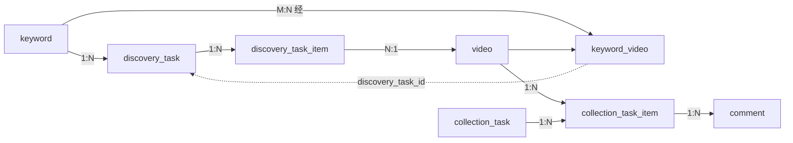
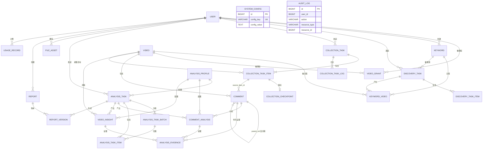

# 21 · 数据库设计缺陷修订与冻结前评审

**任务编号**：M1-C
**执行模式**：READ ONLY
**评审对象**：#20 目标数据库完整设计
**评审日期**：2026-11-03
**结论**：**有条件冻结**。8 项设计缺陷已修订，1 项阻塞待验证（CID）
**授权状态**：**未授权任何实施**

> 证据等级：**A** 代码/DB/配置直接验证｜**B** 由调用关系推导｜**C** 设计建议或未验证假设

---

## 零、执行前核查

| 检查项 | 结果 |
|---|---|
| 目标文件 `21_DATABASE_DESIGN_REVIEW.md` | **不存在**，可创建 |
| #20 表清单实际数量 | 21 张（A） |
| #20 外键声明数量 | **仅 10 处**（A，`grep FK→`） |
| #20 中 `discovery_task` 出现次数 | **1 次**，且仅作为字段说明，**无表定义**（A） |
| #20 中 `analysis_task_item` 出现次数 | **0**（A） |
| #20 中无字段定义的表 | **5 张**：`report` / `report_version` / `system_config` / `usage_record` / `audit_log`（A） |
| MySQL 版本（CHECK 约束需 8.0.16+） | **8.0.46**，支持（A） |

---

## 一、#20 问题清单

| # | 问题 | 证据 | 严重程度 | 处理 |
|---|---|---|---|---|
| **P1** | `keyword_video.discovery_task_id` 引用**不存在的表** | #20 L196 仅有字段，全文无 `discovery_task` 建表 | 🔴 阻塞 | 新增 `discovery_task` + `discovery_task_item` |
| **P2** | `comment.cid NOT NULL` 与「Plan B 用 dedup_hash」**自相矛盾** | #20 L207 `cid NOT NULL`；L503-507 又说 cid 不存在时改 `dedup_hash` | 🔴 阻塞 | 改为 `cid NULL` + `dedup_key NOT NULL` 双唯一键 |
| **P3** | `analysis_task_batch` **无 item 表**，无法记录单条状态/单条 token/单条重试 | #20 L12 节仅 5 个批次级计数字段 | 🔴 高 | 新增 `analysis_task_item` |
| **P4** | `analysis_version VARCHAR(32)` 装不下拼接串 | `deepseek:deepseek-chat:v1:2026-11-01:abc123` = 42 字符 | 🟡 中 | 废弃拼接，改为 `analysis_profile` 表 + `profile_id` |
| **P5** | `data_grant` 三态多态，无法建外键，完整性全靠应用 | #20 L143-144 `resource_type` + `resource_id` | 🟡 中 | **收窄为 `video_grant`**（单态，可建 FK） |
| **P6** | 5 张表只有字段清单，无定义 | `report`/`report_version`/`system_config`/`usage_record`/`audit_log` | 🟡 中 | 全部补齐 |
| **P7** | 外键声明仅 10 处，实际需 20+ | `grep FK→` 统计 | 🟡 中 | 输出完整外键清单 |
| **P8** | `analysis_evidence` 要求「至少一个非空」但无约束 | #20 L15 节仅文字说明 | 🟢 低 | 加 `CHECK` 约束（MySQL 8.0.46 支持） |
| **P9** | Flyway 失败恢复未考虑 MySQL DDL 隐式提交 | #20 L601 仅一句「按备份回滚」 | 🔴 高 | 展开为完整恢复方案（第七节） |
| **P10** | 管理员种子数据写在 Flyway 里，密码固化 | #20 L590-596 | 🟡 中 | 改为哨兵值 + 应用引导（第十节） |
| **P11** | `file_asset.task_id` 多态（采集/分析任务） | #20 L16 节 | 🟢 低 | 改 `biz_type` + `biz_id`，明确无 FK |
| **P12** | `comment.parent_cid` 用 cid 而非 id 自关联，无法建 FK | #20 L209 | 🟢 低 | 保留设计，明确取舍理由 |
| **P13** | `report.current_version` 与 `report_version.version_no` 一致性无保证 | #20 L17 节 | 🟢 低 | 应用层事务保证 + 巡检 SQL |
| **P14** | ER 图缺 `discovery_task`，但 `keyword_video` 有该字段 | #20 L455-492 | 🟡 中 | 重画（第六节） |

**缺陷统计**：🔴 阻塞 2 项、高 2 项、中 6 项、低 4 项。

---

## 二、修订后的领域模型

### 2.1 表数量：21 → **25**

| 变更 | 表 |
|---|---|
| **新增**（4） | `discovery_task`、`discovery_task_item`、`analysis_task_item`、`analysis_profile` |
| **替代**（1） | `data_grant` → `video_grant`（收窄为单态） |
| **废弃字段** | `comment_analysis.analysis_version` → `profile_id` |

### 2.2 六域 25 表

| 域 | 表 | 数 |
|---|---|---|
| 用户与权限 | `user`、`video_grant` | 2 |
| 关键词与发现 | `keyword`、`video`、`keyword_video`、`discovery_task`、`discovery_task_item` | 5 |
| 评论采集 | `comment`、`collection_task`、`collection_task_item`、`collection_checkpoint`、`collection_task_log` | 5 |
| AI 分析 | `analysis_task`、`analysis_task_batch`、`analysis_task_item`、`analysis_profile`、`comment_analysis`、`video_insight`、`analysis_evidence` | 7 |
| 文件与报告 | `file_asset`、`report`、`report_version` | 3 |
| 系统治理 | `system_config`、`usage_record`、`audit_log` | 3 |

### 2.3 两类任务的关系（回应 P1）



**边界划分**：

| 维度 | discovery_task | collection_task |
|---|---|---|
| 目的 | 关键词 → 发现视频 | 视频 → 采集评论 |
| 输入 | `keyword_id` | `video_id` 列表 |
| 输出 | `discovery_task_item`（新增视频）+ `keyword_video` 关联 | `comment` 行 |
| 触发采集 | **不触发**。发现后由用户筛选再创建采集任务 | — |
| 依赖 | 无（可独立运行） | 依赖 video 已存在 |

**关键**：发现任务**不自动触发**采集任务，避免「搜索一次就烧一堆采集资源」。这是产品边界，不是技术限制。

---

## 三、完整表清单

| # | 表名 | 中文 | 域 | 核心职责 | 生命周期 | 核心 |
|---|---|---|---|---|---|---|
| 1 | `user` | 系统用户 | 权限 | 登录身份 | 软删除 | ✅ |
| 2 | `video_grant` | 视频授权 | 权限 | 共享评论的可见性 | 可撤销 | ✅ |
| 3 | `keyword` | 关键词 | 发现 | 关键词定义 | 可停用 | ✅ |
| 4 | `video` | 视频 | 发现 | 视频实体 | 永久 | ✅ |
| 5 | `keyword_video` | 关键词视频 | 发现 | 多对多发现关系 | 随发现新增 | 否 |
| 6 | `discovery_task` | 发现主任务 | 发现 | 一次关键词搜索 | 永久 | ✅ |
| 7 | `discovery_task_item` | 发现子任务 | 发现 | 单条搜索结果 | 永久 | 否 |
| 8 | `comment` | 评论 | 采集 | 评论事实 | **永久** | ✅ |
| 9 | `collection_task` | 采集主任务 | 采集 | 批量采集批次 | 永久 | ✅ |
| 10 | `collection_task_item` | 采集子任务 | 采集 | 单视频采集 | 永久 | ✅ |
| 11 | `collection_checkpoint` | 采集断点 | 采集 | 续采位置 | 随子任务 | 否 |
| 12 | `collection_task_log` | 采集日志 | 采集 | 事件留痕 | 可归档 | 否 |
| 13 | `analysis_task` | 分析主任务 | AI | 一次分析请求 | 永久 | ✅ |
| 14 | `analysis_task_batch` | 分析批次 | AI | 分批执行与计费 | 永久 | 否 |
| 15 | `analysis_task_item` | 分析子项 | AI | **单个分析对象状态** | 永久 | ✅ |
| 16 | `analysis_profile` | 分析配置档 | AI | **模型/Prompt/Schema 版本** | 永久 | ✅ |
| 17 | `comment_analysis` | 评论级分析 | AI | 单评论结构化结果 | 版本并存 | ✅ |
| 18 | `video_insight` | 视频级洞察 | AI | 视频聚合洞察 | 版本并存 | ✅ |
| 19 | `analysis_evidence` | 分析证据 | AI | 洞察↔评论引用 | 随洞察 | ✅ |
| 20 | `file_asset` | 文件资产 | 文件 | 文件元数据 | 可过期 | 否 |
| 21 | `report` | 报告 | 报告 | 报告主体 | 永久 | ✅ |
| 22 | `report_version` | 报告版本 | 报告 | 内容快照 | 版本并存 | 否 |
| 23 | `system_config` | 系统配置 | 治理 | 热改配置 | 永久 | 否 |
| 24 | `usage_record` | 用量记录 | 治理 | Token 与成本 | 永久 | ✅ |
| 25 | `audit_log` | 审计日志 | 治理 | 操作留痕 | 可归档 | 否 |

---

## 四、完整字段定义（修订部分）

> 统一 `ENGINE=InnoDB DEFAULT CHARSET=utf8mb4 COLLATE=utf8mb4_0900_ai_ci`。
> 仅列出**修订或新增**的表；未变更的表沿用 #20 定义。

### 4.1 `comment`（修订 P2）

| 字段 | 类型 | NULL | 默认 | 约束 | 说明 |
|---|---|---|---|---|---|
| `id` | BIGINT UNSIGNED | N | AI | PK | |
| `platform` | VARCHAR(16) | N | `'douyin'` | UK① | |
| **`cid`** | **VARCHAR(64)** | **Y** | **NULL** | **UK①** | **平台评论 ID；未验证存在性，故允许 NULL** |
| **`dedup_key`** | **VARCHAR(64)** | **N** | — | **UK②** | **幂等键：有 cid 时=cid，无 cid 时=本地指纹（非平台 ID）** |
| `video_id` | BIGINT UNSIGNED | N | — | FK→video | 内部 ID |
| `parent_cid` | VARCHAR(64) | Y | NULL | IDX | 父评论 cid（无 FK，见 4.2） |
| `root_cid` | VARCHAR(64) | Y | NULL | | 根评论 cid |
| `is_reply` | TINYINT UNSIGNED | N | 0 | | 0=一级 1=回复 |
| `reply_count` | INT UNSIGNED | N | 0 | | |
| `nickname` | VARCHAR(100) | N | — | | |
| `douyin_id` | VARCHAR(64) | Y | NULL | IDX | |
| `douyin_uid` | VARCHAR(32) | Y | NULL | | |
| `sec_uid` | VARCHAR(128) | Y | NULL | | |
| `ip_region` | VARCHAR(50) | N | `'未知'` | | IP 归属地 |
| `content` | TEXT | N | — | | 原文 |
| `likes` | INT UNSIGNED | N | 0 | | |
| `publish_time` | DATETIME | N | — | | |
| `source_item_id` | BIGINT UNSIGNED | Y | NULL | FK→collection_task_item | 来源子任务 |
| `collected_at` | DATETIME | N | CURRENT_TIMESTAMP | | |
| `updated_at` | DATETIME | N | CURRENT_TIMESTAMP ON UPDATE | | |

**双唯一键设计（解决 P2）**：

```sql
UNIQUE KEY uk_platform_cid   (platform, cid),       -- cid 有值时强唯一；NULL 多行放行
UNIQUE KEY uk_platform_dedup (platform, dedup_key)  -- 兜底幂等，恒非空
```

| 情形 | `cid` | `dedup_key` | 哪个索引生效 |
|---|---|---|---|
| 平台返回稳定 cid | `'7xxx'` | `'7xxx'` | 两者都生效（同值） |
| 平台无 cid | `NULL` | `sha256(...)` | 仅 `uk_platform_dedup` |
| 平台 cid 不稳定 | `'7xxx'` | `sha256(...)` | `uk_platform_dedup` 主导 |

**必须明确**：`dedup_key` 是**本地去重指纹，不是平台唯一 ID**，不得用于与平台数据对账，也不得对外暴露。

### 4.2 `parent_cid` 为何不用 `parent_id`（回应 P12）

| 方案 | 优点 | 缺点 | 选择 |
|---|---|---|---|
| `parent_id BIGINT FK→comment.id` | 可建外键 | **要求父评论必须先入库**；采集顺序不保证父评论先到 | ❌ |
| `parent_cid VARCHAR(64)` | 采集时直接有值，不依赖入库顺序 | 无外键约束，可能悬挂 | ✅ |

取舍理由（C 级建议）：抖音回复可能先于父评论被抓到，用 `parent_id` 会产生「父未入库→子插入失败」或「先插 NULL 后补」的复杂度。用 `parent_cid` 牺牲强制完整性，换取采集健壮性。悬挂引用由**巡检 SQL** 定期检查：

```sql
SELECT c.id, c.parent_cid FROM comment c
LEFT JOIN comment p ON p.platform=c.platform AND p.cid=c.parent_cid
WHERE c.parent_cid IS NOT NULL AND p.id IS NULL;
```

### 4.3 `video_grant`（替代 `data_grant`，解决 P5）

| 字段 | 类型 | NULL | 默认 | 约束 | 说明 |
|---|---|---|---|---|---|
| `id` | BIGINT UNSIGNED | N | AI | PK | |
| `grantee_user_id` | BIGINT UNSIGNED | N | — | FK→user | 被授权用户 |
| `video_id` | BIGINT UNSIGNED | N | — | FK→video | 被授权视频 |
| `permission` | VARCHAR(16) | N | `'READ'` | UK | `READ`（第一版只读） |
| `granted_by` | BIGINT UNSIGNED | N | — | FK→user | 授权人 |
| `created_at` | DATETIME | N | CURRENT_TIMESTAMP | | |
| `expires_at` | DATETIME | Y | NULL | IDX | 过期时间，NULL=永久 |

UK：`uk_grant (grantee_user_id, video_id, permission)`

**为什么收窄为单态**（回应 P5）：

| 方案 | 外键 | 复杂度 | 判断 |
|---|---|---|---|
| 三态多态 `(resource_type, resource_id)` | ❌ 无法建 | 低 | 完整性无保障 |
| 拆 3 张表（video/keyword/task） | ✅ | 高 | 过度设计 |
| **单态 `video_grant`** | ✅ | 低 | ✅ **采用** |

理由：ADR-004 的诉求是「共享评论数据」，而**评论永远挂在视频下**。授权视频 = 授权其评论。关键词级和任务级授权当前无业务需求。

**扩展路径**（若将来需要）：新增 `keyword_grant` / `task_grant` 平级表，保持单态+FK，不要改回多态。

### 4.4 `discovery_task`（新增，解决 P1）

| 字段 | 类型 | NULL | 默认 | 约束 | 说明 |
|---|---|---|---|---|---|
| `id` | BIGINT UNSIGNED | N | AI | PK | |
| `task_no` | VARCHAR(32) | N | — | UK | `DT20261103001` |
| `keyword_id` | BIGINT UNSIGNED | N | — | FK→keyword | 搜索关键词 |
| `status` | VARCHAR(24) | N | `'PENDING'` | IDX | 同采集任务状态机 |
| `owner_user_id` | BIGINT UNSIGNED | N | — | FK→user | |
| `requested_max` | INT UNSIGNED | N | 50 | | 期望条数 |
| `found_count` | INT UNSIGNED | N | 0 | | 返回条数 |
| `new_video_count` | INT UNSIGNED | N | 0 | | 新增视频数 |
| `params_json` | JSON | Y | NULL | | 筛选条件（排序/时间范围） |
| `created_at` | DATETIME | N | CURRENT_TIMESTAMP | | |
| `started_at` / `finished_at` | DATETIME | Y | NULL | | |
| `error_message` | TEXT | Y | NULL | | |

索引：`idx_owner_created (owner_user_id, created_at)`、`idx_status (status)`

### 4.5 `discovery_task_item`（新增）

| 字段 | 类型 | NULL | 默认 | 约束 | 说明 |
|---|---|---|---|---|---|
| `id` | BIGINT UNSIGNED | N | AI | PK | |
| `task_id` | BIGINT UNSIGNED | N | — | FK→discovery_task | |
| `video_id` | BIGINT UNSIGNED | N | — | FK→video | 已入库视频 |
| `position` | INT UNSIGNED | N | 0 | | 搜索结果排序位 |
| `is_new` | TINYINT UNSIGNED | N | 1 | | 是否本任务首次发现 |
| `raw_json` | JSON | Y | NULL | | 原始结果片段（用于追溯） |
| `created_at` | DATETIME | N | CURRENT_TIMESTAMP | | |

UK：`uk_task_video (task_id, video_id)` ← 同一任务内不重复

### 4.6 `analysis_profile`（新增，解决 P4）

| 字段 | 类型 | NULL | 默认 | 约束 | 说明 |
|---|---|---|---|---|---|
| `id` | BIGINT UNSIGNED | N | AI | PK | |
| `profile_key` | VARCHAR(64) | N | — | **UK** | 服务端生成的稳定短键，如 `ap_20261103_a3f2c1` |
| `provider` | VARCHAR(32) | N | — | | `deepseek` |
| `model_name` | VARCHAR(64) | N | — | | `deepseek-chat` |
| `prompt_version` | VARCHAR(32) | N | — | | `v1` |
| `schema_version` | VARCHAR(32) | N | — | | `v1` |
| `taxonomy_version` | VARCHAR(32) | N | — | | `v1` |
| `params_json` | JSON | Y | NULL | | temperature / max_tokens 等 |
| `description` | VARCHAR(255) | Y | NULL | | |
| `created_at` | DATETIME | N | CURRENT_TIMESTAMP | | |

UK：`uk_profile (provider, model_name, prompt_version, schema_version, taxonomy_version, params_hash)`
建议增 `params_hash CHAR(16)` 参与唯一键，避免同参数重复建档。

**废弃**：`comment_analysis.analysis_version VARCHAR(32)` → 改为 `profile_id BIGINT FK→analysis_profile`

### 4.7 `comment_analysis`（修订 P4）

| 字段 | 类型 | NULL | 默认 | 约束 | 说明 |
|---|---|---|---|---|---|
| `id` | BIGINT UNSIGNED | N | AI | PK | |
| `comment_id` | BIGINT UNSIGNED | N | — | FK→comment, UK 一部分 | |
| **`profile_id`** | **BIGINT UNSIGNED** | **N** | — | **FK→analysis_profile, UK 一部分** | 替代 analysis_version |
| `analysis_task_id` | BIGINT UNSIGNED | Y | NULL | FK | |
| `analysis_task_item_id` | BIGINT UNSIGNED | Y | NULL | FK | 单对象执行记录 |
| `sentiment` | VARCHAR(16) | Y | NULL | IDX | |
| `intent` | VARCHAR(32) | Y | NULL | | |
| `topics_json` | JSON | Y | NULL | | |
| `pain_points_json` | JSON | Y | NULL | | |
| `user_need` | VARCHAR(512) | Y | NULL | | |
| `purchase_intent` | VARCHAR(24) | Y | NULL | | |
| `scenario_tags_json` | JSON | Y | NULL | | |
| `product_suggestions_json` | JSON | Y | NULL | | |
| `competitor_mentions_json` | JSON | Y | NULL | | |
| `confidence` | DECIMAL(4,3) | Y | NULL | | 0.000~1.000 |
| `is_uncertain` | TINYINT UNSIGNED | N | 0 | | UNKNOWN/低置信 |
| `created_at` | DATETIME | N | CURRENT_TIMESTAMP | | |

UK：`uk_comment_profile (comment_id, profile_id)` ← 同一评论同一配置档只分析一次

### 4.8 `analysis_task_item`（新增，解决 P3）

| 字段 | 类型 | NULL | 默认 | 约束 | 说明 |
|---|---|---|---|---|---|
| `id` | BIGINT UNSIGNED | N | AI | PK | |
| `task_id` | BIGINT UNSIGNED | N | — | FK→analysis_task | |
| `batch_id` | BIGINT UNSIGNED | Y | NULL | FK→analysis_task_batch | 归属批次 |
| `target_type` | VARCHAR(16) | N | — | UK 一部分 | `COMMENT` / `VIDEO` |
| `target_id` | BIGINT UNSIGNED | N | — | UK 一部分 | comment.id 或 video.id |
| `status` | VARCHAR(24) | N | `'PENDING'` | IDX | PENDING/RUNNING/SUCCESS/FAILED/SKIPPED |
| `retry_count` | INT UNSIGNED | N | 0 | | |
| `input_tokens` | INT UNSIGNED | N | 0 | | **单对象 token** |
| `output_tokens` | INT UNSIGNED | N | 0 | | |
| `cost_amount` | DECIMAL(12,6) | N | 0 | | **单对象成本** |
| `error_code` | VARCHAR(64) | Y | NULL | | |
| `error_message` | VARCHAR(512) | Y | NULL | | |
| `created_at` | DATETIME | N | CURRENT_TIMESTAMP | | |
| `finished_at` | DATETIME | Y | NULL | | |

UK：`uk_task_target (task_id, target_type, target_id)` ← **同一任务内同一对象只出现一次**
索引：`idx_batch_status (batch_id, status)` ← 批次内按状态续跑

**这解决 4 个问题**：
| 问题 | 解法 |
|---|---|
| 批次中有哪些对象 | `SELECT target_id FROM analysis_task_item WHERE batch_id=?` |
| 单条状态 | `status` 列 |
| 失败恢复 | `WHERE status='FAILED' AND retry_count < 3` |
| 跳过已成功 | `WHERE status='SUCCESS'`（或 `INSERT IGNORE` 依赖 UK） |

### 4.9 补齐 5 张简略表（解决 P6）

#### `report`

| 字段 | 类型 | NULL | 默认 | 约束 | 说明 |
|---|---|---|---|---|---|
| `id` | BIGINT UNSIGNED | N | AI | PK | |
| `report_no` | VARCHAR(32) | N | — | UK | `RP20261103001` |
| `title` | VARCHAR(255) | N | — | | |
| `report_type` | VARCHAR(32) | N | — | IDX | `VIDEO` / `KEYWORD` / `COMPARISON` |
| `scope_json` | JSON | N | — | | 数据范围快照 |
| `owner_user_id` | BIGINT UNSIGNED | N | — | FK→user | |
| `status` | VARCHAR(16) | N | `'DRAFT'` | | DRAFT/PUBLISHED/ARCHIVED |
| `current_version` | INT UNSIGNED | N | 1 | | 指向最新 version_no |
| `created_at` / `updated_at` | DATETIME | N | | | |
| `deleted_at` | DATETIME | Y | NULL | IDX | 软删除 |

索引：`idx_owner_created (owner_user_id, created_at)`

#### `report_version`

| 字段 | 类型 | NULL | 默认 | 约束 | 说明 |
|---|---|---|---|---|---|
| `id` | BIGINT UNSIGNED | N | AI | PK | |
| `report_id` | BIGINT UNSIGNED | N | — | FK→report | |
| `version_no` | INT UNSIGNED | N | — | UK 一部分 | 从 1 递增 |
| `content_json` | JSON | N | — | | 结构化内容（唯一权威） |
| `content_md` | MEDIUMTEXT | Y | NULL | | 可读渲染（非权威） |
| `analysis_task_id` | BIGINT UNSIGNED | Y | NULL | FK→analysis_task | 生成来源 |
| `evidence_count` | INT UNSIGNED | N | 0 | | |
| `generated_by` | BIGINT UNSIGNED | Y | NULL | | 生成人（AI 生成时为空） |
| `generated_at` | DATETIME | N | CURRENT_TIMESTAMP | | |

UK：`uk_report_version (report_id, version_no)`

#### `system_config`

| 字段 | 类型 | NULL | 默认 | 约束 | 说明 |
|---|---|---|---|---|---|
| `id` | BIGINT UNSIGNED | N | AI | PK | |
| `config_key` | VARCHAR(64) | N | — | UK | 如 `ai.daily_budget` |
| `config_value` | TEXT | Y | NULL | | |
| `value_type` | VARCHAR(16) | N | `'STRING'` | | STRING/INT/DECIMAL/BOOL/JSON |
| `is_secret` | TINYINT UNSIGNED | N | 0 | | 1=不返回给前端 |
| `description` | VARCHAR(255) | Y | NULL | | |
| `updated_by` | BIGINT UNSIGNED | Y | NULL | | |
| `updated_at` | DATETIME | N | CURRENT_TIMESTAMP ON UPDATE | | |

#### `usage_record`

| 字段 | 类型 | NULL | 默认 | 约束 | 说明 |
|---|---|---|---|---|---|
| `id` | BIGINT UNSIGNED | N | AI | PK | |
| `biz_type` | VARCHAR(24) | N | — | IDX 一部分 | `AI_ANALYSIS` / `COLLECTION` |
| `biz_ref_id` | BIGINT UNSIGNED | Y | NULL | IDX 一部分 | 任务 ID（**多态，无 FK**） |
| `owner_user_id` | BIGINT UNSIGNED | Y | NULL | FK→user | 计费归属 |
| `provider` | VARCHAR(32) | Y | NULL | | |
| `model_name` | VARCHAR(64) | Y | NULL | | |
| `input_tokens` | INT UNSIGNED | N | 0 | | |
| `output_tokens` | INT UNSIGNED | N | 0 | | |
| `cost_amount` | DECIMAL(12,6) | N | 0 | | |
| `price_version` | VARCHAR(32) | Y | NULL | | 计价快照 |
| `latency_ms` | INT UNSIGNED | Y | NULL | | |
| `status` | VARCHAR(16) | N | `'OK'` | | OK/ERROR/TIMEOUT |
| `created_at` | DATETIME | N | CURRENT_TIMESTAMP | | |

索引：`idx_biz (biz_type, biz_ref_id)`、`idx_created_owner (created_at, owner_user_id)`

#### `audit_log`

| 字段 | 类型 | NULL | 默认 | 约束 | 说明 |
|---|---|---|---|---|---|
| `id` | BIGINT UNSIGNED | N | AI | PK | |
| `user_id` | BIGINT UNSIGNED | Y | NULL | IDX | 操作人（系统操作为 NULL） |
| `action` | VARCHAR(48) | N | — | IDX | `LOGIN` / `DELETE_VIDEO` / `GRANT` 等 |
| `resource_type` | VARCHAR(32) | Y | NULL | | **多态，无 FK** |
| `resource_id` | BIGINT UNSIGNED | Y | NULL | | |
| `detail_json` | JSON | Y | NULL | | **禁止写入密码/Token/完整手机号** |
| `client_ip` | VARCHAR(45) | Y | NULL | | IPv4/IPv6 |
| `user_agent` | VARCHAR(255) | Y | NULL | | 截断存储 |
| `created_at` | DATETIME | N | CURRENT_TIMESTAMP | IDX | |

索引：`idx_user_created (user_id, created_at)`、`idx_resource (resource_type, resource_id)`

**脱敏规则**（C 级建议）：`detail_json` 写入前过滤键名匹配 `/password|token|secret|api_?key/i`；手机号保留前 3 后 4。

### 4.10 `analysis_evidence`（修订 P8）

追加约束（MySQL 8.0.46 支持 CHECK）：

```sql
CONSTRAINT ck_evidence_target CHECK (insight_id IS NOT NULL OR comment_analysis_id IS NOT NULL)
```

### 4.11 `file_asset`（修订 P11）

`task_id BIGINT` → **`biz_type VARCHAR(24)` + `biz_id BIGINT UNSIGNED`**，明确多态、无 FK。索引 `idx_biz (biz_type, biz_id)`。

### 4.12 `analysis_task`（修订 P4 连带）

`#20` 中 `analysis_task` 直接存 `model_provider` / `model_name` / `prompt_version` / `schema_version` / `taxonomy_version` 五列，与 `comment_analysis.analysis_version` 形成**两处版本定义**。本次统一收敛到 `analysis_profile`：

| 字段 | 变更 | 说明 |
|---|---|---|
| `model_provider` / `model_name` | **删除** | 移至 `analysis_profile` |
| `prompt_version` / `schema_version` / `taxonomy_version` | **删除** | 同上 |
| **`profile_id`** | **新增** `BIGINT UNSIGNED NOT NULL` | FK→`analysis_profile.id`，**唯一版本来源** |

其余字段（`task_no` / `task_type` / `status` / `owner_user_id` / `scope_type` / `scope_json` / 三项计数 / Token / `cost_amount` / `price_version` / 时间 / `error_message`）沿用 `#20`。

**收益**：版本维度只在 `analysis_profile` 一处定义，`analysis_task` / `comment_analysis` / `video_insight` 全部引用 `profile_id`，不存在漂移可能。

---

## 五、完整外键与索引清单（解决 P7）

### 5.1 外键策略总则

| 类别 | 是否建 FK | 理由 |
|---|---|---|
| 强归属（子记录离开父无意义） | ✅ 建 | `comment→video`、`task_item→task` |
| 审计/授权归属 | ✅ 建 | `*_grant→user/video` |
| **多态关联** | ❌ 不建 | `audit_log.resource_*`、`usage_record.biz_ref_id`、`file_asset.biz_id` |
| **软删除表被引用** | ✅ 建 | `user` 用软删除，行始终存在，FK 不受影响 |
| **可选引用**（可为 NULL） | ✅ 建 | 如 `comment.source_item_id` |

**删除策略统一 `ON DELETE RESTRICT ON UPDATE CASCADE`**：评论、视频、任务是永久数据，禁止级联删除。仅 `collection_checkpoint` / `collection_task_log` 用 `ON DELETE CASCADE`（随子任务清理）。

### 5.2 完整外键清单

| # | 子表.字段 | 父表.字段 | 删除策略 | 说明 |
|---|---|---|---|---|
| 1 | `video_grant.grantee_user_id` | `user.id` | RESTRICT | |
| 2 | `video_grant.video_id` | `video.id` | RESTRICT | |
| 3 | `video_grant.granted_by` | `user.id` | RESTRICT | |
| 4 | `keyword.owner_user_id` | `user.id` | RESTRICT | |
| 5 | `keyword_video.keyword_id` | `keyword.id` | CASCADE | 关联表可随关键词删 |
| 6 | `keyword_video.video_id` | `video.id` | RESTRICT | |
| 7 | `keyword_video.discovery_task_id` | `discovery_task.id` | **SET NULL** | 任务可清理，关联保留 |
| 8 | `discovery_task.keyword_id` | `keyword.id` | RESTRICT | |
| 9 | `discovery_task.owner_user_id` | `user.id` | RESTRICT | |
| 10 | `discovery_task_item.task_id` | `discovery_task.id` | CASCADE | |
| 11 | `discovery_task_item.video_id` | `video.id` | RESTRICT | |
| 12 | `comment.video_id` | `video.id` | RESTRICT | |
| 13 | `comment.source_item_id` | `collection_task_item.id` | **SET NULL** | 子任务清理后评论保留 |
| 14 | `collection_task.owner_user_id` | `user.id` | RESTRICT | |
| 15 | `collection_task_item.task_id` | `collection_task.id` | CASCADE | |
| 16 | `collection_task_item.video_id` | `video.id` | RESTRICT | |
| 17 | `collection_checkpoint.task_item_id` | `collection_task_item.id` | CASCADE | |
| 18 | `collection_task_log.task_id` | `collection_task.id` | CASCADE | |
| 19 | `collection_task_log.task_item_id` | `collection_task_item.id` | SET NULL | |
| 20 | `analysis_task.owner_user_id` | `user.id` | RESTRICT | |
| 21 | `analysis_task.profile_id` | `analysis_profile.id` | RESTRICT | |
| 22 | `analysis_task_batch.task_id` | `analysis_task.id` | CASCADE | |
| 23 | `analysis_task_item.task_id` | `analysis_task.id` | CASCADE | |
| 24 | `analysis_task_item.batch_id` | `analysis_task_batch.id` | SET NULL | |
| 25 | `comment_analysis.comment_id` | `comment.id` | RESTRICT | |
| 26 | `comment_analysis.profile_id` | `analysis_profile.id` | RESTRICT | |
| 27 | `comment_analysis.analysis_task_id` | `analysis_task.id` | SET NULL | |
| 28 | `comment_analysis.analysis_task_item_id` | `analysis_task_item.id` | SET NULL | |
| 29 | `video_insight.video_id` | `video.id` | RESTRICT | |
| 30 | `video_insight.analysis_task_id` | `analysis_task.id` | SET NULL | |
| 31 | `video_insight.profile_id` | `analysis_profile.id` | RESTRICT | |
| 32 | `analysis_evidence.insight_id` | `video_insight.id` | CASCADE | |
| 33 | `analysis_evidence.comment_analysis_id` | `comment_analysis.id` | SET NULL | |
| 34 | `analysis_evidence.comment_id` | `comment.id` | RESTRICT | **证据必须指向真实评论** |
| 35 | `file_asset.owner_user_id` | `user.id` | RESTRICT | |
| 36 | `report.owner_user_id` | `user.id` | RESTRICT | |
| 37 | `report_version.report_id` | `report.id` | CASCADE | |
| 38 | `report_version.analysis_task_id` | `analysis_task.id` | SET NULL | |
| 39 | `usage_record.owner_user_id` | `user.id` | SET NULL | |

**共 39 个外键**。多态字段（`audit_log.resource_*`、`usage_record.biz_ref_id`、`file_asset.biz_id`）**不建 FK**，由应用校验 + 巡检。

> ⚠️ 注意：`analysis_task.profile_id` 在 #20 中不存在（`analysis_task` 原来直接存 model/prompt 列）。本次修订让 `analysis_task` 也引用 `profile_id`，避免两处版本定义不一致。

### 5.3 索引清单（除 UK/PK 外）

| 表 | 索引 | 支撑查询 |
|---|---|---|
| `user` | `idx_role`、`idx_status`、`idx_deleted` | 用户筛选 |
| `video_grant` | `idx_grantee (grantee_user_id)`、`idx_expires` | 授权查询 |
| `keyword` | `uk_owner_norm`、`idx_status` | 关键词列表 |
| `video` | `uk_platform_aweme`、`idx_publish_time`、`idx_last_collected` | 视频库、增量判断 |
| `comment` | `uk_platform_cid`、`uk_platform_dedup`、`idx_video_time`、`idx_video_likes`、`idx_video_region`、`idx_parent`、`idx_source_item` | 幂等写入 / 列表 / 排序 / 地区 / 回复 / 溯源 |
| `discovery_task_item` | `uk_task_video`、`idx_video` | |
| `collection_task_item` | `uk_video_active`、`idx_task_status`、`idx_status_lease` | 防重 / 进度 / 领取 |
| `analysis_task_item` | `uk_task_target`、`idx_batch_status` | 续跑 |
| `comment_analysis` | `uk_comment_profile`、`idx_task`、`idx_sentiment` | |
| `video_insight` | `idx_video_created` | 多版本 |
| `usage_record` | `idx_biz`、`idx_created_owner` | 成本统计 |

**冗余检查**：`comment.idx_video_time` 的最左前缀 `video_id` 覆盖了旧的单独 `idx_video_id`，不重复建。

---

## 六、Mermaid ER 图（解决 P14）



> `system_config` 与 `audit_log` **不参与外键关系**（配置为全局键值；审计为写入型流水，其 `resource_type`/`resource_id` 是多态，刻意不建 FK），以属性块形式列入以保证 25 张表全覆盖。

**一致性自查**：

| 检查 | 结果 |
|---|---|
| ER 图中所有实体均在表清单 | ✅ 25 个实体全部对应 |
| 所有关联均有字段依据 | ✅ 逐条对应第五节外键清单 |
| 无引用不存在的表 | ✅ `discovery_task` 已建表 |
| 关联字段类型一致 | ✅ 全部 `BIGINT UNSIGNED` |
| `COMMENT.parent_cid` 自关联 | ✅ 虚线标注为 cid 级关联（非 id） |

---

## 七、数据授权设计（回应问题 1）

### 7.1 四种角色的分离

| 角色 | 字段 | 语义 |
|---|---|---|
| **任务创建者** | `collection_task.owner_user_id` | 谁发起采集 |
| **任务执行者** | `collection_task_item.worker_id` | 哪个 Worker 执行（机器标识） |
| **数据所有者** | **不存在** | 评论是共享事实（ADR-004） |
| **数据访问者** | `video_grant` 决定 | 谁能看 |

### 7.2 可见性规则（唯一权威定义）

```
普通用户可见的视频集合 =
    自己任务覆盖的 video（collection_task_item → task.owner_user_id = me）
  ∪ video_grant 授权给我的 video（未过期）
  ∪ 公开视频（若启用 PUBLIC 模式，第一版不启用）

管理员（role=1）可见全部
```

### 7.3 数据库保证 vs 应用保证

| 约束 | 由谁保证 | 说明 |
|---|---|---|
| `video_grant` 引用真实 user/video | **数据库** | FK |
| 同一用户对同一视频不重复授权 | **数据库** | `uk_grant` |
| 过期时间格式 | **数据库** | `DATETIME` 类型 |
| **过期后不可见** | **应用** | 查询需带 `expires_at IS NULL OR expires_at > NOW()` |
| **授权人必须是管理员** | **应用** | 数据库无法表达「按角色限制写入」 |
| **资源删除时授权级联清理** | **数据库** | `ON DELETE CASCADE`（video 用 RESTRICT 则不会删） |
| **跨用户越权拦截** | **应用** | 每个查询入口统一注入过滤 |

### 7.4 Java 与 Python 的统一授权边界（回应问题 1 关键点）

**现状问题（A 级）**：授权逻辑分散 5 处（4 Java + 1 Python），改一处漏一处。

**修订原则**：

```
                     ┌─────────────────┐
   前端请求 ────────► │ Java: 鉴权 + 过滤 │ ──► Flask（只收内部 id，不判权限）
                     └─────────────────┘
```

| 层 | 职责 | 禁止 |
|---|---|---|
| Java | 解析 token、查 `video_grant`、确定可见 `video_id` 集合 | — |
| Flask | 只按传入的**内部 video_id** 查数据 | **禁止接收 `user_id` 做过滤** |
| Python 清洗 | 只按传入 `video_id` 写入 | 禁止自行判定归属 |

**实施要点**：`wordcloud_service.py:179` 的 `AND user_id=%s` 分支必须删除（#20 已列为改造项，此处强化为**强制项**）。

---

## 八、采集任务与分析任务关系（回应问题 4 的前置）

| 维度 | 采集任务 | 分析任务 |
|---|---|---|
| 触发源 | 用户选视频 | 用户选范围（视频/关键词） |
| 子项粒度 | 一视频一项 | **一评论/一视频一项** |
| 幂等键 | `uk(video_id, active_flag)` | `uk(task_id, target_type, target_id)` |
| 断点 | `collection_checkpoint`（cursor/page） | `analysis_task_item.status`（对象级） |
| 成本记录 | 无（不花钱） | `analysis_task_item.cost_amount` + `usage_record` |
| 失败重试 | `retry_count` + 租约 | `retry_count` + 按 status 重跑 |

**关键差异**：采集的断点是「分页位置」，分析的断点是「对象状态」。**不能用同一套 checkpoint 模型**。

---

## 九、AI 版本与证据模型（回应问题 6）

### 9.1 版本四维 + 参数

| 维度 | 存储位置 | 示例 |
|---|---|---|
| provider/model | `analysis_profile.provider` / `model_name` | `deepseek` / `deepseek-chat` |
| prompt 版本 | `analysis_profile.prompt_version` | `v2.1` |
| schema 版本 | `analysis_profile.schema_version` | `v1` |
| taxonomy 版本 | `analysis_profile.taxonomy_version` | `v1` |
| 运行参数 | `analysis_profile.params_json` + `params_hash` | `{"temperature":0.2}` |

**唯一性**：`analysis_profile` 用五维 + `params_hash` 做 UK；`comment_analysis` 用 `(comment_id, profile_id)` 做 UK。

### 9.2 重复实验如何保存

| 场景 | 处理 |
|---|---|
| 同配置重跑同一评论 | `profile_id` 相同 → `uk_comment_profile` 冲突 → **跳过或 UPDATE**（幂等，不重复付费） |
| 换 Prompt 重跑 | 新建 `analysis_profile` → `profile_id` 不同 → **新行并存** |
| 换模型重跑 | 同上 |
| 抽样对比实验 | 新建 profile + 新 `analysis_task`，`analysis_task_item` 记录对象集 |

### 9.3 证据链

```
video_insight (结论)
    └─ analysis_evidence (insight_id, comment_id, relevance, explanation)
         └─ comment (原始文本)
              └─ comment_analysis (单评论结构化结果, 可选)
```

约束：`analysis_evidence.comment_id` **NOT NULL + FK RESTRICT** → 证据必须指向真实评论，评论不可删。

---

## 十、Flyway 迁移与恢复方案（解决 P9）

### 10.1 MySQL DDL 隐式提交的影响（核心技术点）

**事实（A 级，MySQL 官方行为）**：MySQL 的 `CREATE TABLE` / `ALTER TABLE` / `DROP TABLE` 等 DDL 会**隐式提交**当前事务，且**无法回滚**。

这意味着：

| 假设 | 实际 |
|---|---|
| ❌「Flyway 迁移失败会自动回滚」 | MySQL 不支持事务性 DDL，**已执行的 DDL 不会撤销** |
| ❌「`flyway repair` 能回滚结构」 | `repair` **只清理 `flyway_schema_history` 的失败记录**，不碰任何表结构 |
| ✅「失败后必须人工介入」 | 正确 |

### 10.2 迁移失败后的真实状态

以 `V5__init_ai_analysis.sql` 含 7 张表为例，执行到第 4 张时失败：

```
实际状态：
  analysis_task           ✅ 已创建（无法撤销）
  analysis_task_batch     ✅ 已创建
  analysis_task_item      ✅ 已创建
  analysis_profile        ❌ 失败
  comment_analysis        ⬜ 未执行
  ...
  flyway_schema_history   V5 记录 success=0
```

### 10.3 恢复流程（标准操作）

```
1. 停止后端服务（避免应用继续写库）
2. 判断影响面
   - SELECT * FROM flyway_schema_history WHERE success = 0;
   - 对照迁移脚本，列出「已执行 / 未执行」的语句
3. 二选一：
   
   路径 A（推荐，测试环境）：全量重建
     docker compose down
     docker volume rm dy-comment_mysql-data   ← 绝不碰 chrome-data
     docker compose up -d
     Flyway 从 V1 重跑

   路径 B（生产环境）：从备份恢复
     mysql -uroot -p dy_comment < backup_before_migration.sql
     flyway repair（清失败记录）
     修复 SQL 后重新 migrate

4. 手动清理半成品表（仅当无备份且确认无数据时）
   DROP TABLE IF EXISTS analysis_task_batch, analysis_task_item, analysis_task;
   flyway repair
```

### 10.4 迁移前必做

| 项 | 命令/动作 |
|---|---|
| 全量备份 | `mysqldump --single-transaction --routines --triggers dy_comment > backup_$(date +%F_%H%M).sql` |
| 验证备份可读 | `grep -c "CREATE TABLE" backup.sql` 应等于预期表数 |
| 记录当前版本 | `SELECT version, description, success FROM flyway_schema_history` |
| 记录表数量 | `SELECT COUNT(*) FROM information_schema.TABLES WHERE TABLE_SCHEMA='dy_comment'` |

### 10.5 两种环境流程

| 场景 | 流程 |
|---|---|
| **空库初始化** | MySQL 建空库（`MYSQL_DATABASE`）→ 后端启动 → Flyway 依次 V1..V8 |
| **已初始化库升级** | 新增 `V9__xxx.sql` → 备份 → 重启 → Flyway 只跑 V9 |
| **测试重置** | 删 volume（仅 mysql-data）→ 重启 |
| **生产迁移** | 备份 → 低峰期执行 → 校验 `flyway_schema_history` 全 success → 冒烟 |

### 10.6 版本分组（修订为 8 个）

| 版本 | 内容 | 依赖 |
|---|---|---|
| `V1__init_user.sql` | `user`、`video_grant` | — |
| `V2__init_content.sql` | `video`、`keyword`、`discovery_task` | V1 |
| `V3__init_keyword_video.sql` | `keyword_video`（依赖 discovery_task）、`discovery_task_item` | V2 |
| `V4__init_comment.sql` | `comment` | V2 |
| `V5__init_collection_task.sql` | 采集 4 表 | V1/V2/V4 |
| `V6__init_ai_analysis.sql` | `analysis_profile`、`analysis_task`、`batch`、`item`、`comment_analysis`、`video_insight`、`analysis_evidence` | V1/V2/V4 |
| `V7__init_report_governance.sql` | `file_asset`、`report`、`report_version`、`system_config`、`usage_record`、`audit_log` | V1/V6 |
| `V8__seed_admin_sentinel.sql` | **仅插入哨兵管理员**（不可登录） | V1 |

> `V3` 拆出来是因为 `keyword_video` 同时依赖 `keyword`/`video`/`discovery_task`，必须后置。

---

## 十一、管理员初始化方案（解决 P10）

### 11.1 职责分离

| 项 | 负责方 | 理由 |
|---|---|---|
| 表结构 | **Flyway** | ADR-001 |
| 管理员**行**创建 | **Flyway**（V8，哨兵值） | 保证空库可登录 |
| 管理员**密码**设置 | **应用启动引导**（`AdminBootstrap`） | 密码不能固化在版本库 |

### 11.2 哨兵方案

```sql
-- V8__seed_admin_sentinel.sql
INSERT INTO `user` (username, phone, password_hash, role, status, must_change_pwd)
VALUES ('管理员', '<REDACTED-ADMIN-PHONE-1>', '!SENTINEL_NO_LOGIN!', 1, 0, 1)
ON DUPLICATE KEY UPDATE id = id;   -- 幂等
```

- `password_hash` 为哨兵串，BCrypt 校验必然失败 → **库泄露也无法登录**
- `status = 0` 禁用

### 11.3 应用引导流程（`AdminBootstrap`）

```
启动时：
  1. 查 phone='<REDACTED-ADMIN-PHONE-1>' 且 password_hash='!SENTINEL_NO_LOGIN!'
  2. 若存在：
     a. 读环境变量 ADMIN_INIT_PASSWORD
     b. 有值 → BCrypt 加密 → UPDATE password_hash, status=1, must_change_pwd=1
     c. 无值 → 生成 16 位随机密码 → 同上，并打印一次到日志（WARN 级别，提示立即修改）
  3. 若已是正常哈希 → 跳过（幂等）
```

### 11.4 BCrypt 生成与校验

| 项 | 方案 |
|---|---|
| 生成 | `new BCryptPasswordEncoder().encode(raw)` → `$2a$10$...`（60 字符，存 `VARCHAR(100)`） |
| 校验 | `matches(raw, hash)`；哨兵串 `!SENTINEL_NO_LOGIN!` 天然不匹配任何 BCrypt 格式 |
| MD5 兼容移除 | M2-C 删除 `UserServiceImpl` 双格式分支；清库后无 MD5 用户，可安全移除 |

### 11.5 首次登录强制改密

- `must_change_pwd=1` → 登录接口返回 `mustChangePwd: true`
- 前端拦截，强制跳转改密页
- 改密成功后置 0

---

## 十二、CID 验证任务书（回应问题 3）

> 保持「**未验证**」状态。以下为验证任务，**不是已确认结论**。

### 12.1 验证目标

| # | 待确认项 | 判定标准 |
|---|---|---|
| 1 | `cid` 字段是否存在 | 响应 JSON 中 comments[*].cid 有值 |
| 2 | cid 类型与长度 | 字符串？纯数字？最大长度 |
| 3 | cid 是否跨请求稳定 | 两次采集同一视频，同一条评论 cid 一致 |
| 4 | `reply_comment` 结构 | 是数组还是摘要对象？含哪些字段 |
| 5 | 父子关系字段 | `reply_id` / `reply_to_reply_id` / `parent_cid` |
| 6 | 回复分页协议 | 是否有独立接口、cursor 参数名 |
| 7 | 回复接口路径 | 是否 `aweme/v1/web/comment/list/reply` |
| 8 | 一级评论的回复总数 | `reply_comment_total` 字段名 |

### 12.2 验证方法（M2-A 执行）

```python
# 伪代码，验证脚本需落盘原始响应
dp.listen.start("aweme/v1/web/comment")
resp = dp.listen.wait()
raw = resp.response.body          # 完整原始 JSON
json.dump(raw, open("raw_dump.json","w"))   # ← 关键：本次必须落盘
# 然后离线分析字段
```

### 12.3 CID 缺失时的 Plan B 及局限

| 项 | 说明 |
|---|---|
| 备用键 | `dedup_key = SHA256(aweme_id + '\|' + douyin_uid + '\|' + publish_time + '\|' + LEFT(content,100))` |
| **性质** | **本地去重指纹，不是平台唯一 ID** |
| 局限 1 | 用户改昵称不影响（用 uid），但**改评论内容会产生新指纹** → 同一条评论变两条 |
| 局限 2 | 同一用户同一秒发两条相同内容 → **误判为重复，丢一条** |
| 局限 3 | 无法与平台数据对账 |
| 局限 4 | 无法精确判断「评论是否被删除」 |
| 缓解 | `dedup_key` 只用于入库幂等，不做业务标识；定期人工抽查重复率 |

### 12.4 对冻结的影响

**这是唯一的阻塞项**：`comment` 表的双唯一键设计已兼容两种情形，因此**结构可以冻结**，但：
- `cid` 是否真能用 → 决定 M2-D 采集脚本是否需大改
- 若 cid 不存在，`is_reply` / `parent_cid` 的填充逻辑也要改

**结论**：结构可冻结，采集实现需在 M2-A 验证后确认。

---

## 十三、旧代码依赖影响（增量修订）

| 位置 | #20 已列 | 本次新增影响 |
|---|---|---|
| `CommentServiceImpl` | 重写过滤 | 改用 `video_grant` 而非 `data_grant`；查询需带过期判断 |
| `AnalysisServiceImpl` | 6 方法改 Long | `refreshAnalysis` 需写 `analysis_profile` 而非拼字符串 |
| `wordcloud_service.py:179` | 移除 user_id | **强化为强制项**（统一授权边界） |
| `clean_main.py:97` | 改 INSERT | 新增 `dedup_key` 计算逻辑（Python 端算 SHA256） |
| `CollectServiceImpl` | 任务模型 | 新增 `discovery_task` 相关（若做关键词发现） |
| 前端 | videoId/region | 不变 |

**关键新增**：`dedup_key` 的生成必须在 **Python 入库时**完成（因为只有那里有原始字段），Java 侧不重复实现，避免两处算法漂移。

---

## 十四、尚未验证事项

| # | 事项 | 级别 | 影响 |
|---|---|---|---|
| 1 | 抖音 `cid` 存在性与稳定性 | **未验证** | 🔴 阻塞采集实现 |
| 2 | `reply_comment` 结构与回复分页 | **未验证** | 影响二级评论表填充 |
| 3 | `cursor` 长期复用性 | **未验证** | 影响 checkpoint 有效性 |
| 4 | `active_flag` 在 MyBatis-Plus 下的实现顺畅度 | 未验证 | 影响防重方案落地 |
| 5 | 39 个外键对批量插入的性能影响 | 未压测 | 可能需分批或延迟校验 |
| 6 | BCrypt(10) 在登录高峰的 CPU 开销 | 未压测 | 可能需调 cost |
| 7 | `dedup_key` 的 SHA256 在 10 万条规模的碰撞率 | 理论可忽略 | 低 |
| 8 | Flyway 8.5.13 在容器内的启动耗时 | 未实测 | 低 |
| 9 | MySQL 8.0.46 CHECK 约束的实际执行 | 版本支持但未实测 | 低 |
| 10 | 关键词搜索的平台合规边界 | 未评估 | 影响 discovery_task 是否可用 |

---

## 十五、冻结结论

### 15.1 缺陷解决情况

| 类别 | 数量 | 状态 |
|---|---|---|
| 🔴 阻塞级（P1、P2） | 2 | ✅ **已解决**（补建表、双唯一键） |
| 🔴 高级（P3、P9） | 2 | ✅ **已解决**（analysis_task_item、DDL 恢复方案） |
| 🟡 中级（P4、P5、P6、P7、P10、P14） | 6 | ✅ **已解决** |
| 🟢 低级（P8、P11、P12、P13） | 4 | ✅ **已解决或明确取舍** |
| **合计** | **14** | **14/14 解决** |

### 15.2 表数量变化

**21 → 25 张**（+4：`discovery_task`、`discovery_task_item`、`analysis_task_item`、`analysis_profile`；`data_grant` → `video_grant`）

### 15.3 冻结判定

| 判定项 | 结论 |
|---|---|
| 设计缺陷是否全部解决 | ✅ **是**（14/14） |
| 是否存在阻塞项 | ⚠️ **存在 1 项**：抖音 `cid` 未验证 |
| 阻塞项是否影响结构冻结 | **否**——双唯一键设计已兼容两种情况 |
| **数据库设计是否可以冻结** | ✅ **可以冻结**（结构层面） |
| 是否可以进入 M2-A | ⚠️ **有条件**：M2-A 首个动作必须是 CID 抓包验证 |
| 是否获得实施授权 | ❌ **否** |

### 15.4 仍需人工确认的事项

| # | 待确认 | 我的建议 |
|---|---|---|
| 1 | `video_grant` 收窄是否接受（放弃关键词/任务级授权） | 接受。评论永远挂视频下 |
| 2 | `comment.parent_cid` 不建外键是否接受 | 接受。采信「采集不依赖入库顺序」 |
| 3 | 39 个外键是否全建（生产性能取舍） | 建。当前数据量小，性能不是瓶颈 |
| 4 | `region` → `ip_region` 改名 | 改。前端本就要动 18 处 |
| 5 | 管理员初始密码：随机生成 vs 环境变量 | 随机生成 + 日志一次性输出 |
| 6 | `analysis_task` 是否也引用 `profile_id`（本次新增） | 是。避免两处版本定义 |
| 7 | 是否保留 `/api/` 旧契约 | 建议保留，新增 `/api/v1/` |

### 15.5 进入 M2-A 的前置条件

```
1. 人工确认 15.4 的 7 项
2. 执行 CID 抓包验证（第十二节）
3. 根据验证结果决定 M2-D 采集脚本改造范围
```

---

## 十六、本轮操作记录（READ ONLY 复核）

| 项 | 状态 |
|---|---|
| 修改 Java / Python / Vue | **未执行** |
| 修改 pom.xml / SQL / Docker Compose | **未执行** |
| 增删依赖 | **未执行** |
| DDL / DML / Flyway / 清库 / 删卷 | **未执行** |
| Git 索引 / 提交 / 分支 | **未执行** |
| 覆盖现有文件 | **未执行**（目标文件创建前已确认不存在） |
| 只读操作 | `grep` / `ls` / `wc` / `SELECT VERSION()` / #20 文档核对 |
| 新增文件 | 仅本文 `docs/audit/2026-11/21_DATABASE_DESIGN_REVIEW.md` |

**本任务完成不代表获得任何实施授权。**
