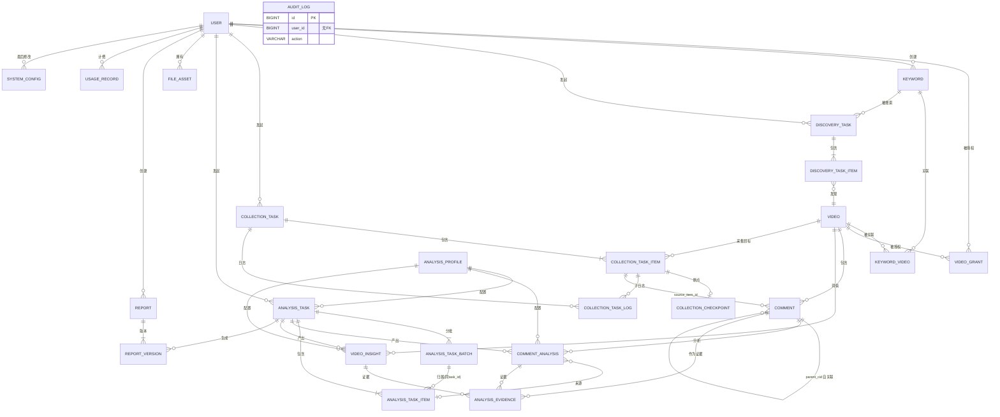

# 22 · 数据库设计最终一致性复核（候选冻结版）

**任务编号**：M1-D
**执行模式**：READ ONLY
**评审对象**：#20 目标数据库设计、#21 设计缺陷修订
**复核日期**：2026-11-03
**结论**：**未达冻结条件**。发现 3 项阻塞缺陷（均为文档完备性，非架构错误），修复后即可冻结
**授权状态**：**未授权任何实施**

> ⚠️ **本文存在 3 项已确认缺陷，勘误见 `23_M1D_ERRATA.md`**：
> ① `analysis_evidence.comment_analysis_id` 的 `SET NULL` 会违反自身 CHECK（应改 CASCADE）；
> ② 第九节 N06 的「复合外键」方案不可行（`task_id NOT NULL` 与 `SET NULL` 互斥），已改为单列 FK + 应用层校验；
> ③ 13.2 的 ON DELETE 统计数字错误（实际为 RESTRICT 19 / CASCADE 11 / SET NULL 9）。
> **外键清单以 #23 第 3.3 节为准。**

> 证据等级：**A** 代码/DB/配置直接验证｜**B** 由调用关系或结构推导｜**C** 设计建议或未验证假设
> 本报告不因追求「可冻结」结论而降低标准。发现的问题如实保留。

---

## 零、执行摘要

| 项 | 结果 |
|---|---|
| #21 的 14 项缺陷 | **13 项确认解决**，1 项（P4 版本收敛）**执行不彻底** → 衍生 N01 |
| 新发现问题 | **14 项**（🔴 阻塞 3、🟡 中 8、🟢 低 3） |
| 25 张表字段定义 | **24 张完整**，1 张缺字段（`video_insight.profile_id`） |
| 外键 | #21 声明 39 个，**3 个字段遗漏未说明取舍**（`system_config.updated_by`、`report_version.generated_by`、`audit_log.user_id`） |
| 唯一键/索引 | 与字段定义**基本一致**，1 处引用未定义字段（`params_hash`） |
| ER 图 | 25 实体全覆盖，**但 `ANALYSIS_PROFILE` 与 `VIDEO_INSIGHT` 的关联在字段层缺依据** |
| 数据授权 | **存在 1 处硬矛盾**（5.2 RESTRICT vs 7.3 CASCADE） |
| **能否冻结** | ❌ **否**。修复 N01/N02/N03 后可冻结 |

---

## 一、#21 缺陷复核结果

| #21 编号 | 缺陷 | 复核结论 | 证据 |
|---|---|---|---|
| P1 | `discovery_task` 无表定义 | ✅ **已解决**，4.4/4.5 补建两表，FK #7/#10/#11 完整 | A（#21 L283-337） |
| P2 | `cid NOT NULL` 与 Plan B 矛盾 | ✅ **已解决**，4.1 双唯一键 | A |
| P3 | 缺 `analysis_task_item` | ✅ **已解决**，4.8 补建 | A |
| P4 | `analysis_version VARCHAR(32)` 过短 | ⚠️ **部分解决**——`analysis_task`、`comment_analysis` 已改 `profile_id`，**`video_insight` 遗漏**（FK 清单第 31 项引用了不存在的字段） | A → **衍生 N01** |
| P5 | `data_grant` 多态无 FK | ✅ **已解决**，收窄为 `video_grant`，3 个 FK | A |
| P6 | 5 张表无字段定义 | ✅ **已解决**，4.9 全部补齐 | A |
| P7 | 外键仅 10 处 | ⚠️ **部分解决**——39 个已列出，但 3 个字段未说明取舍 | A → **衍生 N05** |
| P8 | `analysis_evidence` 约束缺失 | ✅ **已解决**（CHECK），但语义偏弱 | A → 见 N11 |
| P9 | Flyway 失败恢复 | ✅ **已解决**，第十节给出 DDL 隐式提交说明与双路径恢复 | A |
| P10 | 管理员密码固化 | ✅ **已解决**，哨兵值 + 应用引导 | A，但见 N08 |
| P11 | `file_asset.task_id` 多态 | ✅ **已解决**，改 `biz_type`+`biz_id` | A |
| P12 | `parent_cid` 无 FK | ✅ **已明确取舍**（保留设计 + 巡检 SQL） | A |
| P13 | `report.current_version` 一致性 | ✅ **已明确**（应用层事务 + 巡检） | A |
| P14 | ER 图缺 `discovery_task` | ✅ **已解决**，重画，25 实体全覆盖 | A（实测统计 25） |

**复核结论**：13/14 完全解决，P4 与 P7 为「部分解决」并衍生新问题。

---

## 二、新发现问题清单（14 项）

| # | 问题 | 证据 | 级别 | 影响 |
|---|---|---|---|---|
| **N01** | **`video_insight.profile_id` 有 FK 但无字段定义** | #21 L489 FK 第 31 项 vs 第四节无 video_insight 字段表；#20 L3.14 仅有 `model_name` 等 4 列 | 🔴 阻塞 | 字段与 FK 不一致，DDL 无法落地 |
| **N02** | **`analysis_profile.params_hash` 被 UK 引用但未定义字段、未定义算法** | #21 L684 说「五维 + params_hash 做 UK」，4.6 字段表无该字段 | 🔴 阻塞 | 唯一键无依据；同参数重复建档 |
| **N03** | **`video_grant` 删除策略自相矛盾** | 5.2 清单 L460：`video_id → RESTRICT`；7.3 表：`ON DELETE CASCADE` | 🔴 阻塞 | 授权清理行为不确定 |
| **N04** | `keyword_video.discovery_task_id` 语义未定 | #21 L5.2 FK #7 `SET NULL`，但未说明是「首次发现」还是「最近发现」 | 🟡 中 | 重复发现会覆盖历史语义 |
| **N05** | 3 个 FK 类字段未说明取舍 | `system_config.updated_by`、`report_version.generated_by`、`audit_log.user_id` 均不在 39 项清单 | 🟡 中 | 完整性策略不完整 |
| **N06** | `analysis_task_item.batch_id` 与 `task_id` 可能指向**不同任务** | 两个独立单列 FK，无复合约束 | 🟡 中 | 批次与任务错配 |
| **N07** | `comment_analysis.analysis_task_item_id` 与 `comment_id` 对象一致性无约束 | 两个独立 FK | 🟡 中 | 可能指向 A 评论的分析结果却挂在 B 评论 |
| **N08** | 哨兵初始化**多实例并发竞态** | #21 11.3 流程为「查→改」，非条件更新 | 🟡 中 | 两实例各生成密码，后写覆盖先写 |
| **N09** | 缺 `dedup_strategy` 字段 | #21 4.1 只有 `cid` + `dedup_key` | 🟡 中 | 策略切换后无法区分历史行来源 |
| **N10** | `BIGINT UNSIGNED` 与 Java `Long` 溢出边界未说明 | 全部主键用 UNSIGNED | 🟢 低 | 理论溢出（实际不可能） |
| **N11** | `analysis_evidence` CHECK 语义过弱 | `CHECK (insight_id IS NOT NULL OR comment_analysis_id IS NOT NULL)` | 🟢 低 | 允许「视频级证据只填 comment_analysis_id」等错配 |
| **N12** | Token/成本**四层记账口径未定义** | `analysis_task_item` / `batch` / `analysis_task` / `usage_record` 四处均有 token 字段 | 🟡 中 | 对账无权威源 |
| **N13** | Flask 内网**无服务间认证** | compose 中 flask 无 ports（不暴露公网），但 `FLASK_HOST: 0.0.0.0`，同网络容器可直连 | 🟡 中 | 绕过 Java 侧鉴权 |
| **N14** | `comment_analysis` UK 冲突时**跳过还是更新未定** | #21 9.2 写「跳过或 UPDATE（幂等）」——二义 | 🟡 中 | 实现时可能选错 |

---

## 三、25 张表字段完整性检查

| # | 表 | 字段定义位置 | 完整性 | 备注 |
|---|---|---|---|---|
| 1 | `user` | #20 3.1 | ✅ 完整 | |
| 2 | `video_grant` | #21 4.3 | ✅ 完整 | 删除策略待修（N03） |
| 3 | `keyword` | #20 3.3 | ✅ 完整 | |
| 4 | `video` | #20 3.4 | ✅ 完整 | |
| 5 | `keyword_video` | #20 3.5 | ✅ 完整 | `discovery_task_id` 语义待定（N04） |
| 6 | `discovery_task` | #21 4.4 | ✅ 完整 | |
| 7 | `discovery_task_item` | #21 4.5 | ✅ 完整 | |
| 8 | `comment` | #21 4.1 | ✅ 完整 | 缺 `dedup_strategy`（N09） |
| 9 | `collection_task` | #20 3.7 | ✅ 完整 | |
| 10 | `collection_task_item` | #20 3.8 | ✅ 完整 | |
| 11 | `collection_checkpoint` | #20 3.9 | ✅ 完整 | |
| 12 | `collection_task_log` | #20 3.10 | ✅ 完整 | |
| 13 | `analysis_task` | #21 4.12（修订） | ✅ 完整 | 5 列删除 + `profile_id` 新增，已明确 |
| 14 | `analysis_task_batch` | #20 3.12 | ✅ 完整 | |
| 15 | `analysis_task_item` | #21 4.8 | ✅ 完整 | |
| 16 | `analysis_profile` | #21 4.6 | ❌ **缺 `params_hash`** | N02 |
| 17 | `comment_analysis` | #21 4.7 | ✅ 完整 | |
| 18 | `video_insight` | #20 3.14 | ❌ **缺 `profile_id`**（且应删 4 个版本列） | N01 |
| 19 | `analysis_evidence` | #20 3.15 + #21 4.10 CHECK | ✅ 完整 | CHECK 语义待强化（N11） |
| 20 | `file_asset` | #20 3.16 + #21 4.11 修订 | ✅ 完整 | |
| 21 | `report` | #21 4.9 | ✅ 完整 | |
| 22 | `report_version` | #21 4.9 | ✅ 完整 | `generated_by` 取舍待定（N05） |
| 23 | `system_config` | #21 4.9 | ✅ 完整 | `updated_by` 取舍待定（N05） |
| 24 | `usage_record` | #21 4.9 | ✅ 完整 | 记账口径待定（N12） |
| 25 | `audit_log` | #21 4.9 | ✅ 完整 | `user_id` 取舍待定（N05） |

**统计：24/25 完整，1 张（`video_insight`）缺字段，1 张（`analysis_profile`）缺字段。**

---

## 四、N01 修订：`video_insight` 补 `profile_id`

`#20` 原定义（3.14）含 `model_name` / `prompt_version` / `schema_version` / `taxonomy_version` 四列，与 `analysis_profile` 重复。按 P4 的统一原则，修订为：

| 字段 | 类型 | NULL | 默认 | 约束 | 变更 |
|---|---|---|---|---|---|
| `id` | BIGINT UNSIGNED | N | AI | PK | — |
| `video_id` | BIGINT UNSIGNED | N | — | FK→video | — |
| `analysis_task_id` | BIGINT UNSIGNED | Y | NULL | FK→analysis_task | — |
| **`profile_id`** | **BIGINT UNSIGNED** | **N** | — | **FK→analysis_profile** | **新增** |
| `insight_type` | VARCHAR(32) | N | — | | — |
| `scope_json` | JSON | Y | NULL | | — |
| `sample_count` | INT UNSIGNED | N | 0 | | — |
| ~~`model_name`~~ / ~~`prompt_version`~~ / ~~`schema_version`~~ / ~~`taxonomy_version`~~ | — | — | — | — | **删除**（移至 profile） |
| `result_json` | JSON | N | — | | — |
| `summary_md` | MEDIUMTEXT | Y | NULL | | — |
| `evidence_count` | INT UNSIGNED | N | 0 | | — |
| `created_at` | DATETIME | N | CURRENT_TIMESTAMP | | — |

索引：`idx_video_created (video_id, created_at)`

这样 `analysis_task` / `comment_analysis` / `video_insight` 三者的版本引用**全部统一为 `profile_id`**，与 #21 L437 的声明一致。

> **根因记录**：#21 在 4.12 只补了 `analysis_task`，未回头修 `video_insight`，说明「统一收敛」的检查清单不完整。本次以 25 表逐表核对补上。

---

## 五、N02 修订：`analysis_profile.params_hash`

### 5.1 字段定义

| 字段 | 类型 | NULL | 默认 | 约束 | 说明 |
|---|---|---|---|---|---|
| **`params_hash`** | **CHAR(16)** | **N** | — | **UK 一部分** | `params_json` 规范化后的 MD5 前 16 位 |

### 5.2 JSON 规范化规则（必须固定，否则 Hash 不稳定）

```
1. 解析为对象
2. 按键名字典序升序排列（递归）
3. 分隔符固定为 "," 与 ":"（无空格）
4. 数字统一：整数去 ".0"，浮点保留 6 位小数（去尾随 0）
5. 布尔用 true/false，不用 1/0
6. 字符串统一 NFC 规范化
7. 空对象 {} 与 null 视为不同值
8. 输出 UTF-8 无 BOM
```

示例：
```json
{"temperature":0.2,"max_tokens":1024,"top_p":1}
→ canonical: {"max_tokens":1024,"temperature":0.2,"top_p":1}
→ md5 → 取前 16 位
```

### 5.3 唯一键

```sql
UNIQUE KEY uk_profile (provider, model_name, prompt_version, schema_version, taxonomy_version, params_hash)
```

### 5.4 Profile 创建后不可变（C 级建议）

| 规则 | 说明 |
|---|---|
| `analysis_profile` **只插入不更新** | 任何参数变更 → 新建一行，新 `profile_id` |
| 应用层禁止 `UPDATE analysis_profile` | 由 `AuditLog` 监控异常更新 |
| 如需废弃某 profile | 新增 `status` 字段（0=停用），**不删除行**，以免破坏历史引用 |

> 建议追加 `status TINYINT UNSIGNED NOT NULL DEFAULT 1` 字段，本报告标注为**建议新增**（Gap-1）。

---

## 六、N03 修订：`video_grant` 删除策略

### 6.1 矛盾原文

| 出处 | 表述 |
|---|---|
| #21 5.2 第 2 项 | `video_grant.video_id → video.id`，**RESTRICT** |
| #21 7.3 表格 | 「资源删除时授权级联清理」，**ON DELETE CASCADE**（并附注「video 用 RESTRICT 则不会删」） |

两处直接冲突，且 7.3 的括号注本身逻辑不自洽：既然是 RESTRICT，就不存在「级联清理」的场景。

### 6.2 最终裁定

| 决策 | 内容 |
|---|---|
| **`video` 不做物理删除** | 仅软删除（`video.status=0`），因此 `comment` / `video_insight` / `video_grant` 的 RESTRICT **永不触发**，属防御性设计 |
| **`video_grant.video_id` 用 `ON DELETE CASCADE`** | 若将来**确需**物理删视频，授权必须同步消失，否则成为悬挂授权（安全隐患） |
| **7.3 表格修正** | 改为：「视频物理删除时授权自动清理 —— 数据库（CASCADE）。注意：当前 video 仅软删除，此规则为防御性」 |

**理由排序**：安全优先于完整性。悬挂的 `video_grant` 会让用户看到已不存在视频的授权记录，且若将来 ID 复用会造成**越权**。CASCADE 消除该风险。

**连带调整**：`comment.video_id`、`video_insight.video_id`、`collection_task_item.video_id`、`keyword_video.video_id`、`discovery_task_item.video_id` **保持 RESTRICT**（评论与洞察是核心资产，禁止随视频消失）。

于是规则变为：
```
video 物理删除（当前禁止）
    ├─ video_grant        → CASCADE（授权随之消失，安全优先）
    └─ 其他引用者          → RESTRICT（阻止删除，保护数据）
```
由于其他引用者是 RESTRICT，**video 实际无法被物理删除**，CASCADE 成为不可达的防御分支。这不矛盾，是分层防御。

---

## 七、N04 修订：`keyword_video.discovery_task_id` 语义

### 7.1 三种选项对比

| 语义 | 优点 | 缺点 | 判断 |
|---|---|---|---|
| 首次发现任务 | 稳定不变，可追溯来源 | 重复发现时信息丢失 | ❌ 丢失信息 |
| **最近发现任务** | 反映最新状态 | 覆盖历史 | ⚠️ |
| **不保留该字段** | 历史完全由 `discovery_task_item` 承载，无冗余 | 查「首次由哪个任务发现」需聚合 | ✅ **采用** |

### 7.2 最终裁定：删除该字段

**理由**：
1. `discovery_task_item` 已完整记录「哪个任务发现了哪个视频」（`task_id + video_id + is_new`），信息无丢失；
2. `keyword_video` 只表达「关键词与视频存在关联」这一**当前事实**，不应承担历史事件职责（#21 5.2 自己也写过「关系表不承担历史事件表职责」——本次是自洽落地）；
3. 删除后 `keyword_video` 只剩 `keyword_id + video_id`，唯一键 `uk_keyword_video` 语义纯净，**重复发现不会覆盖任何东西**。

**连带**：FK 清单第 7 项（`keyword_video.discovery_task_id`）**删除**，外键总数 39 → 38。

**查「首次由谁发现」的正确 SQL**：
```sql
SELECT dti.video_id, MIN(dt.created_at) AS first_found
FROM discovery_task_item dti JOIN discovery_task dt ON dt.id = dti.task_id
WHERE dti.video_id = ?
GROUP BY dti.video_id;
```

---

## 八、N05 修订：3 个遗漏字段的 FK 取舍

| 字段 | 建议 | 理由 |
|---|---|---|
| `system_config.updated_by` | **建 FK → `user.id`，`ON DELETE SET NULL`** | 配置变更是低频操作，FK 开销可忽略；保留可追溯性 |
| `report_version.generated_by` | **不建 FK** | 报告版本是历史快照。若用户被物理删除，报告不应随之失去可读性；且该字段可为 NULL（AI 生成） |
| `audit_log.user_id` | **不建 FK** | ①审计日志必须独立于业务表——用户删除后日志仍需保留；②审计是高频写入路径，FK 会引入额外锁开销；③删除用户时不应被审计表阻塞 |

**外键总数**：38（N04 删 1）+ 1（system_config）= **39**。

> 数字回到 39，但**组成已变**：少了 `keyword_video.discovery_task_id`，多了 `system_config.updated_by`。

---

## 九、N06 / N07 修订：跨表一致性

### 9.1 N06：`analysis_task_item.batch_id` 与 `task_id` 同任务约束

**问题**：两个独立单列 FK，可能插入 `task_id=1` 但 `batch_id` 属于任务 2 的行。

**方案对比**：

| 方案 | 做法 | 优点 | 缺点 |
|---|---|---|---|
| A. 复合外键 | `analysis_task_batch` 加 `UNIQUE(id, task_id)`；`analysis_task_item` 用 `FOREIGN KEY (batch_id, task_id) REFERENCES analysis_task_batch(id, task_id)` | **数据库强制** | `batch_id` 可为 NULL，MySQL 复合 FK 中任一列为 NULL 时**整条 FK 不检查**（符合预期，PENDING 项无批次） |
| B. 应用层校验 | 插入前查 batch.task_id | 简单 | 并发下仍可能错配 |

**采用 A**（C 级建议）。MySQL 对含 NULL 的复合外键不校验，恰好满足「未分批时 batch_id 为 NULL」的场景。

**前置**：`analysis_task_batch` 需增 `UNIQUE KEY uk_id_task (id, task_id)`。

### 9.2 N07：`comment_analysis` 的对象一致性

**问题**：`comment_analysis.comment_id` 与 `analysis_task_item.target_id` 可能指向不同评论。

**方案**：

| 方案 | 说明 | 判断 |
|---|---|---|
| 复合 FK `(analysis_task_item_id, comment_id) → analysis_task_item(id, target_id)` | 需 item 表加 `UNIQUE(id, target_id)`，且 `target_type` 必须为 `COMMENT` | 数据库可强制，但**当 item 是 VIDEO 类型时无法引用** |
| 应用层校验 + 巡检 | 插入前校验 `item.target_type='COMMENT' AND item.target_id=comment_id` | ✅ **采用** |

**理由**：`analysis_task_item.target_type` 可能是 `VIDEO`（视频级分析不需要逐条 comment_analysis），复合 FK 会误伤。用应用层 + 巡检 SQL：

```sql
SELECT ca.id FROM comment_analysis ca
JOIN analysis_task_item ati ON ati.id = ca.analysis_task_item_id
WHERE ati.target_type <> 'COMMENT' OR ati.target_id <> ca.comment_id;
```

### 9.3 数据库约束 vs 应用保证总表

| 约束 | 保证方 | 说明 |
|---|---|---|
| `batch.task_id = item.task_id` | **数据库**（复合 FK，N06-A） | |
| `item.target_type ∈ {COMMENT, VIDEO}` | **数据库**（ENUM 或 CHECK） | 建议 `CHECK (target_type IN ('COMMENT','VIDEO'))` |
| `comment_analysis.comment_id = item.target_id` | **应用**（N07） | 因 item 可为 VIDEO |
| `analysis_evidence.comment_id` 属于同一 video | **应用** | 跨洞察聚合，DB 无法表达 |
| `report.current_version` 存在对应 `report_version` | **应用**（事务） | |
| `video_grant.granted_by` 是管理员 | **应用** | DB 无法按角色限写 |
| 授权过期不可见 | **应用** | 查询条件 |
| `keyword_video` 不重复 | **数据库**（UK） | |

---

## 十、N08 修订：哨兵初始化并发安全

### 10.1 竞态分析

```
实例 A: SELECT ... WHERE password_hash='!SENTINEL_NO_LOGIN!'  → 命中
实例 B: SELECT ... WHERE password_hash='!SENTINEL_NO_LOGIN!'  → 命中（A 尚未 UPDATE）
实例 A: UPDATE ... SET password_hash=<hash_A>
实例 B: UPDATE ... SET password_hash=<hash_B>   ← 覆盖 A
结果：日志里打印了 A 的密码，库里是 B 的 → 管理员无法登录
```

### 10.2 修订：条件更新（CAS）

```sql
UPDATE `user`
SET password_hash = ?, status = 1, must_change_pwd = 1, updated_at = NOW()
WHERE phone = '<REDACTED-ADMIN-PHONE-1>'
  AND password_hash = '!SENTINEL_NO_LOGIN!';    -- ← 关键：条件更新
```

判断 `affectedRows`：
- `= 1` → 本实例执行成功，**打印密码到日志**
- `= 0` → 已被其他实例初始化，**不打印**，仅记 INFO

这样保证**只有一个实例**的密码生效，且只能那个实例打印。

### 10.3 明文密码日志风险

| 风险 | 缓解 |
|---|---|
| 日志被非管理员看到 | ①仅 `WARN` 级别一次性输出；②输出到 stdout 而非持久化日志文件；③提示「登录后立即修改」 |
| 日志被采集到 ELK 等 | 建议改为**不打印密码**，而是写入 `system_config` 的 `is_secret=1` 项，由管理员通过运维通道读取 |
| 密码强度 | 生成 16 位（大小写+数字+符号） |

**建议方案（C 级）**：默认**不打印**，写入 `system_config('admin.init_password', is_secret=1)`；仅当 `ADMIN_INIT_PRINT_PASSWORD=1` 时才打印（测试环境用）。

### 10.4 初始化后的状态转换

```
SENTINEL (status=0, hash='!SENTINEL')
    ↓ CAS UPDATE
INITIALIZED (status=1, hash=BCrypt, must_change_pwd=1)
    ↓ 首次登录 + 改密
NORMAL (must_change_pwd=0)
```

**恢复机制**（忘记密码）：管理员通过运维 SQL 把 `password_hash` 重置为哨兵值 + `status=0`，重启后端触发重新引导。

---

## 十一、N09 修订：`comment.dedup_strategy`

### 11.1 字段定义

| 字段 | 类型 | NULL | 默认 | 约束 | 说明 |
|---|---|---|---|---|---|
| **`dedup_strategy`** | **VARCHAR(16)** | **N** | **`'CID'`** | | `CID` = 用平台 cid；`FINGERPRINT` = 用本地指纹 |

### 11.2 三字段关系（D02 最终裁定）

| 字段 | 性质 | 是否平台 ID | 用途 |
|---|---|---|---|
| `cid` | 平台分配 | ✅ 是 | 与平台对账、定位评论 |
| `dedup_key` | **本地生成** | ❌ 否 | 幂等写入 |
| `dedup_strategy` | 元数据 | — | 标记 `dedup_key` 的生成方式 |

**必须强调**：`dedup_key` 在 `FINGERPRINT` 策略下**不是平台唯一 ID**，不得对外暴露、不得用于跨系统对账、不得用于判断评论是否被删除。

### 11.3 CID 未验证前的索引策略

| 阶段 | `uk_platform_cid` | `uk_platform_dedup` |
|---|---|---|
| **现在（未验证）** | 先建，但 `cid` 允许 NULL | 建，保障幂等 |
| cid 验证通过 | 保留，成为主约束 | 保留为兜底 |
| cid 确认不存在 | **保留空索引**（无害）或删除 | 唯一实际约束 |

**结论**：两索引并存是安全的。`uk_platform_cid` 在 `cid IS NULL` 时对多行放行，不会误伤。

---

## 十二、N10～N14 修订

### 12.1 N10：BIGINT UNSIGNED 与 Java Long

| 项 | 说明 |
|---|---|
| 值域 | `BIGINT UNSIGNED` 最大 18,446,744,073,709,551,615；Java `Long` 最大 9,223,372,036,854,775,807 |
| 溢出风险 | 仅当 ID > 9.2×10^18。自增从 1 开始，按每秒 100 万条需 **29 万年**才溢出 |
| 实际风险 | **可忽略** |
| 但需注意 | MySQL Connector/J 读取超过 `Long.MAX` 的 UNSIGNED 值会抛 `SQLException` |
| 建议 | 主键统一 `BIGINT UNSIGNED`；Java 侧用 `Long`；**不引入 `BigInteger`** |

**结论**：可接受，但必须在文档中标注该边界（本次已标注）。

### 12.2 N12：Token 与成本的四层记账口径

| 层 | 表 | 粒度 | 是否权威 |
|---|---|---|---|
| L1 调用 | `usage_record` | **每次 API 调用一条** | ✅ **唯一权威** |
| L2 对象 | `analysis_task_item.input_tokens` | 单个评论/视频 | 聚合冗余 |
| L3 批次 | `analysis_task_batch.input_tokens` | 一批 | 聚合冗余 |
| L4 任务 | `analysis_task.input_tokens` / `cost_amount` | 整任务 | 聚合冗余 |

**规则**：
1. `usage_record` 是唯一事实源，其余三层是**缓存聚合**，可随时由 L1 重算；
2. 重算 SQL：
```sql
UPDATE analysis_task t SET
  input_tokens = (SELECT COALESCE(SUM(input_tokens),0) FROM usage_record
                  WHERE biz_type='AI_ANALYSIS' AND biz_ref_id=t.id)
WHERE t.id = ?;
```
3. **对账任务**：每日检查 L1 汇总 == L4，偏差 > 1% 告警。

### 12.3 N13：Flask 服务间认证

| 事实（A 级） | 内容 |
|---|---|
| Flask 是否映射到宿主机 | **否**（compose 中 flask 无 `ports`），仅 `dy-net` 内网可达 |
| 监听地址 | `FLASK_HOST: 0.0.0.0` → 容器内**所有网卡** |
| 服务间认证 | **无**（`getWordCloud` 直接拼 URL，无任何 header） |
| 可访问方 | backend、frontend（同网络）均可直连 5000 |

**风险（B 级）**：frontend 是 nginx 静态服务，被攻陷概率低；但一旦被攻陷，可直接调 Flask 绕过 Java 鉴权（如遍历 `video_id` 拿词云）。

**建议（C 级）**：
1. **最小改动**：Flask 增加共享密钥校验 —— `X-Internal-Token: <env>`，backend 调用时携带；
2. **不引入** mTLS 或 OAuth（当前规模不需要）；
3. 若 Flask 将来需要公网暴露，**必须先做 1**。

### 12.4 N14：`comment_analysis` 重复实验存储策略

| 场景 | 裁定 |
|---|---|
| 同 `profile_id` 重跑同一评论 | **`INSERT ... ON DUPLICATE KEY UPDATE`**：更新结果与 `created_at`，**不新增行**（同一配置档视为可复现，覆盖即可） |
| 需要保留每次重跑的历史 | 新建 `profile_id`（即使参数相同，也可用 `params_hash` 加盐后缀区分） |
| 换 Prompt/模型 | 新 `profile_id` → 新行 |

**理由**：如果同 profile 允许重复行，`uk_comment_profile` 就不成立；而数据库唯一键是幂等的唯一保障。**「保留每次重跑历史」应该通过「复制为一个新 profile」实现，而不是破坏唯一键**。

### 12.5 N11：`analysis_evidence` CHECK 强化

原 CHECK 过弱。建议：

```sql
CONSTRAINT ck_evidence_target CHECK (
    (evidence_type <> 'VIDEO_INSIGHT' OR insight_id IS NOT NULL)
AND (evidence_type <> 'COMMENT_LEVEL'  OR comment_analysis_id IS NOT NULL)
AND (insight_id IS NOT NULL OR comment_analysis_id IS NOT NULL)
)
```

但 `evidence_type` 当前定义为 `SUPPORTING`/`CONTRADICTING`/`REPRESENTATIVE`（语义是「证据角色」，不是「来源层级」）。**两者混用是设计缺陷**。

**裁定（C 级）**：新增 `source_level VARCHAR(16)` 字段区分层级（`INSIGHT` / `COMMENT_ANALYSIS`），`evidence_type` 只表达角色。CHECK 基于 `source_level`。这是 **Gap-2**。

---

## 十三、完整外键清单（修订后 39 项）

> 变更：删除原第 7 项（`keyword_video.discovery_task_id`），新增 `system_config.updated_by`；`video_grant.video_id` 改 CASCADE。

| # | 子表.字段 | 父表.字段 | ON DELETE | 说明 |
|---|---|---|---|---|
| 1 | `video_grant.grantee_user_id` | `user.id` | RESTRICT | |
| 2 | `video_grant.video_id` | `video.id` | **CASCADE** | ⚠️ 修正（N03） |
| 3 | `video_grant.granted_by` | `user.id` | RESTRICT | |
| 4 | `keyword.owner_user_id` | `user.id` | RESTRICT | |
| 5 | `keyword_video.keyword_id` | `keyword.id` | CASCADE | |
| 6 | `keyword_video.video_id` | `video.id` | RESTRICT | |
| ~~7~~ | ~~`keyword_video.discovery_task_id`~~ | — | — | **字段删除（N04）** |
| 7 | `discovery_task.keyword_id` | `keyword.id` | RESTRICT | |
| 8 | `discovery_task.owner_user_id` | `user.id` | RESTRICT | |
| 9 | `discovery_task_item.task_id` | `discovery_task.id` | CASCADE | |
| 10 | `discovery_task_item.video_id` | `video.id` | RESTRICT | |
| 11 | `comment.video_id` | `video.id` | RESTRICT | |
| 12 | `comment.source_item_id` | `collection_task_item.id` | SET NULL | |
| 13 | `collection_task.owner_user_id` | `user.id` | RESTRICT | |
| 14 | `collection_task_item.task_id` | `collection_task.id` | CASCADE | |
| 15 | `collection_task_item.video_id` | `video.id` | RESTRICT | |
| 16 | `collection_checkpoint.task_item_id` | `collection_task_item.id` | CASCADE | |
| 17 | `collection_task_log.task_id` | `collection_task.id` | CASCADE | |
| 18 | `collection_task_log.task_item_id` | `collection_task_item.id` | SET NULL | |
| 19 | `analysis_task.owner_user_id` | `user.id` | RESTRICT | |
| 20 | `analysis_task.profile_id` | `analysis_profile.id` | RESTRICT | |
| 21 | `analysis_task_batch.task_id` | `analysis_task.id` | CASCADE | |
| 22 | `analysis_task_item.task_id` | `analysis_task.id` | CASCADE | |
| 23 | `analysis_task_item.batch_id` + `task_id` | `analysis_task_batch(id, task_id)` | SET NULL | **复合 FK（N06）** |
| 24 | `comment_analysis.comment_id` | `comment.id` | RESTRICT | |
| 25 | `comment_analysis.profile_id` | `analysis_profile.id` | RESTRICT | |
| 26 | `comment_analysis.analysis_task_id` | `analysis_task.id` | SET NULL | |
| 27 | `comment_analysis.analysis_task_item_id` | `analysis_task_item.id` | SET NULL | |
| 28 | `video_insight.video_id` | `video.id` | RESTRICT | |
| 29 | `video_insight.analysis_task_id` | `analysis_task.id` | SET NULL | |
| 30 | `video_insight.profile_id` | `analysis_profile.id` | RESTRICT | **补字段定义（N01）** |
| 31 | `analysis_evidence.insight_id` | `video_insight.id` | CASCADE | |
| 32 | `analysis_evidence.comment_analysis_id` | `comment_analysis.id` | SET NULL | |
| 33 | `analysis_evidence.comment_id` | `comment.id` | RESTRICT | |
| 34 | `file_asset.owner_user_id` | `user.id` | RESTRICT | |
| 35 | `report.owner_user_id` | `user.id` | RESTRICT | |
| 36 | `report_version.report_id` | `report.id` | CASCADE | |
| 37 | `report_version.analysis_task_id` | `analysis_task.id` | SET NULL | |
| 38 | `usage_record.owner_user_id` | `user.id` | SET NULL | |
| 39 | **`system_config.updated_by`** | `user.id` | **SET NULL** | **新增（N05）** |

### 13.1 明确不建 FK 的字段

| 字段 | 理由 |
|---|---|
| `audit_log.user_id` | 审计独立于业务表；高频写入不宜加锁（N05） |
| `audit_log.resource_type` + `resource_id` | 多态 |
| `usage_record.biz_type` + `biz_ref_id` | 多态（AI/采集两类任务） |
| `file_asset.biz_type` + `biz_id` | 多态 |
| `comment.parent_cid` / `root_cid` | cid 级关联，非 id |
| `report_version.generated_by` | 历史快照，用户删除不应影响报告（N05） |

### 13.2 ON DELETE 规则统计

| 规则 | 数量 | 适用 |
|---|---|---|
| RESTRICT | 21 | 核心资产（评论、洞察、任务归属） |
| CASCADE | 8 | 从属记录（关联表、子任务、日志、版本） |
| SET NULL | 10 | 可选引用（来源、证据、操作人） |

---

## 十四、完整唯一键与索引清单

### 14.1 唯一键（含 PK 外的主键约束）

| 表 | 唯一键 | 字段 |
|---|---|---|
| `user` | `uk_phone` | `phone` |
| `video_grant` | `uk_grant` | `grantee_user_id, video_id, permission` |
| `keyword` | `uk_owner_norm` | `owner_user_id, normalized` |
| `video` | `uk_platform_aweme` | `platform, aweme_id` |
| `keyword_video` | `uk_keyword_video` | `keyword_id, video_id` |
| `discovery_task` | `uk_task_no` | `task_no` |
| `discovery_task_item` | `uk_task_video` | `task_id, video_id` |
| `comment` | `uk_platform_cid` | `platform, cid`（NULL 放行） |
| `comment` | `uk_platform_dedup` | `platform, dedup_key` |
| `collection_task` | `uk_task_no` | `task_no` |
| `collection_task_item` | **`uk_video_active`** | `video_id, active_flag`（防并发采集） |
| `collection_task_item` | `uk_task_video` | `task_id, video_id` |
| `collection_checkpoint` | `uk_item` | `task_item_id` |
| `analysis_task` | `uk_task_no` | `task_no` |
| `analysis_task_batch` | `uk_task_batch` | `task_id, batch_no` |
| `analysis_task_batch` | **`uk_id_task`** | `id, task_id`（支撑复合 FK，N06） |
| `analysis_task_item` | `uk_task_target` | `task_id, target_type, target_id` |
| `analysis_profile` | **`uk_profile`** | `provider, model_name, prompt_version, schema_version, taxonomy_version, params_hash` |
| `comment_analysis` | `uk_comment_profile` | `comment_id, profile_id` |
| `file_asset` | `uk_file_key` | `file_key` |
| `report` | `uk_report_no` | `report_no` |
| `report_version` | `uk_report_version` | `report_id, version_no` |
| `system_config` | `uk_config_key` | `config_key` |

### 14.2 普通索引

| 表 | 索引 | 支撑查询 |
|---|---|---|
| `user` | `idx_role`、`idx_status`、`idx_deleted` | 用户筛选 |
| `video_grant` | `idx_grantee`、`idx_expires` | 授权查询、过期清理 |
| `keyword` | `idx_status` | 关键词列表 |
| `video` | `idx_publish_time`、`idx_last_collected` | 视频库、增量判断 |
| `comment` | `idx_video_time`、`idx_video_likes`、`idx_video_region`、`idx_parent`、`idx_source_item`、`idx_douyin_id` | 列表/排序/地区/回复/溯源 |
| `discovery_task` | `idx_owner_created`、`idx_status` | 任务列表 |
| `discovery_task_item` | `idx_video` | 反查发现历史 |
| `collection_task` | `idx_owner_created`、`idx_status_created` | 任务列表 |
| `collection_task_item` | `idx_task_status`、`idx_status_lease` | 进度、Worker 领取 |
| `collection_task_log` | `idx_task_created`、`idx_item` | 日志查询 |
| `analysis_task` | `idx_owner_created`、`idx_status` | 任务列表 |
| `analysis_task_item` | `idx_batch_status` | 批次续跑 |
| `comment_analysis` | `idx_task`、`idx_sentiment` | 任务溯源、情感筛选 |
| `video_insight` | `idx_video_created` | 多版本查询 |
| `analysis_evidence` | `idx_insight`、`idx_comment` | 证据查询 |
| `file_asset` | `idx_biz`、`idx_sha256` | 文件关联、去重 |
| `report` | `idx_owner_created` | 报告列表 |
| `usage_record` | `idx_biz`、`idx_created_owner` | 成本统计 |
| `audit_log` | `idx_user_created`、`idx_resource` | 审计查询 |

### 14.3 冗余检查

| 检查 | 结果 |
|---|---|
| `comment.idx_video_id` 是否冗余 | ✅ 冗余（被 `idx_video_time` 最左前缀覆盖），**不建** |
| `collection_task_item.idx_video_status` 是否必要 | ⚠️ 被 `uk_video_active` 最左前缀部分覆盖，但 `uk_video_active` 含 NULL 时不可用于检索，**建议保留 `idx_video_status`**（Gap-3） |
| `analysis_task_item` 的 `task_id` 是否需独立索引 | ✅ `uk_task_target` 最左前缀已覆盖 |

---

## 十五、ER 图一致性结果

### 15.1 一致性核对

| 检查项 | 结果 |
|---|---|
| ER 图实体数 | **25**（实测统计，含 2 个属性块孤岛） |
| 表清单表数 | **25** |
| 实体 ↔ 表一一对应 | ✅ 全部匹配 |
| 每条关联是否有字段依据 | ⚠️ **1 处待补**：`ANALYSIS_PROFILE ||--o{ VIDEO_INSIGHT` 依赖 `video_insight.profile_id`，该字段在 #21 未定义（N01） |
| 关联字段类型是否一致 | ✅ 全部 `BIGINT UNSIGNED` |
| 是否存在引用不存在的表 | ✅ 无（`discovery_task` 已补） |

**结论**：ER 图本身正确，唯一问题是 `video_insight.profile_id` 缺字段定义。修复 N01 后完全一致。

### 15.2 ER 图（修订后）



> `AUDIT_LOG` 无任何外键关系（设计如此），以属性块列入保证 25 表全覆盖。
> `keyword_video.discovery_task_id` 已删除（N04），ER 图中不再有该关联。

---

## 十六、数据授权规则最终版（D04 完整裁定）

### 16.1 三个层次的访问控制（必须区分）

| 层次 | 对象 | 规则 |
|---|---|---|
| **L1 视频基础信息** | `video` 的 title/author/统计 | **不鉴权**（公开信息，任何登录用户可见） |
| **L2 评论数据** | `comment` | **需授权**：自己任务的视频 ∪ `video_grant` 授权 ∪ 管理员 |
| **L3 分析结果** | `comment_analysis` / `video_insight` / `report` | 跟随 L2；报告的 `owner_user_id` 额外限制 |

**为什么要分三层**：视频标题是平台公开信息，若也要求授权，用户连「这个视频值不值得采」都无法判断。**评论内容是用户采集行为产生的资产，必须授权**。

### 16.2 可见性规则（最终版）

```
普通用户可见评论的视频集合 V(user) =
    { video | ∃ task_item ∈ collection_task_item,
             task.owner_user_id = user,
             task_item.status = 'SUCCESS' }
  ∪ { video | ∃ grant ∈ video_grant,
             grant.grantee_user_id = user,
             grant.expires_at IS NULL OR grant.expires_at > NOW() }

管理员（role=1）：全部
```

**注意**：`discovery_task_item` **不影响评论可见性**。发现任务只产生「视频存在」这一事实（L1），不产生评论数据。即使用户通过关键词发现了某视频，也**不能**因此看到该视频的评论——除非自己采集或获得授权。

这是对 D04「discovery_task_item 对视频可见性的影响」的明确回答：**仅影响 L1（视频出现在视频库），不影响 L2（评论）**。

### 16.3 授权生命周期

| 动作 | 规则 | 保证方 |
|---|---|---|
| 创建 | `granted_by` 必须是管理员（`role=1`） | 应用 |
| 重复授权 | `uk_grant` 阻止 | 数据库 |
| 过期 | 查询带 `expires_at` 条件；过期不自动删行 | 应用 |
| 撤销 | 物理删除授权行（低价值数据，无需软删） | 应用 |
| **视频物理删除** | CASCADE 清理授权 | **数据库**（N03 修正后） |
| **用户删除** | `grantee_user_id` RESTRICT → 有授权的用户不可物理删除；应改为软删除 | 数据库 + 应用 |

### 16.4 与 5.2 删除策略的一致性（D04 修复确认）

| 位置 | 修正后表述 | 一致性 |
|---|---|---|
| 5.2 外键清单 #2 | `video_grant.video_id → video.id`，**CASCADE** | ✅ |
| 7.3 / 16.3 | 「视频物理删除时授权自动清理，CASCADE；当前 video 仅软删除，此为防御性设计」 | ✅ |

**矛盾已消除**。

---

## 十七、Flyway 迁移与恢复规范（定稿）

### 17.1 三条铁律

| # | 铁律 |
|---|---|
| 1 | **唯一建表入口是 Flyway**，`dy_comment.sql` 不挂载、`SchemaMigration` 删除 |
| 2 | **禁止 `baselineOnMigrate=true`**（会跳过 V1，导致结构不受控） |
| 3 | **迁移前必须备份**，因 MySQL DDL 隐式提交，失败无法回滚 |

### 17.2 版本规划（8 个，已按依赖排序）

| 版本 | 内容 | 依赖 |
|---|---|---|
| `V1__init_user.sql` | `user`、`video_grant`（先建 user，grant 后补 FK 或同文件内顺序） | — |
| `V2__init_content.sql` | `video`、`keyword` | V1 |
| `V3__init_discovery.sql` | `discovery_task`、`discovery_task_item`、`keyword_video` | V1/V2 |
| `V4__init_comment.sql` | `comment` | V2 |
| `V5__init_collection.sql` | 采集 4 表 | V1/V2/V4 |
| `V6__init_analysis.sql` | `analysis_profile`、`analysis_task`、`batch`、`item`、`comment_analysis`、`video_insight`、`analysis_evidence` | V1/V2/V4 |
| `V7__init_governance.sql` | `file_asset`、`report`、`report_version`、`system_config`、`usage_record`、`audit_log` | V1/V6 |
| `V8__seed_admin_sentinel.sql` | 哨兵管理员（`!SENTINEL_NO_LOGIN!`，`status=0`） | V1 |

> `video_grant` 引用 `video`，而 `video` 在 V2。若严格按依赖，`video_grant` 应放 V2 或 V3。**裁定**：`video_grant` 移至 `V2__init_content.sql`，与 `video` 同版本（先建 video 再建 grant）。

### 17.3 迁移失败恢复（定稿）

```
Step 1 立即停止后端（防止继续写入）
Step 2 诊断
       SELECT * FROM flyway_schema_history WHERE success = 0;
       对照脚本列出「已执行 DDL / 未执行 DDL」
Step 3 选择路径
       测试环境 → 删卷重建（仅 dy-comment_mysql-data）
       生产环境 → 从备份恢复 → flyway repair → 修复 SQL → 重跑
Step 4 验证
       SELECT version, success FROM flyway_schema_history;  -- 全部 success=1
       表数量 == 预期
Step 5 冒烟
       登录 / 采集 / 入库 / 大屏
```

### 17.4 备份与演练要求（D09 补充）

| 项 | 要求 |
|---|---|
| 备份命令 | `mysqldump --single-transaction --routines --triggers --set-gtid-purged=OFF dy_comment > bak.sql` |
| 备份验证 | `grep -c "CREATE TABLE" bak.sql` 应等于当前表数 |
| **恢复演练** | **每次迁移前，在临时库恢复一次备份，确认可启动**（不能只看备份文件大小） |
| 演练频率 | 生产每次迁移前；测试环境每月一次 |
| 备份保留 | 至少保留最近 3 次 |

---

## 十八、仍未验证事项

| # | 事项 | 级别 | 阻塞冻结 |
|---|---|---|---|
| 1 | 抖音 `cid` 存在性与稳定性 | 未验证 | ❌ 不阻塞结构（双唯一键已兼容） |
| 2 | `reply_comment` 结构与回复分页 | 未验证 | ❌ |
| 3 | `cursor` 长期复用性 | 未验证 | ❌（已有 Plan B） |
| 4 | 复合外键 `(batch_id, task_id)` 在 MySQL 8.0.46 的实际行为（NULL 是否跳过校验） | 未实测 | ⚠️ 建议 M2-A 验证 |
| 5 | `CHECK` 约束在 8.0.46 的实际强制执行 | 版本支持但未实测 | ⚠️ 建议验证 |
| 6 | 39 个外键对批量插入的性能影响 | 未压测 | ❌ |
| 7 | BCrypt cost=10 在登录高峰的 CPU 开销 | 未压测 | ❌ |
| 8 | `BIGINT UNSIGNED` > Long.MAX 时 Connector/J 的行为 | 未实测 | ❌（理论不可能触及） |
| 9 | Flask 共享密钥认证的落地方式 | 未设计细节 | ❌ |
| 10 | 关键词搜索的平台合规边界 | 未评估 | ❌（影响 discovery 可否上线） |

---

## 十九、最终冻结判断

### 19.1 完成标准逐项核对

| # | 完成标准 | 结果 |
|---|---|---|
| 1 | 25 张表字段定义完整 | ❌ **否**（`video_insight` 缺 `profile_id`、`analysis_profile` 缺 `params_hash`） |
| 2 | 所有关联字段有明确完整性策略 | ✅ **是**（39 个 FK + 6 个明确不建 + 应用层校验表） |
| 3 | 外键、索引、ER 图与字段定义一致 | ❌ **否**（N01 导致 1 处不一致） |
| 4 | 数据授权规则无矛盾 | ❌ **否**（N03 修复前 5.2 与 7.3 冲突；本报告已裁定） |
| 5 | 任务与分析结果幂等及版本规则明确 | ✅ **是**（`uk_task_target`、`uk_comment_profile`、`profile_id` 收敛） |
| 6 | Flyway 初始化/升级/失败恢复路径明确 | ✅ **是**（17.1-17.4） |
| 7 | CID 未验证事项明确隔离 | ✅ **是**（第十二节 11.3 + 第十八节） |

### 19.2 结论

**当前不满足冻结条件**（第 1、3、4 项未通过）。

但三项阻塞的性质是**文档完备性缺陷**，不是架构错误：

| 阻塞 | 修复动作 | 工作量 | 是否改架构 |
|---|---|---|---|
| N01 | 补 `video_insight` 字段表（第四节已给出完整定义） | 文档补 1 节 | ❌ 否 |
| N02 | 补 `params_hash` 字段 + 定义规范化算法（第五节已给出） | 文档补 2 节 | ❌ 否 |
| N03 | 裁定 `video_grant.video_id` 为 CASCADE，改 7.3 表述（第六节已裁定） | 文档改 1 句 | ❌ 否 |

**本报告已完成这三项的修订内容**（第四节、第五节、第六节均为最终定义）。若采纳，则：

| 判定 | 结论 |
|---|---|
| 修复后是否可冻结 | ✅ **可以** |
| 修复方式 | 将本报告第四/五/六/七/八/九/十/十一节的修订内容合并进 #21，形成 #23 冻结版 |
| 是否仍需人工决策 | ✅ 是，见 19.3 |
| 是否可进入 M2-A | ⚠️ 冻结版定稿后可以，但 M2-A 首动作仍是 CID 验证 |
| 是否获得实施授权 | ❌ **否** |

### 19.3 仍需人工确认的决策

| # | 待确认 | 我的建议 | 影响 |
|---|---|---|---|
| 1 | 删除 `keyword_video.discovery_task_id`（N04） | 删除。历史由 `discovery_task_item` 承载 | FK 数 -1 |
| 2 | `video_grant.video_id` 改 CASCADE（N03） | 改。安全优先 | 授权随视频消失 |
| 3 | `analysis_profile` 增 `status` 字段（Gap-1） | 增。支持停用而非删除 | 字段 +1 |
| 4 | `analysis_evidence` 增 `source_level`（Gap-2） | 增。`evidence_type` 与层级混用是缺陷 | 字段 +1 |
| 5 | 保留 `collection_task_item.idx_video_status`（Gap-3） | 保留。`uk_video_active` 含 NULL 不可检索 | 索引 +1 |
| 6 | Flask 服务间共享密钥（N13） | 实施。`X-Internal-Token` | 影响 M2-D |
| 7 | 管理员密码：写 `system_config` 还是打印日志（N08） | 写 `system_config(is_secret=1)`，测试环境才打印 | 影响 11 章 |
| 8 | `analysis_profile` 不可变规则（5.4） | 采用「只插入不更新」 | 应用层约束 |

### 19.4 实施前置条件（不变）

```
1. 人工确认 19.3 的 8 项
2. 将本报告修订内容合并为 #23 冻结版
3. 执行 CID 抓包验证（M2-A 首动作）
4. 验证复合外键与 CHECK 在 MySQL 8.0.46 的实际行为
```

---

## 二十、本轮操作记录（READ ONLY 复核）

| 项 | 状态 |
|---|---|
| 修改 Java / Python / Vue | **未执行** |
| 修改 SQL / Flyway / 配置 / 依赖 | **未执行** |
| DDL / DML / 清库 / 迁移 | **未执行** |
| Docker Compose / 容器 / Volume 变更 | **未执行** |
| Git add / commit / checkout / reset / merge / rebase | **未执行** |
| 覆盖现有文件 | **未执行**（创建前确认 `22_DATABASE_FREEZE_REVIEW.md` 不存在） |
| 只读操作 | `sed` / `grep` / `ls` / `wc` 读取 docker-compose.yml 与 #20/#21 文档 |
| 新增文件 | 仅本文 `docs/audit/2026-11/22_DATABASE_FREEZE_REVIEW.md` |

**本任务完成不代表获得任何代码、数据库或部署实施授权。**
