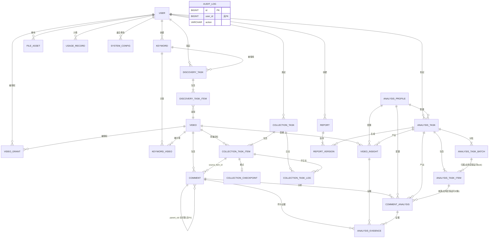

# 24 · 数据库设计冻结候选版 V1.0

**任务编号**：M1-E
**执行模式**：READ ONLY
**生成日期**：2026-11-03
**文档性质**：唯一冻结候选版（替代 #20～#23 作为设计与实施依据）
**审查结论**：**通过冻结候选审查**
**授权状态**：**未授权任何实施**

> 通过候选审查 ≠ 正式冻结 ≠ 获得实施授权。
> 正式冻结需用户确认第十三节的 8 项待确认事项；实施需另行授权。

---

## 零、文档状态与来源优先级

### 0.1 来源优先级

```
#23（已确认勘误） > #22（最终复核） > #21（缺陷修订） > #20（原始设计）
```

冲突时按此顺序取值。本文已将四份文档的有效结论合并，**不再存在新旧方案混用**。

### 0.2 合并结果概览

| 项 | 数值 | 来源 |
|---|---|---|
| 表数量 | **25** | #20 (21) + #21 (+4) |
| 外键 | **39** | #23 第 3.3 节（最终） |
| 外键分布 | RESTRICT **19** / CASCADE **11** / SET NULL **9** | #23 第 3.2 节 |
| 唯一键 | 24 个（含 PK） | 本文第四节 |
| CHECK 约束 | **6** 个 | 本文第六节 |
| ER 实体 | 25（全覆盖） | 本文第八节 |

### 0.3 本文对前序文档的实质变更（3 处）

| # | 变更 | 依据 |
|---|---|---|
| 1 | `params_hash` **CHAR(16) → CHAR(32)** | 碰撞后果是「不同参数被判为同一 profile」导致分析结果混用；CHAR(32) 成本为零（profile 表规模 < 1000 行，增 < 16KB），故取全 MD5 |
| 2 | 管理员初始化方案由「写 `system_config(is_secret=1)`」**降级**为「不落库」 | `is_secret=1` 仅控制 API 脱敏，**不是存储加密**（见 11.5） |
| 3 | 补齐 6 个 CHECK 约束 | #21/#22 仅提及 1 个，实际需要 6 个 |

---

## 一、裁定摘要

### 1.1 已确认裁定（14 项，本文直接采用）

| # | 裁定 | 出处 |
|---|---|---|
| R1 | 表数量 25，`analysis_result` 不进入目标模型 | #20/#21 |
| R2 | `comment` 双唯一键：`uk_platform_cid` + `uk_platform_dedup` | #21 4.1 |
| R3 | `cid` 允许 NULL，`dedup_key` 恒非空 | #21 4.1 |
| R4 | 新增 `dedup_strategy` 区分 CID / FINGERPRINT | #22 十一 |
| R5 | `keyword_video` **删除** `discovery_task_id` | #22 七 |
| R6 | `video_grant.video_id` 用 **CASCADE** | #22 六 |
| R7 | `analysis_task_item.batch_id` 为**单列** FK + SET NULL（非复合） | #23 二 |
| R8 | `analysis_evidence.comment_analysis_id` 用 **CASCADE** | #23 一 |
| R9 | `analysis_task` / `comment_analysis` / `video_insight` 统一引用 `profile_id` | #21 4.12 + #22 四 |
| R10 | 版本四维收敛到 `analysis_profile`，不拼接字符串 | #21 4.6 |
| R11 | `analysis_task_item` 提供对象级状态与单条成本 | #21 4.8 |
| R12 | `user` 仅 BCrypt，移除 MD5 兼容 | ADR-005 |
| R13 | 授权三层：L1 视频信息不鉴权 / L2 评论需授权 / L3 分析跟随 L2 | #22 十六 |
| R14 | Flyway 为唯一建表入口，禁 `baselineOnMigrate` | ADR-001 |

### 1.2 待用户确认（8 项，本文保留待确认状态）

| # | 事项 | 当前状态 | 建议 |
|---|---|---|---|
| U1 | 删除 `keyword_video.discovery_task_id` | 已按 R5 删除 | 采纳 |
| U2 | `video_grant.video_id` CASCADE | 已按 R6 设定 | 采纳 |
| U3 | `analysis_profile.status` 字段 | **未加入**（本文不含） | 建议增 |
| U4 | `analysis_evidence.source_level` 字段 | **未加入**（本文不含） | 建议增 |
| U5 | `collection_task_item.idx_video_status` 索引 | **未加入**（本文不含） | 建议增 |
| U6 | Flask `X-Internal-Token` 服务间认证 | **未实施**（仅建议） | 建议实施 |
| U7 | 管理员初始密码交付方式 | **待定**（本文给 3 方案） | 方案 A |
| U8 | `analysis_profile` 只插入不更新 | **未强制**（依赖应用层） | 采纳 |

> U3/U4/U5 未加入本文的字段/索引清单，以免擅自替用户决定。

### 1.3 未验证事项

见第十二节（13 项）。

---

## 二、25 张表完整字段定义

> **统一约定**：`ENGINE=InnoDB DEFAULT CHARSET=utf8mb4 COLLATE=utf8mb4_0900_ai_ci`
> **主键**：除另有说明外，均为 `BIGINT UNSIGNED NOT NULL AUTO_INCREMENT`
> **时间**：统一 `DATETIME`（非 TIMESTAMP）；`created_at` 默认 `CURRENT_TIMESTAMP`
> **计数**：`INT UNSIGNED` 或 `BIGINT UNSIGNED`；**金额**：`DECIMAL(12,6)`
> **NULL 列含义**：N=NOT NULL，Y=NULL 允许
> 缩写：`AI`=AUTO_INCREMENT，`CT`=CURRENT_TIMESTAMP，`OU`=ON UPDATE CURRENT_TIMESTAMP

### 2.1 `user` — 系统用户

| 字段 | 类型 | NULL | 默认 | 键/约束 | 说明 |
|---|---|---|---|---|---|
| `id` | BIGINT UNSIGNED | N | AI | PK | |
| `username` | VARCHAR(50) | N | — | | 显示名 |
| `phone` | VARCHAR(11) | N | — | UK `uk_phone` | 登录账号 |
| `password_hash` | VARCHAR(100) | N | — | | **仅 BCrypt**（60 字符，留余量） |
| `role` | TINYINT UNSIGNED | N | 0 | IDX `idx_role`, CHECK `ck_user_role` | 0=普通 1=管理员 |
| `status` | TINYINT UNSIGNED | N | 1 | IDX `idx_status` | 1=正常 0=禁用 |
| `must_change_pwd` | TINYINT UNSIGNED | N | 0 | | 强制改密标记 |
| `last_login_at` | DATETIME | Y | NULL | | |
| `created_at` | DATETIME | N | CT | | |
| `updated_at` | DATETIME | N | CT OU | | |
| `deleted_at` | DATETIME | Y | NULL | IDX `idx_deleted` | 软删除 |

### 2.2 `video_grant` — 视频授权

| 字段 | 类型 | NULL | 默认 | 键/约束 | 说明 |
|---|---|---|---|---|---|
| `id` | BIGINT UNSIGNED | N | AI | PK | |
| `grantee_user_id` | BIGINT UNSIGNED | N | — | FK1, IDX `idx_grantee` | 被授权用户 |
| `video_id` | BIGINT UNSIGNED | N | — | FK2 | 被授权视频 |
| `permission` | VARCHAR(16) | N | `'READ'` | UK `uk_grant` | 第一版仅 READ |
| `granted_by` | BIGINT UNSIGNED | N | — | FK3 | 授权人（须为管理员，应用层校验） |
| `created_at` | DATETIME | N | CT | | |
| `expires_at` | DATETIME | Y | NULL | IDX `idx_expires` | NULL=永久 |

**UK**：`uk_grant (grantee_user_id, video_id, permission)`

### 2.3 `keyword` — 关键词

| 字段 | 类型 | NULL | 默认 | 键/约束 | 说明 |
|---|---|---|---|---|---|
| `id` | BIGINT UNSIGNED | N | AI | PK | |
| `keyword` | VARCHAR(128) | N | — | | 原始输入 |
| `normalized` | VARCHAR(128) | N | — | UK `uk_owner_norm` | 小写+去空格+全角转半角 |
| `description` | VARCHAR(512) | Y | NULL | | |
| `owner_user_id` | BIGINT UNSIGNED | N | — | FK4 | 创建者 |
| `status` | TINYINT UNSIGNED | N | 1 | IDX `idx_status` | 1=启用 0=停用 |
| `created_at` | DATETIME | N | CT | | |
| `updated_at` | DATETIME | N | CT OU | | |

**UK**：`uk_owner_norm (owner_user_id, normalized)` —— 同用户不可重复，不同用户可建同名

### 2.4 `video` — 视频

| 字段 | 类型 | NULL | 默认 | 键/约束 | 说明 |
|---|---|---|---|---|---|
| `id` | BIGINT UNSIGNED | N | AI | PK | **内部主键** |
| `platform` | VARCHAR(16) | N | `'douyin'` | UK `uk_platform_aweme` | |
| `aweme_id` | VARCHAR(64) | N | — | UK `uk_platform_aweme` | **平台视频 ID** |
| `title` | VARCHAR(512) | Y | NULL | | |
| `author_name` | VARCHAR(128) | Y | NULL | | |
| `author_id` | VARCHAR(128) | Y | NULL | | 作者 sec_uid |
| `cover_url` | VARCHAR(1024) | Y | NULL | | |
| `publish_time` | DATETIME | Y | NULL | IDX `idx_publish_time` | |
| `digg_count` | BIGINT UNSIGNED | N | 0 | | |
| `comment_count` | BIGINT UNSIGNED | N | 0 | | 平台显示值 |
| `share_count` | BIGINT UNSIGNED | N | 0 | | |
| `status` | TINYINT UNSIGNED | N | 1 | | 1=正常 0=下架 |
| `first_discovered_at` | DATETIME | N | CT | | |
| `last_collected_at` | DATETIME | Y | NULL | IDX `idx_last_collected` | 增量判断依据 |
| `metadata_json` | JSON | Y | NULL | | 仅放非查询字段 |
| `created_at` | DATETIME | N | CT | | |
| `updated_at` | DATETIME | N | CT OU | | |

### 2.5 `keyword_video` — 关键词视频关联

| 字段 | 类型 | NULL | 默认 | 键/约束 | 说明 |
|---|---|---|---|---|---|
| `id` | BIGINT UNSIGNED | N | AI | PK | |
| `keyword_id` | BIGINT UNSIGNED | N | — | FK5, UK | |
| `video_id` | BIGINT UNSIGNED | N | — | FK6, UK, IDX `idx_video` | |
| `discovered_at` | DATETIME | N | CT | | 首次建立关联时间 |

**UK**：`uk_keyword_video (keyword_id, video_id)`
**⚠️ R5 裁定**：**不含** `discovery_task_id`。发现历史由 `discovery_task_item` 承载。

### 2.6 `discovery_task` — 发现主任务

| 字段 | 类型 | NULL | 默认 | 键/约束 | 说明 |
|---|---|---|---|---|---|
| `id` | BIGINT UNSIGNED | N | AI | PK | |
| `task_no` | VARCHAR(32) | N | — | UK `uk_task_no` | `DT20261103001` |
| `keyword_id` | BIGINT UNSIGNED | N | — | FK7 | |
| `status` | VARCHAR(24) | N | `'PENDING'` | IDX `idx_status` | 同采集状态机 |
| `owner_user_id` | BIGINT UNSIGNED | N | — | FK8, IDX | |
| `requested_max` | INT UNSIGNED | N | 50 | | |
| `found_count` | INT UNSIGNED | N | 0 | | |
| `new_video_count` | INT UNSIGNED | N | 0 | | |
| `params_json` | JSON | Y | NULL | | 排序/时间筛选 |
| `created_at` | DATETIME | N | CT | | |
| `started_at` / `finished_at` | DATETIME | Y | NULL | | |
| `error_message` | TEXT | Y | NULL | | |

**IDX**：`idx_owner_created (owner_user_id, created_at)`

### 2.7 `discovery_task_item`

| 字段 | 类型 | NULL | 默认 | 键/约束 | 说明 |
|---|---|---|---|---|---|
| `id` | BIGINT UNSIGNED | N | AI | PK | |
| `task_id` | BIGINT UNSIGNED | N | — | FK9, UK | |
| `video_id` | BIGINT UNSIGNED | N | — | FK10, UK | |
| `position` | INT UNSIGNED | N | 0 | | 搜索结果排序位 |
| `is_new` | TINYINT UNSIGNED | N | 1 | | 是否本任务首次发现 |
| `raw_json` | JSON | Y | NULL | | 原始结果片段 |
| `created_at` | DATETIME | N | CT | | |

**UK**：`uk_task_video (task_id, video_id)`

### 2.8 `comment` — 评论（核心）

| 字段 | 类型 | NULL | 默认 | 键/约束 | 说明 |
|---|---|---|---|---|---|
| `id` | BIGINT UNSIGNED | N | AI | PK | |
| `platform` | VARCHAR(16) | N | `'douyin'` | UK①, UK② | |
| `cid` | VARCHAR(64) | **Y** | NULL | **UK①** `uk_platform_cid` | 平台评论 ID（**存在性未验证**） |
| `dedup_key` | VARCHAR(64) | N | — | **UK②** `uk_platform_dedup` | 幂等键（本地生成） |
| `dedup_strategy` | VARCHAR(16) | N | `'CID'` | CHECK `ck_dedup_strategy` | `CID`/`FINGERPRINT` |
| `video_id` | BIGINT UNSIGNED | N | — | FK11 | 内部 video.id |
| `parent_cid` | VARCHAR(64) | Y | NULL | IDX `idx_parent` | 父评论 cid（**无 FK**） |
| `root_cid` | VARCHAR(64) | Y | NULL | | 根评论 cid |
| `is_reply` | TINYINT UNSIGNED | N | 0 | | 0=一级 1=回复 |
| `reply_count` | INT UNSIGNED | N | 0 | | 平台值 |
| `nickname` | VARCHAR(100) | N | — | | |
| `douyin_id` | VARCHAR(64) | Y | NULL | IDX `idx_douyin_id` | 评论者抖音号 |
| `douyin_uid` | VARCHAR(32) | Y | NULL | | |
| `sec_uid` | VARCHAR(128) | Y | NULL | | |
| `ip_region` | VARCHAR(50) | N | `'未知'` | | IP 归属地 |
| `content` | TEXT | N | — | | 原文 |
| `likes` | INT UNSIGNED | N | 0 | | |
| `publish_time` | DATETIME | N | — | IDX | |
| `source_item_id` | BIGINT UNSIGNED | Y | NULL | FK12, IDX `idx_source_item` | 来源子任务 |
| `collected_at` | DATETIME | N | CT | | |
| `updated_at` | DATETIME | N | CT OU | | |

**UK**：`uk_platform_cid (platform, cid)`、`uk_platform_dedup (platform, dedup_key)`
**IDX**：`idx_video_time (video_id, publish_time)`、`idx_video_likes (video_id, likes)`、`idx_video_region (video_id, ip_region)`

### 2.9 `collection_task`

| 字段 | 类型 | NULL | 默认 | 键/约束 | 说明 |
|---|---|---|---|---|---|
| `id` | BIGINT UNSIGNED | N | AI | PK | |
| `task_no` | VARCHAR(32) | N | — | UK `uk_task_no` | |
| `task_type` | VARCHAR(24) | N | `'COLLECTION'` | | `COLLECTION`/`REFRESH` |
| `status` | VARCHAR(24) | N | `'PENDING'` | IDX | PENDING/RUNNING/RETRY_WAIT/SUCCESS/PARTIAL_SUCCESS/FAILED/CANCEL_REQUESTED/CANCELLED |
| `owner_user_id` | BIGINT UNSIGNED | N | — | FK13, IDX | |
| `params_json` | JSON | Y | NULL | | |
| `total_items` | INT UNSIGNED | N | 0 | | |
| `success_items` / `failed_items` | INT UNSIGNED | N | 0 | | |
| `created_at` | DATETIME | N | CT | | |
| `started_at` / `finished_at` | DATETIME | Y | NULL | | |
| `updated_at` | DATETIME | N | CT OU | | |

**IDX**：`idx_owner_created`、`idx_status_created (status, created_at)`

### 2.10 `collection_task_item`

| 字段 | 类型 | NULL | 默认 | 键/约束 | 说明 |
|---|---|---|---|---|---|
| `id` | BIGINT UNSIGNED | N | AI | PK | |
| `task_id` | BIGINT UNSIGNED | N | — | FK14, UK②, IDX | |
| `video_id` | BIGINT UNSIGNED | N | — | FK15, UK①, UK② | |
| `status` | VARCHAR(24) | N | `'PENDING'` | IDX `idx_status_lease` | |
| **`active_flag`** | TINYINT UNSIGNED | **Y** | **1** | **UK①** `uk_video_active`, CHECK | **活动任务标记** |
| `worker_id` | VARCHAR(64) | Y | NULL | | |
| `retry_count` | INT UNSIGNED | N | 0 | | |
| `max_retry` | INT UNSIGNED | N | 3 | | |
| `requested_max` | INT UNSIGNED | N | 300 | | |
| `collected_count` | BIGINT UNSIGNED | N | 0 | | |
| `skipped_count` | BIGINT UNSIGNED | N | 0 | | |
| `heartbeat_at` / `lease_until` | DATETIME | Y | NULL | IDX | |
| `started_at` / `finished_at` | DATETIME | Y | NULL | | |
| `error_code` | VARCHAR(64) | Y | NULL | | |
| `error_message` | TEXT | Y | NULL | | |
| `created_at` | DATETIME | N | CT | | |

**UK**：`uk_video_active (video_id, active_flag)` ← 防并发采集；`uk_task_video (task_id, video_id)`
**IDX**：`idx_task_status (task_id, status)`、`idx_status_lease (status, lease_until)`

> `active_flag` 机制：终态置 NULL，MySQL 唯一索引对 NULL 不生效，故仅一个 1 有效。
> **待确认 U5**：是否额外加 `idx_video_status`。

### 2.11 `collection_checkpoint`

| 字段 | 类型 | NULL | 默认 | 键/约束 | 说明 |
|---|---|---|---|---|---|
| `id` | BIGINT UNSIGNED | N | AI | PK | |
| `task_item_id` | BIGINT UNSIGNED | N | — | FK16, **UK** `uk_item` | 一子任务一断点 |
| `cursor_value` | VARCHAR(2048) | Y | NULL | | **仅 cursor 验证通过后使用** |
| `page_no` | INT UNSIGNED | N | 0 | | |
| `last_cid` | VARCHAR(64) | Y | NULL | | |
| `persisted_count` | BIGINT UNSIGNED | N | 0 | | **已确认入库**数 |
| `last_success_at` | DATETIME | Y | NULL | | |
| `updated_at` | DATETIME | N | CT OU | | |

### 2.12 `collection_task_log`

| 字段 | 类型 | NULL | 默认 | 键/约束 | 说明 |
|---|---|---|---|---|---|
| `id` | BIGINT UNSIGNED | N | AI | PK | |
| `task_id` | BIGINT UNSIGNED | N | — | FK17, IDX `idx_task_created` | |
| `task_item_id` | BIGINT UNSIGNED | Y | NULL | FK18, IDX `idx_item` | |
| `event_type` | VARCHAR(32) | N | — | | STATUS_CHANGE/PAGE_DONE/ERROR/RETRY/CANCEL |
| `event_level` | VARCHAR(12) | N | `'INFO'` | | INFO/WARN/ERROR |
| `message` | VARCHAR(512) | Y | NULL | | |
| `details_json` | JSON | Y | NULL | | |
| `created_at` | DATETIME | N | CT | | |

### 2.13 `analysis_task`

| 字段 | 类型 | NULL | 默认 | 键/约束 | 说明 |
|---|---|---|---|---|---|
| `id` | BIGINT UNSIGNED | N | AI | PK | |
| `task_no` | VARCHAR(32) | N | — | UK `uk_task_no` | |
| `task_type` | VARCHAR(32) | N | — | | COMMENT_LEVEL/VIDEO_LEVEL/COMPARISON |
| `status` | VARCHAR(24) | N | `'PENDING'` | IDX | |
| `owner_user_id` | BIGINT UNSIGNED | N | — | FK19, IDX | |
| `scope_type` | VARCHAR(24) | N | — | | VIDEO/VIDEO_SET/KEYWORD |
| `scope_json` | JSON | Y | NULL | | 范围明细 |
| **`profile_id`** | BIGINT UNSIGNED | N | — | **FK20** | **唯一版本来源（R9）** |
| `total_items` / `success_items` / `failed_items` | INT UNSIGNED | N | 0 | | |
| `input_tokens` / `output_tokens` | BIGINT UNSIGNED | N | 0 | | 聚合（权威在 usage_record） |
| `cost_amount` | DECIMAL(12,6) | N | 0 | | |
| `price_version` | VARCHAR(32) | Y | NULL | | |
| `created_at` | DATETIME | N | CT | | |
| `started_at` / `finished_at` | DATETIME | Y | NULL | | |
| `error_message` | TEXT | Y | NULL | | |

> **R9 裁定**：删除原 `model_provider` / `model_name` / `prompt_version` / `schema_version` / `taxonomy_version` 五列，统一由 `profile_id` 引用。

### 2.14 `analysis_task_batch`

| 字段 | 类型 | NULL | 默认 | 键/约束 | 说明 |
|---|---|---|---|---|---|
| `id` | BIGINT UNSIGNED | N | AI | PK | |
| `task_id` | BIGINT UNSIGNED | N | — | FK21 | |
| `batch_no` | INT UNSIGNED | N | — | UK `uk_task_batch` | |
| `status` | VARCHAR(24) | N | `'PENDING'` | IDX `idx_task_status` | |
| `input_count` / `success_count` / `failed_count` | INT UNSIGNED | N | 0 | | |
| `input_tokens` / `output_tokens` | BIGINT UNSIGNED | N | 0 | | |
| `error_message` | TEXT | Y | NULL | | |
| `started_at` / `finished_at` | DATETIME | Y | NULL | | |

**UK**：`uk_task_batch (task_id, batch_no)`
> **注意**：**不含** `uk_id_task (id, task_id)`（#23 已删除，因复合 FK 方案撤销）。

### 2.15 `analysis_task_item`

| 字段 | 类型 | NULL | 默认 | 键/约束 | 说明 |
|---|---|---|---|---|---|
| `id` | BIGINT UNSIGNED | N | AI | PK | |
| `task_id` | BIGINT UNSIGNED | N | — | FK22 | |
| `batch_id` | BIGINT UNSIGNED | **Y** | NULL | **FK23（单列）**, IDX | 未分批时 NULL |
| `target_type` | VARCHAR(16) | N | — | UK | CHECK `ck_target_type` |
| `target_id` | BIGINT UNSIGNED | N | — | UK | comment.id 或 video.id |
| `status` | VARCHAR(24) | N | `'PENDING'` | IDX `idx_batch_status` | PENDING/RUNNING/SUCCESS/FAILED/SKIPPED |
| `retry_count` | INT UNSIGNED | N | 0 | | |
| `input_tokens` / `output_tokens` | INT UNSIGNED | N | 0 | | **单对象 Token** |
| `cost_amount` | DECIMAL(12,6) | N | 0 | | **单对象成本** |
| `error_code` | VARCHAR(64) | Y | NULL | | |
| `error_message` | VARCHAR(512) | Y | NULL | | |
| `created_at` | DATETIME | N | CT | | |
| `finished_at` | DATETIME | Y | NULL | | |

**UK**：`uk_task_target (task_id, target_type, target_id)`
**IDX**：`idx_batch_status (batch_id, status)`

> **R7 强制约束**：`batch_id` 必须是**单列外键**。**禁止**改为 `(batch_id, task_id)` 复合外键 + `SET NULL`——`task_id NOT NULL` 会使该 FK 无法创建（MySQL 8.0 Manual 15.1.20.5）。
> **代价**：`batch.task_id = item.task_id` 由应用层保证（见第十节 A1）。

### 2.16 `analysis_profile`

| 字段 | 类型 | NULL | 默认 | 键/约束 | 说明 |
|---|---|---|---|---|---|
| `id` | BIGINT UNSIGNED | N | AI | PK | |
| `profile_key` | VARCHAR(64) | N | — | UK `uk_profile_key` | 服务端生成 `ap_20261103_a3f2c1` |
| `provider` | VARCHAR(32) | N | — | UK `uk_profile` | `deepseek` |
| `model_name` | VARCHAR(64) | N | — | UK `uk_profile` | `deepseek-chat` |
| `prompt_version` | VARCHAR(32) | N | — | UK `uk_profile` | `v1` |
| `schema_version` | VARCHAR(32) | N | — | UK `uk_profile` | `v1` |
| `taxonomy_version` | VARCHAR(32) | N | — | UK `uk_profile` | `v1` |
| `params_json` | JSON | Y | NULL | | temperature 等 |
| **`params_hash`** | **CHAR(32)** | **N** | — | **UK `uk_profile`** | **`params_json` 规范化后的 MD5（32 位全量）** |
| `description` | VARCHAR(255) | Y | NULL | | |
| `created_at` | DATETIME | N | CT | | |

**UK**：`uk_profile (provider, model_name, prompt_version, schema_version, taxonomy_version, params_hash)`、`uk_profile_key (profile_key)`

**规范化算法（必须固定，否则 Hash 不稳定）**：
```
1. 解析为对象
2. 键名字典序升序（递归）
3. 分隔符 "," 与 ":"，无空格
4. 数字：整数去 ".0"；浮点保留 6 位小数并去尾随 0
5. 布尔 true/false（非 1/0）
6. 字符串 NFC 规范化
7. 空对象 {} 与 null 视为不同
8. UTF-8 无 BOM
9. MD5(规范化串) → 32 位小写十六进制
```
**碰撞分析**：128 bit，profile 表规模 < 1000 行时碰撞概率 < 10⁻³²，可忽略。
**待确认 U3**：是否加 `status TINYINT`（停用而非删除）。

### 2.17 `comment_analysis`

| 字段 | 类型 | NULL | 默认 | 键/约束 | 说明 |
|---|---|---|---|---|---|
| `id` | BIGINT UNSIGNED | N | AI | PK | |
| `comment_id` | BIGINT UNSIGNED | N | — | FK24, UK | |
| `profile_id` | BIGINT UNSIGNED | N | — | FK25, UK | |
| `analysis_task_id` | BIGINT UNSIGNED | Y | NULL | FK26 | |
| `analysis_task_item_id` | BIGINT UNSIGNED | Y | NULL | FK27 | |
| `sentiment` | VARCHAR(16) | Y | NULL | IDX `idx_sentiment` | positive/neutral/negative/unknown |
| `intent` | VARCHAR(32) | Y | NULL | | complaint/praise/question/purchase/other |
| `topics_json` | JSON | Y | NULL | | |
| `pain_points_json` | JSON | Y | NULL | | |
| `user_need` | VARCHAR(512) | Y | NULL | | |
| `purchase_intent` | VARCHAR(24) | Y | NULL | | none/low/medium/high |
| `scenario_tags_json` | JSON | Y | NULL | | |
| `product_suggestions_json` | JSON | Y | NULL | | |
| `competitor_mentions_json` | JSON | Y | NULL | | |
| `confidence` | DECIMAL(4,3) | Y | NULL | CHECK `ck_confidence` | 0.000~1.000 |
| `is_uncertain` | TINYINT UNSIGNED | N | 0 | | UNKNOWN/低置信 |
| `created_at` | DATETIME | N | CT | | |

**UK**：`uk_comment_profile (comment_id, profile_id)`
**IDX**：`idx_task (analysis_task_id)`

**重复实验策略（R 裁定）**：同 `profile_id` 重跑用 `ON DUPLICATE KEY UPDATE`（覆盖）；需保留历史则新建 `profile_id`。

### 2.18 `video_insight`

| 字段 | 类型 | NULL | 默认 | 键/约束 | 说明 |
|---|---|---|---|---|---|
| `id` | BIGINT UNSIGNED | N | AI | PK | |
| `video_id` | BIGINT UNSIGNED | N | — | FK28 | |
| `analysis_task_id` | BIGINT UNSIGNED | Y | NULL | FK29 | |
| **`profile_id`** | BIGINT UNSIGNED | N | — | **FK30** | **R9 补齐** |
| `insight_type` | VARCHAR(32) | N | — | | OVERVIEW/PAIN_POINTS/PRODUCT_OPPORTUNITY |
| `scope_json` | JSON | Y | NULL | | 数据快照范围 |
| `sample_count` | INT UNSIGNED | N | 0 | | |
| `result_json` | JSON | N | — | | 结构化洞察 |
| `summary_md` | MEDIUMTEXT | Y | NULL | | 可读摘要（非权威） |
| `evidence_count` | INT UNSIGNED | N | 0 | | |
| `created_at` | DATETIME | N | CT | | |

**IDX**：`idx_video_created (video_id, created_at)`
> **多版本并存**：`(video_id, insight_type)` **不设唯一约束**。
> **R9**：删除原 4 个版本列（model_name/prompt_version/schema_version/taxonomy_version）。

### 2.19 `analysis_evidence`

| 字段 | 类型 | NULL | 默认 | 键/约束 | 说明 |
|---|---|---|---|---|---|
| `id` | BIGINT UNSIGNED | N | AI | PK | |
| `insight_id` | BIGINT UNSIGNED | **Y** | NULL | FK31, IDX `idx_insight` | 视频级证据 |
| `comment_analysis_id` | BIGINT UNSIGNED | **Y** | NULL | FK32, IDX | 评论级证据 |
| `comment_id` | BIGINT UNSIGNED | N | — | FK33, IDX `idx_comment` | **必指向原始评论** |
| `evidence_type` | VARCHAR(32) | N | — | | SUPPORTING/CONTRADICTING/REPRESENTATIVE |
| `relevance_score` | DECIMAL(4,3) | Y | NULL | | |
| `explanation` | VARCHAR(512) | Y | NULL | | |
| `created_at` | DATETIME | N | CT | | |

**CHECK**：`ck_evidence_target (insight_id IS NOT NULL OR comment_analysis_id IS NOT NULL)`

> **S1 裁定**：`comment_analysis_id` 必须 `ON DELETE CASCADE`。
> 若用 `SET NULL`：删除 `comment_analysis` 后该行两列皆 NULL → 违反 CHECK → **删除被拒绝**。
> 现两条 FK 均为 CASCADE，证据随分析结果消亡，CHECK 恒可满足。
> **待确认 U4**：是否加 `source_level` 区分 `INSIGHT`/`COMMENT_ANALYSIS`。

### 2.20 `file_asset`

| 字段 | 类型 | NULL | 默认 | 键/约束 | 说明 |
|---|---|---|---|---|---|
| `id` | BIGINT UNSIGNED | N | AI | PK | |
| `file_key` | VARCHAR(64) | N | — | UK `uk_file_key` | **服务端 UUID，对外标识** |
| `owner_user_id` | BIGINT UNSIGNED | N | — | FK34 | |
| `biz_type` | VARCHAR(24) | Y | NULL | IDX `idx_biz` | 多态，**无 FK** |
| `biz_id` | BIGINT UNSIGNED | Y | NULL | IDX `idx_biz` | 多态，**无 FK** |
| `file_type` | VARCHAR(32) | N | — | | CSV_IMPORT/REPORT_EXPORT/RAW_JSON |
| `storage_path` | VARCHAR(512) | N | — | | **服务端拼接** |
| `original_filename` | VARCHAR(255) | Y | NULL | | 仅展示 |
| `mime_type` | VARCHAR(128) | Y | NULL | | |
| `file_size` | BIGINT UNSIGNED | N | 0 | | |
| `sha256` | CHAR(64) | Y | NULL | IDX `idx_sha256` | |
| `status` | TINYINT UNSIGNED | N | 1 | | 1=有效 0=已删 |
| `expires_at` | DATETIME | Y | NULL | | |
| `created_at` | DATETIME | N | CT | | |

### 2.21 `report`

| 字段 | 类型 | NULL | 默认 | 键/约束 | 说明 |
|---|---|---|---|---|---|
| `id` | BIGINT UNSIGNED | N | AI | PK | |
| `report_no` | VARCHAR(32) | N | — | UK `uk_report_no` | |
| `title` | VARCHAR(255) | N | — | | |
| `report_type` | VARCHAR(32) | N | — | IDX | VIDEO/KEYWORD/COMPARISON |
| `scope_json` | JSON | N | — | | 数据范围快照 |
| `owner_user_id` | BIGINT UNSIGNED | N | — | FK35, IDX | |
| `status` | VARCHAR(16) | N | `'DRAFT'` | | DRAFT/PUBLISHED/ARCHIVED |
| `current_version` | INT UNSIGNED | N | 1 | | 应用层与 report_version 保持一致 |
| `created_at` / `updated_at` | DATETIME | N | CT | | |
| `deleted_at` | DATETIME | Y | NULL | IDX | 软删除 |

**IDX**：`idx_owner_created (owner_user_id, created_at)`

### 2.22 `report_version`

| 字段 | 类型 | NULL | 默认 | 键/约束 | 说明 |
|---|---|---|---|---|---|
| `id` | BIGINT UNSIGNED | N | AI | PK | |
| `report_id` | BIGINT UNSIGNED | N | — | FK36, UK | |
| `version_no` | INT UNSIGNED | N | — | UK | 从 1 递增 |
| `content_json` | JSON | N | — | | **唯一权威内容** |
| `content_md` | MEDIUMTEXT | Y | NULL | | 渲染用，非权威 |
| `analysis_task_id` | BIGINT UNSIGNED | Y | NULL | FK37 | |
| `evidence_count` | INT UNSIGNED | N | 0 | | |
| `generated_by` | BIGINT UNSIGNED | Y | NULL | **无 FK** | 历史快照，用户删除不应影响 |
| `generated_at` | DATETIME | N | CT | | |

**UK**：`uk_report_version (report_id, version_no)`

### 2.23 `system_config`

| 字段 | 类型 | NULL | 默认 | 键/约束 | 说明 |
|---|---|---|---|---|---|
| `id` | BIGINT UNSIGNED | N | AI | PK | |
| `config_key` | VARCHAR(64) | N | — | UK `uk_config_key` | `ai.daily_budget` |
| `config_value` | TEXT | Y | NULL | | **明文存储** |
| `value_type` | VARCHAR(16) | N | `'STRING'` | | STRING/INT/DECIMAL/BOOL/JSON |
| `is_secret` | TINYINT UNSIGNED | N | 0 | | **仅控制 API 脱敏，非加密**（见 11.5） |
| `description` | VARCHAR(255) | Y | NULL | | |
| `updated_by` | BIGINT UNSIGNED | Y | NULL | FK39 | |
| `updated_at` | DATETIME | N | CT OU | | |

### 2.24 `usage_record`

| 字段 | 类型 | NULL | 默认 | 键/约束 | 说明 |
|---|---|---|---|---|---|
| `id` | BIGINT UNSIGNED | N | AI | PK | |
| `biz_type` | VARCHAR(24) | N | — | IDX `idx_biz` | AI_ANALYSIS/COLLECTION |
| `biz_ref_id` | BIGINT UNSIGNED | Y | NULL | IDX `idx_biz` | 多态，**无 FK** |
| `owner_user_id` | BIGINT UNSIGNED | Y | NULL | FK38 | |
| `provider` | VARCHAR(32) | Y | NULL | | |
| `model_name` | VARCHAR(64) | Y | NULL | | |
| `input_tokens` / `output_tokens` | INT UNSIGNED | N | 0 | | **每次调用一条（权威源）** |
| `cost_amount` | DECIMAL(12,6) | N | 0 | | |
| `price_version` | VARCHAR(32) | Y | NULL | | |
| `latency_ms` | INT UNSIGNED | Y | NULL | | |
| `status` | VARCHAR(16) | N | `'OK'` | | OK/ERROR/TIMEOUT |
| `created_at` | DATETIME | N | CT | IDX `idx_created_owner` | |

### 2.25 `audit_log`

| 字段 | 类型 | NULL | 默认 | 键/约束 | 说明 |
|---|---|---|---|---|---|
| `id` | BIGINT UNSIGNED | N | AI | PK | |
| `user_id` | BIGINT UNSIGNED | Y | NULL | **无 FK**, IDX `idx_user_created` | 审计须独立于业务表 |
| `action` | VARCHAR(48) | N | — | IDX | LOGIN/DELETE_VIDEO/GRANT |
| `resource_type` | VARCHAR(32) | Y | NULL | IDX `idx_resource` | 多态 |
| `resource_id` | BIGINT UNSIGNED | Y | NULL | IDX `idx_resource` | 多态 |
| `detail_json` | JSON | Y | NULL | | **禁止写密码/Token/完整手机号** |
| `client_ip` | VARCHAR(45) | Y | NULL | | IPv4/IPv6 |
| `user_agent` | VARCHAR(255) | Y | NULL | | 截断 |
| `created_at` | DATETIME | N | CT | | |

---

## 三、全部外键清单（39 项）

| # | 子表.字段 | 父表.字段 | ON DELETE |
|---|---|---|---|
| 1 | `video_grant.grantee_user_id` | `user.id` | RESTRICT |
| 2 | `video_grant.video_id` | `video.id` | **CASCADE**（R6） |
| 3 | `video_grant.granted_by` | `user.id` | RESTRICT |
| 4 | `keyword.owner_user_id` | `user.id` | RESTRICT |
| 5 | `keyword_video.keyword_id` | `keyword.id` | CASCADE |
| 6 | `keyword_video.video_id` | `video.id` | RESTRICT |
| 7 | `discovery_task.keyword_id` | `keyword.id` | RESTRICT |
| 8 | `discovery_task.owner_user_id` | `user.id` | RESTRICT |
| 9 | `discovery_task_item.task_id` | `discovery_task.id` | CASCADE |
| 10 | `discovery_task_item.video_id` | `video.id` | RESTRICT |
| 11 | `comment.video_id` | `video.id` | RESTRICT |
| 12 | `comment.source_item_id` | `collection_task_item.id` | SET NULL |
| 13 | `collection_task.owner_user_id` | `user.id` | RESTRICT |
| 14 | `collection_task_item.task_id` | `collection_task.id` | CASCADE |
| 15 | `collection_task_item.video_id` | `video.id` | RESTRICT |
| 16 | `collection_checkpoint.task_item_id` | `collection_task_item.id` | CASCADE |
| 17 | `collection_task_log.task_id` | `collection_task.id` | CASCADE |
| 18 | `collection_task_log.task_item_id` | `collection_task_item.id` | SET NULL |
| 19 | `analysis_task.owner_user_id` | `user.id` | RESTRICT |
| 20 | `analysis_task.profile_id` | `analysis_profile.id` | RESTRICT |
| 21 | `analysis_task_batch.task_id` | `analysis_task.id` | CASCADE |
| 22 | `analysis_task_item.task_id` | `analysis_task.id` | CASCADE |
| 23 | `analysis_task_item.batch_id` | `analysis_task_batch.id` | SET NULL |
| 24 | `comment_analysis.comment_id` | `comment.id` | RESTRICT |
| 25 | `comment_analysis.profile_id` | `analysis_profile.id` | RESTRICT |
| 26 | `comment_analysis.analysis_task_id` | `analysis_task.id` | SET NULL |
| 27 | `comment_analysis.analysis_task_item_id` | `analysis_task_item.id` | SET NULL |
| 28 | `video_insight.video_id` | `video.id` | RESTRICT |
| 29 | `video_insight.analysis_task_id` | `analysis_task.id` | SET NULL |
| 30 | `video_insight.profile_id` | `analysis_profile.id` | RESTRICT |
| 31 | `analysis_evidence.insight_id` | `video_insight.id` | CASCADE |
| 32 | `analysis_evidence.comment_analysis_id` | `comment_analysis.id` | **CASCADE**（R8） |
| 33 | `analysis_evidence.comment_id` | `comment.id` | RESTRICT |
| 34 | `file_asset.owner_user_id` | `user.id` | RESTRICT |
| 35 | `report.owner_user_id` | `user.id` | RESTRICT |
| 36 | `report_version.report_id` | `report.id` | CASCADE |
| 37 | `report_version.analysis_task_id` | `analysis_task.id` | SET NULL |
| 38 | `usage_record.owner_user_id` | `user.id` | SET NULL |
| 39 | `system_config.updated_by` | `user.id` | SET NULL |

**分布统计**：RESTRICT **19** / CASCADE **11** / SET NULL **9** = **39**

> ⚠️ **第 23 项必须为单列外键**（R7）。禁止改为 `(batch_id, task_id)` 复合外键 + `SET NULL`：`task_id` 为 `NOT NULL`，MySQL 会拒绝创建该约束（8.0 Manual 15.1.20.5）。同任务一致性由应用层保证（第十节 A1）。

### 3.1 明确不建外键的字段（6 处）

| 字段 | 理由 |
|---|---|
| `audit_log.user_id` | 审计须独立于业务表；高频写入不宜加锁 |
| `audit_log.resource_type` + `resource_id` | 多态 |
| `usage_record.biz_ref_id` | 多态（AI/采集两类任务） |
| `file_asset.biz_id` | 多态 |
| `comment.parent_cid` / `root_cid` | cid 级关联，非 id 级 |
| `report_version.generated_by` | 历史快照，用户删除不应影响报告可读性 |

---

## 四、唯一键清单

| 表 | 唯一键 | 字段 |
|---|---|---|
| `user` | `uk_phone` | `phone` |
| `video_grant` | `uk_grant` | `grantee_user_id, video_id, permission` |
| `keyword` | `uk_owner_norm` | `owner_user_id, normalized` |
| `video` | `uk_platform_aweme` | `platform, aweme_id` |
| `keyword_video` | `uk_keyword_video` | `keyword_id, video_id` |
| `discovery_task` | `uk_task_no` | `task_no` |
| `discovery_task_item` | `uk_task_video` | `task_id, video_id` |
| `comment` | `uk_platform_cid` | `platform, cid` |
| `comment` | `uk_platform_dedup` | `platform, dedup_key` |
| `collection_task` | `uk_task_no` | `task_no` |
| `collection_task_item` | `uk_video_active` | `video_id, active_flag` |
| `collection_task_item` | `uk_task_video` | `task_id, video_id` |
| `collection_checkpoint` | `uk_item` | `task_item_id` |
| `analysis_task` | `uk_task_no` | `task_no` |
| `analysis_task_batch` | `uk_task_batch` | `task_id, batch_no` |
| `analysis_task_item` | `uk_task_target` | `task_id, target_type, target_id` |
| `analysis_profile` | `uk_profile` | `provider, model_name, prompt_version, schema_version, taxonomy_version, params_hash` |
| `analysis_profile` | `uk_profile_key` | `profile_key` |
| `comment_analysis` | `uk_comment_profile` | `comment_id, profile_id` |
| `file_asset` | `uk_file_key` | `file_key` |
| `report` | `uk_report_no` | `report_no` |
| `report_version` | `uk_report_version` | `report_id, version_no` |
| `system_config` | `uk_config_key` | `config_key` |

**共 23 个唯一键**（不含 25 个主键）。

---

## 五、普通索引清单

| 表 | 索引 | 支撑查询 |
|---|---|---|
| `user` | `idx_role`、`idx_status`、`idx_deleted` | 用户筛选 |
| `video_grant` | `idx_grantee (grantee_user_id)`、`idx_expires` | 授权查询、过期清理 |
| `keyword` | `idx_status` | 关键词列表 |
| `video` | `idx_publish_time`、`idx_last_collected` | 视频库、增量判断 |
| `keyword_video` | `idx_video (video_id)` | 反查关联视频 |
| `discovery_task` | `idx_owner_created`、`idx_status` | 任务列表 |
| `discovery_task_item` | `idx_video (video_id)` | 反查发现历史 |
| `comment` | `idx_video_time`、`idx_video_likes`、`idx_video_region`、`idx_parent`、`idx_source_item`、`idx_douyin_id` | 列表/排序/地区/回复/溯源 |
| `collection_task` | `idx_owner_created`、`idx_status_created` | 任务列表 |
| `collection_task_item` | `idx_task_status`、`idx_status_lease` | 进度、Worker 领取 |
| `collection_task_log` | `idx_task_created`、`idx_item` | 日志查询 |
| `analysis_task` | `idx_owner_created`、`idx_status` | 任务列表 |
| `analysis_task_batch` | `idx_task_status` | 批次查询 |
| `analysis_task_item` | `idx_batch_status` | 批次续跑 |
| `comment_analysis` | `idx_task`、`idx_sentiment` | 溯源、筛选 |
| `video_insight` | `idx_video_created` | 多版本查询 |
| `analysis_evidence` | `idx_insight`、`idx_comment` | 证据查询 |
| `file_asset` | `idx_biz`、`idx_sha256` | 文件关联、去重 |
| `report` | `idx_owner_created`、`idx_deleted` | 报告列表 |
| `usage_record` | `idx_biz`、`idx_created_owner` | 成本统计 |
| `audit_log` | `idx_user_created`、`idx_resource` | 审计查询 |

**冗余检查**：
- `comment.idx_video_id` **不建**（被 `idx_video_time` 最左前缀覆盖）
- `collection_task_item` 的 `video_id` 单独索引 **不建**（被 `uk_video_active` 最左前缀部分覆盖；**待确认 U5** 是否补 `idx_video_status`）

---

## 六、CHECK 约束（6 个）

| # | 表 | 约束名 | 表达式 | 语义 |
|---|---|---|---|---|
| C1 | `user` | `ck_user_role` | `role IN (0,1)` | 仅两种角色 |
| C2 | `comment` | `ck_dedup_strategy` | `dedup_strategy IN ('CID','FINGERPRINT')` | 策略枚举 |
| C3 | `collection_task_item` | `ck_active_flag` | `active_flag IS NULL OR active_flag = 1` | 活动标记仅 1 或 NULL |
| C4 | `analysis_task_item` | `ck_target_type` | `target_type IN ('COMMENT','VIDEO')` | 对象类型 |
| C5 | `comment_analysis` | `ck_confidence` | `confidence IS NULL OR (confidence >= 0 AND confidence <= 1)` | 置信度值域 |
| C6 | `analysis_evidence` | `ck_evidence_target` | `insight_id IS NOT NULL OR comment_analysis_id IS NOT NULL` | 证据至少挂一个分析结果 |

**兼容性验证**：
| CHECK | 与 ON DELETE 是否冲突 | 说明 |
|---|---|---|
| C6 | ✅ 无冲突 | 两条 FK（#31/#32）均 CASCADE，行被整体删除，不会产生「双 NULL」中间态 |
| C3 | ✅ 无冲突 | `active_flag` 置 NULL 是应用行为，非 FK 动作 |
| C1/C2/C4/C5 | ✅ 无冲突 | 与 FK 无关 |

> **注意**：MySQL 8.0.16+ 才强制执行 CHECK；本项目 8.0.46 支持（A 级）。
> **未验证**：CHECK 与外键 CASCADE 的实际执行顺序需在 M2-B 实测（见第十二节 V9）。

---

## 七、删除策略总表

| 规则 | 数量 | 适用表 | 语义 |
|---|---|---|---|
| **RESTRICT** | 19 | 评论、洞察、任务归属、关键词归属、报告归属 | 父记录不可删，保护核心资产 |
| **CASCADE** | 11 | 关联表、子任务、日志、报告版本、证据、**video_grant** | 子记录随父消亡 |
| **SET NULL** | 9 | 可选引用（来源任务、批次、分析任务、操作人） | 保留子记录，断开引用 |
| **无 FK** | 6 处 | 多态关联、审计、cid 级自关联 | 应用层保证 |

**核心资产保护链**：
```
video 物理删除 → 被 RESTRICT 阻止（comment/video_insight/task_item 均 RESTRICT）
              → 唯 video_grant CASCADE（授权随视频消失，防 ID 复用越权）
```

---

## 八、ER 图



**一致性核对**：

| 检查项 | 结果 |
|---|---|
| ER 实体数 vs 表数 | **25 / 25** ✅ |
| 每条实线关联是否有 FK 依据 | ✅ 全部对应第三节 39 项之一 |
| 虚线关联（应用层保证） | ⚠️ **3 处**已标注（`COMMENT` 自关联、`TASK_ITEM→BATCH`、`TASK_ITEM→COMMENT_ANALYSIS`） |
| 关联字段类型一致 | ✅ 全部 `BIGINT UNSIGNED` |
| 是否引用不存在的表 | ✅ 无 |

---

## 九、数据授权规则

### 9.1 三层访问控制

| 层 | 对象 | 规则 | 保证方 |
|---|---|---|---|
| **L1 视频基础信息** | `video` 的 title/author/统计 | **不鉴权**（平台公开信息） | — |
| **L2 评论数据** | `comment` | 需授权（见 9.2） | 应用 |
| **L3 分析结果** | `comment_analysis` / `video_insight` / `report` | 跟随 L2；报告另受 `owner_user_id` 限制 | 应用 |

### 9.2 L2 可见性规则（唯一权威）

```
普通用户可见评论的视频集合 V(user) =
    { video | ∃ item ∈ collection_task_item,
             task.owner_user_id = user,
             item.status = 'SUCCESS' }
  ∪ { video | ∃ g ∈ video_grant,
             g.grantee_user_id = user,
             g.expires_at IS NULL OR g.expires_at > NOW() }

管理员（role=1）：全部
```

### 9.3 角色分离

| 角色 | 字段 | 说明 |
|---|---|---|
| 任务创建者 | `collection_task.owner_user_id` | 谁发起 |
| 任务执行者 | `collection_task_item.worker_id` | 机器标识 |
| **数据所有者** | **不存在** | 评论为共享事实（ADR-004） |
| 数据访问者 | `video_grant` 决定 | 谁能看 |

### 9.4 `discovery_task_item` 对可见性的影响（明确回答）

**仅影响 L1，不影响 L2。**

用户通过关键词发现某视频 → 该视频出现在「视频库」（L1 可见）→ **但看不到其评论**（L2 未授权），除非自己采集过或获得授权。

### 9.5 授权生命周期

| 动作 | 规则 | 保证方 |
|---|---|---|
| 创建 | `granted_by` 必须 `role=1` | **应用** |
| 重复授权 | 被 `uk_grant` 阻止 | 数据库 |
| 过期 | 查询带 `expires_at` 条件；不自动删行 | **应用** |
| 撤销 | 物理删除授权行 | 应用 |
| 视频删除 | CASCADE 清理授权 | **数据库** |
| 用户删除 | `grantee_user_id` RESTRICT 阻止；应走软删除 | 数据库 + 应用 |

---

## 十、应用层一致性约束与巡检 SQL

### 10.1 约束清单（数据库无法保证，必须有应用层实现）

| # | 约束 | 原因 | 实现位置 |
|---|---|---|---|
| A1 | `analysis_task_item.batch_id` 所属批次与本行 `task_id` 相同 | 复合 FK 不可行（R7） | 插入前校验 |
| A2 | `comment_analysis.comment_id` == `analysis_task_item.target_id` 且 `target_type='COMMENT'` | item 可为 VIDEO，无法建 FK | 插入前校验 |
| A3 | `analysis_evidence.comment_id` 与 `insight`/`comment_analysis` 属同一视频 | 跨洞察聚合，DB 无法表达 | 插入前校验 |
| A4 | `report.current_version` 存在于 `report_version` | 需事务 | 发布时事务内更新 |
| A5 | `video_grant.granted_by` 是管理员 | DB 无法按角色限写 | Service 层鉴权 |
| A6 | 授权过期不可见 | 查询条件 | 统一查询入口 |
| A7 | `comment.parent_cid` 悬挂检测 | 无 FK | 定时巡检 |
| A8 | 四层 Token 记账一致性 | 聚合冗余 | 定时对账 |
| A9 | `analysis_profile` 只插入不更新 | 版本不可变 | Service 禁止 update |

### 10.2 巡检 SQL（建议每日执行）

**A1 巡检：批次与任务不匹配**
```sql
SELECT ati.id, ati.task_id, b.task_id AS batch_task_id
FROM analysis_task_item ati
JOIN analysis_task_batch b ON b.id = ati.batch_id
WHERE ati.task_id <> b.task_id;
```

**A2 巡检：评论分析对象错配**
```sql
SELECT ca.id, ca.comment_id, ati.target_type, ati.target_id
FROM comment_analysis ca
JOIN analysis_task_item ati ON ati.id = ca.analysis_task_item_id
WHERE ati.target_type <> 'COMMENT' OR ati.target_id <> ca.comment_id;
```

**A3 巡检：证据跨视频**
```sql
SELECT ae.id
FROM analysis_evidence ae
JOIN comment c ON c.id = ae.comment_id
JOIN video_insight vi ON vi.id = ae.insight_id
WHERE vi.video_id <> c.video_id;
```

**A4 巡检：报告版本不一致**
```sql
SELECT r.id, r.current_version, MAX(rv.version_no) AS max_ver
FROM report r LEFT JOIN report_version rv ON rv.report_id = r.id
GROUP BY r.id, r.current_version
HAVING r.current_version <> COALESCE(MAX(rv.version_no), 0);
```

**A7 巡检：父评论悬挂**
```sql
SELECT c.id, c.parent_cid
FROM comment c
LEFT JOIN comment p ON p.platform = c.platform AND p.cid = c.parent_cid
WHERE c.parent_cid IS NOT NULL AND p.id IS NULL;
```

**A8 对账：任务 Token 与调用记录**
```sql
SELECT t.id, t.input_tokens AS task_tokens,
       COALESCE(SUM(u.input_tokens),0) AS usage_tokens
FROM analysis_task t
LEFT JOIN usage_record u
  ON u.biz_type='AI_ANALYSIS' AND u.biz_ref_id = t.id
GROUP BY t.id, t.input_tokens
HAVING ABS(t.input_tokens - COALESCE(SUM(u.input_tokens),0)) > 0;
```

**A5 巡检：过期授权未清理**
```sql
SELECT id FROM video_grant
WHERE expires_at IS NOT NULL AND expires_at < NOW() - INTERVAL 30 DAY;
```

---

## 十一、Flyway 版本规划与恢复规范

### 11.1 ADR-001 落地要点

| 项 | 规定 |
|---|---|
| 唯一建表入口 | **Flyway** |
| `dy_comment.sql` | 降级为参考文档，**移除 compose 挂载** |
| `SchemaMigration.java` | **删除** |
| `baselineOnMigrate` | **禁止为 true** |
| 数据库本身创建 | 容器 `MYSQL_DATABASE=dy_comment`（仅建空库） |

### 11.2 版本规划（8 个）

| 版本 | 内容 | 依赖 |
|---|---|---|
| `V1__init_user.sql` | `user` | — |
| `V2__init_content.sql` | `video`、`keyword`、`video_grant` | V1 |
| `V3__init_discovery.sql` | `discovery_task`、`discovery_task_item`、`keyword_video` | V1/V2 |
| `V4__init_comment.sql` | `comment` | V2 |
| `V5__init_collection.sql` | 采集 4 表 | V1/V2/V4 |
| `V6__init_analysis.sql` | `analysis_profile`、`analysis_task`、`analysis_task_batch`、`analysis_task_item`、`comment_analysis`、`video_insight`、`analysis_evidence` | V1/V2/V4 |
| `V7__init_governance.sql` | `file_asset`、`report`、`report_version`、`system_config`、`usage_record`、`audit_log` | V1/V6 |
| `V8__seed_admin_sentinel.sql` | 哨兵管理员 | V1 |

### 11.3 MySQL DDL 隐式提交（关键事实）

> MySQL 的 `CREATE TABLE` / `ALTER TABLE` / `DROP TABLE` 会**隐式提交**当前事务，**无法回滚**。
> 迁移中途失败时，**已执行的 DDL 永久留在库里**；`flyway repair` 只清理 `flyway_schema_history` 的失败记录，**不回滚任何结构**。

### 11.4 失败恢复流程

```
1. 停止后端（防继续写入）
2. 诊断：SELECT * FROM flyway_schema_history WHERE success=0;
        对照脚本列出已执行/未执行的 DDL
3. 二选一：
   测试环境 → 删卷重建（仅 dy-comment_mysql-data，绝不碰 chrome-data）
   生产环境 → 从备份恢复 → flyway repair → 修复 SQL → 重跑
4. 验证：flyway_schema_history 全 success=1；表数 == 预期
5. 冒烟：登录 / 采集 / 入库 / 大屏
```

### 11.5 管理员初始化（ADR-005）

#### 职责分离

| 项 | 负责方 |
|---|---|
| 表结构 | Flyway |
| 管理员**行** | Flyway（V8 哨兵，`password_hash='!SENTINEL_NO_LOGIN!'`, `status=0`） |
| 管理员**密码** | 应用启动引导 |

#### 并发安全（CAS）

```sql
UPDATE `user` SET password_hash=?, status=1, must_change_pwd=1, updated_at=NOW()
WHERE phone='<REDACTED-ADMIN-PHONE-1>' AND password_hash='!SENTINEL_NO_LOGIN!';
```
- `affectedRows=1` → 本实例成功
- `affectedRows=0` → 其他实例已初始化，跳过

#### ⚠️ 关于 `is_secret=1` 的诚实说明

**`system_config.is_secret=1` 不是秘密保护机制。**

| 它能做 | 它不能做 |
|---|---|
| API 返回时脱敏（不返回该字段） | **不能加密存储** |
| | 数据库被拖库时**明文仍泄露** |
| | 不能防止 DB 管理员的读取 |

**因此本文不采用「把初始密码写入 `system_config`」作为方案**（#22 方案的降级）。

#### 三种方案（待确认 U7）

| 方案 | 做法 | 安全性 | 建议 |
|---|---|---|---|
| **A** | 要求 `ADMIN_INIT_PASSWORD` 环境变量；未提供则 `status=0` 保持禁用，不生成密码 | 高（不落库、不进日志） | ✅ **推荐** |
| B | 生成随机密码写入容器内 `/run/secrets/`（tmpfs，不落 DB） | 高 | 备选 |
| C | 生成密码打印 WARN 日志 | 中（可能被日志采集） | 仅测试环境 |

### 11.6 迁移前检查清单

| # | 项 | 命令 |
|---|---|---|
| 1 | 全量备份 | `mysqldump --single-transaction --routines --triggers dy_comment > bak_$(date +%F_%H%M).sql` |
| 2 | 备份可读 | `grep -c "CREATE TABLE" bak.sql` == 当前表数 |
| 3 | 记录版本 | `SELECT version, success FROM flyway_schema_history` |
| 4 | **恢复演练** | 在临时库导入备份并启动一次（**不能只看文件大小**） |

---

## 十二、未验证事项（13 项）

| # | 事项 | 级别 | 阻塞冻结 | 验证方式 |
|---|---|---|---|---|
| V1 | 抖音评论 `cid` 存在性 | 未验证 | ❌ 否（双唯一键已兼容） | M2-A 抓包 dump |
| V2 | `cid` 跨请求稳定性 | 未验证 | ❌ | 两次采集比对 |
| V3 | `reply_comment` 结构 | 未验证 | ❌ | 抓包分析 |
| V4 | 回复接口分页协议 | 未验证 | ❌ | 抓包 |
| V5 | `cursor` 长期复用性 | 未验证 | ❌（已有 Plan B） | 中断后续采实测 |
| V6 | 匿名态 15 条上限能否被登录态突破 | 未验证 | ❌ | 登录态实测 |
| V7 | `active_flag` 在 MyBatis-Plus 的实现顺畅度 | 未验证 | ❌ | 单测 |
| V8 | 39 个外键对批量插入的性能影响 | 未压测 | ❌ | 压测 |
| V9 | **CHECK 与外键 CASCADE 的执行顺序** | 未实测 | ⚠️ 建议 M2-B 验 | 删除一条 comment_analysis，其证据行应被级联删除且不报 CHECK 错误 |
| V10 | BCrypt cost=10 在登录高峰的 CPU 开销 | 未压测 | ❌ | 压测 |
| V11 | `params_hash` 含浮点时的规范化稳定性 | 未验证 | ⚠️ 需测试用例 | 固定 6 位小数 + 用例覆盖 |
| V12 | Flyway 8.5.13 容器内启动耗时 | 未实测 | ❌ | 启动日志计时 |
| V13 | 关键词搜索的平台合规边界 | 未评估 | ❌ | 法务确认 |

**CID 未验证的隔离声明**：`comment` 表设计为 `cid NULL + dedup_key NOT NULL` 双键，**两种情形均可工作**。`cid` 缺失时 `dedup_key` 用本地指纹（`FINGERPRINT` 策略），此指纹**不是平台唯一 ID**，不得对外暴露或用于对账。

---

## 十三、待用户确认事项（8 项）

| # | 事项 | 选项 | 建议 | 影响 |
|---|---|---|---|---|
| **U1** | 删除 `keyword_video.discovery_task_id` | 删 / 保留 | **删** | FK -1；历史由 `discovery_task_item` 承载 |
| **U2** | `video_grant.video_id` 删除策略 | CASCADE / RESTRICT | **CASCADE** | 安全优先，防 ID 复用越权 |
| **U3** | `analysis_profile.status` 字段 | 加 / 不加 | **加** | 支持停用而非删除 |
| **U4** | `analysis_evidence.source_level` 字段 | 加 / 不加 | **加** | `evidence_type` 与层级混用是缺陷 |
| **U5** | `collection_task_item.idx_video_status` | 加 / 不加 | **加** | `uk_video_active` 含 NULL 时不可检索 |
| **U6** | Flask `X-Internal-Token` 认证 | 实施 / 不实施 | **实施** | 防同网络容器绕过 Java 鉴权 |
| **U7** | 管理员初始密码方案 | A / B / C | **A** | 见 11.5 |
| **U8** | `analysis_profile` 只插入不更新 | 强制 / 不强制 | **强制** | 版本不可变 |

> 本文**未**将 U3/U4/U5 的字段或索引写入第二～五节，以免擅自替用户决定。

---

## 十四、最终冻结检查表

### 14.1 验收标准逐项核对

| # | 验收标准 | 结果 | 依据 |
|---|---|---|---|
| 1 | 无字段未定义却被 FK/UK/索引/ER 引用 | ✅ **通过** | 39 FK 全部对应第二/三节字段；`video_insight.profile_id`（2.18）、`params_hash`（2.16）已定义 |
| 2 | 无新旧 FK 删除策略冲突 | ✅ **通过** | `video_grant.video_id` 全文统一 CASCADE（2.2 + 3 + 7 + 9.5） |
| 3 | 无 CHECK 与 ON DELETE 冲突 | ✅ **通过** | C6 的两条 FK 均 CASCADE，不产生双 NULL |
| 4 | 外键总数与删除规则统计一致 | ✅ **通过** | 39 项 = 19 + 11 + 9（已实测统计） |
| 5 | 每条 ER 关联均有字段依据 | ✅ **通过** | 实线对应 FK，虚线标注为应用层 |
| 6 | 未验证事项明确标记 | ✅ **通过** | 第十二节 13 项 |
| 7 | 未擅自决定待确认事项 | ✅ **通过** | 第十三节 8 项保留，U3/U4/U5 未写入正文 |
| 8 | 无代码/DB/配置/部署/Git 变更 | ✅ **通过** | 第十五节 |

### 14.2 重点复核项专项确认

| 复核项 | 确认结果 |
|---|---|
| `analysis_task_item` 未引入复合 SET NULL FK | ✅ 2.15 明确**单列**，并附禁止说明 |
| `analysis_evidence` CHECK 与外键动作兼容 | ✅ C6 + 两条 CASCADE（2.19） |
| `params_hash` 长度/算法/规范化/碰撞 | ✅ CHAR(32) + 9 步规范化 + 碰撞分析（2.16） |
| `video_insight.profile_id` 与版本模型一致 | ✅ 与 `analysis_task` / `comment_analysis` 统一（2.13/2.17/2.18） |
| `video_grant.video_id` 策略统一 | ✅ 全链路 CASCADE |
| `keyword_video.discovery_task_id` 已删除 | ✅ 2.5 明确不含，2.5 附 R5 说明 |
| 管理员初始化未误认 `is_secret` | ✅ 11.5 明确其为脱敏标记而非加密，方案降级 |
| Flask 认证区分事实与建议 | ✅ 已验证（无 ports/监听 0.0.0.0/无认证头）与建议（X-Internal-Token）分开 |

### 14.3 结论

# **通过冻结候选审查**

| 判定 | 结果 |
|---|---|
| 是否通过冻结候选审查 | ✅ **是** |
| 是否正式冻结 | ❌ 否（需用户确认第十三节 8 项） |
| 是否获得实施授权 | ❌ **否** |
| 进入 M2-A 的前置 | ① 确认 U1～U8；② 执行 V1 抓包验证；③ 确认 V9 的 CHECK 行为 |

---

## 十五、本轮操作记录（READ ONLY）

| 项 | 状态 |
|---|---|
| 修改 Java / Python / Vue | **未执行** |
| 修改 SQL / Flyway / 配置 / 依赖 | **未执行** |
| DDL / DML / 清库 / 迁移 | **未执行** |
| Docker Compose / 容器 / Volume 变更 | **未执行** |
| Git add / commit / checkout / reset / merge / rebase | **未执行** |
| 覆盖 #20/#21/#22/#23 | **未执行**（仅读取） |
| 只读操作 | `wc` / `ls` / `grep` 读四份文档；核对关键裁定 |
| 新增文件 | 仅本文 `docs/audit/2026-11/24_DATABASE_FREEZE_CANDIDATE.md` |

**本任务完成不代表获得任何代码、数据库或部署实施授权。**
