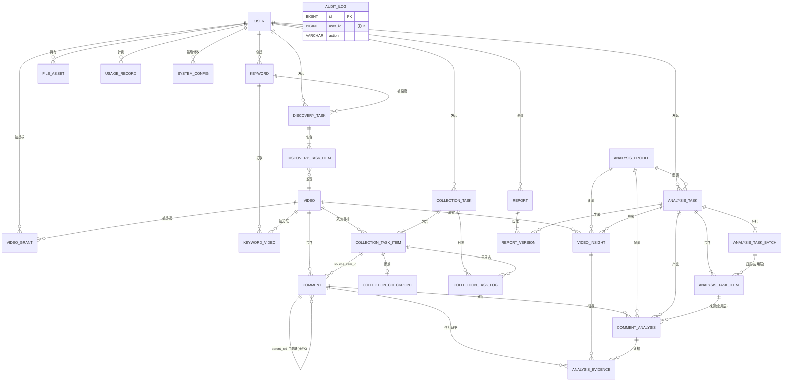

# 25 · 数据库冻结候选版 V1.1

**任务编号**：M1-F
**执行模式**：READ ONLY
**输入依据**：`24_DATABASE_FREEZE_CANDIDATE.md`、`23_M1D_ERRATA.md`、#24 审查反馈
**生成日期**：2026-11-03
**文档性质**：V1.1 修订版，**替代 V1.0 作为设计与实施依据**
**审查结论**：**通过冻结候选审查**
**授权状态**：**未授权任何实施**

> 通过候选审查 ≠ 正式冻结 ≠ 获得实施授权。
> 正式冻结需用户对第十节的 U1～U8 作出明确决策。

---

## 零、文档状态与本次修订摘要

### 0.1 修订范围

对 #24（V1.0）的 **11 项问题**逐项修正，**7 项设计**保持不变。

| 类别 | 数量 | 说明 |
|---|---|---|
| 必须修正 | **11** | 见第一节 |
| 必须保留 | **7** | 见 0.3 |
| 实质字段变更 | **4** 处 | `params_hash`、`analysis_task_item` 三个 token 字段改名、`usage_record` 加 `batch_id` |
| 统计修正 | **3** 处 | 唯一键总数（48）、`params_hash` 长度（64）、字段总数（291→292） |
| 表述修正 | **5** 处 | R/U 状态、U5 理由、A3 拆分、双关联、Flyway 顺序 |

### 0.2 与 V1.0 的差异总表

| # | V1.0 | V1.1 | 依据 |
|---|---|---|---|
| 1 | 「已确认裁定 R1～R14」 | **「文档采纳决定 D1～D14」**（明确非用户确认） | 审查项 1 |
| 2 | 「23 个唯一键（不含主键）」 | **48 个（25 PK + 23 UK）** | 审查项 2 |
| 3 | `params_hash CHAR(32)`（MD5） | **`CHAR(64)`（SHA-256）**，规范化用 Decimal 不舍入 | 审查项 3 |
| 4 | 无多态存在性校验 | 新增 `target_type/target_id` 存在性校验 + 巡检 | 审查项 4 |
| 5 | A3 单条巡检 | **拆 A3a（insight）/ A3b（comment_analysis）** | 审查项 5 |
| 6 | 双关联未明确 | **允许同时关联**，CHECK + CASCADE + 语义已定 | 审查项 6 |
| 7 | U5 理由「含 NULL 不可检索」 | **改为「现有索引不含 status 列」** | 审查项 7 |
| 8 | 四层 Token 未区分真实/分摊 | **L1 真实 / L2 分摊 / L3·L4 可重算**，字段改名 | 审查项 8 |
| 9 | 哨兵值与 BCrypt 关系未明确 | 明确**哨兵非合法 BCrypt**，登录须先判 status | 审查项 9 |
| 10 | L2 授权仅 `status='SUCCESS'` | 覆盖**部分成功/重试/取消/禁用** | 审查项 10 |
| 11 | `repair` 语义模糊 | 明确 **validate → 结构核对 → repair → migrate** 顺序 | 审查项 11 |

### 0.3 必须保留（未改动）

| # | 保留项 |
|---|---|
| K1 | 25 张表的整体业务边界与领域划分 |
| K2 | #23 已确认的外键勘误（39 条，19/11/9 分布） |
| K3 | Flyway 是唯一数据库结构创建与迁移入口 |
| K4 | MySQL 8.0 DDL 隐式提交风险说明 |
| K5 | 用户数据授权与共享评论事实的设计方向（ADR-004） |
| K6 | 所有未验证事项的原状态（13 项，无降级） |
| K7 | U1～U8 继续作为待用户确认事项 |

---

## 一、#24 问题逐项处理

### 1.1 修正项 1：R/U 状态定义统一

**V1.0 的问题**：把「文档采纳的设计方案」写成「已确认裁定」，容易被误读为用户已批准。

**V1.1 修正**：三级状态严格区分。

| 状态 | 编号 | 含义 | 谁做的决定 |
|---|---|---|---|
| **【已确认】** | ADR-001～005 | 用户已在 M1-B 任务卡中明确 | **用户** |
| **【文档采纳】** | D1～D14 | 设计文档为形成唯一版本而采纳的方案 | 设计方，**待用户追认** |
| **【待确认】** | U1～U8 | 存在多个合理选项，需用户选择 | **待用户** |

#### ADR 级（用户已确认，不可擅改）

| # | 内容 |
|---|---|
| ADR-001 | Flyway 为唯一迁移入口；删除 `SchemaMigration`；禁 `baselineOnMigrate` |
| ADR-002 | 测试数据不迁移；不清 CID |
| ADR-003 | `video.id` 为内部主键，`aweme_id` 为平台标识；`comment.video_id` 指内部 ID |
| ADR-004 | 评论采用共享事实模型；`user_id` 不得同时承担归属/操作人/权限 |
| ADR-005 | 密码统一 BCrypt，不产生新 MD5 |

#### 文档采纳决定（D1～D14，**非用户确认**）

| # | 决定 | 出处 |
|---|---|---|
| D1 | 表数量 25，`analysis_result` 不进入目标模型 | #20/#21 |
| D2 | `comment` 双唯一键 `uk_platform_cid` + `uk_platform_dedup` | #21 |
| D3 | `cid` 允许 NULL，`dedup_key` 恒非空 | #21 |
| D4 | 新增 `dedup_strategy` 区分 CID / FINGERPRINT | #22 |
| D5 | `keyword_video` 删除 `discovery_task_id`（**U1 待确认**） | #22 |
| D6 | `video_grant.video_id` 用 CASCADE（**U2 待确认**） | #22 |
| D7 | `analysis_task_item.batch_id` 为单列 FK + SET NULL | #23 |
| D8 | `analysis_evidence.comment_analysis_id` 用 CASCADE | #23 |
| D9 | 版本四维收敛至 `analysis_profile`，三表统一引用 `profile_id` | #21 |
| D10 | `analysis_task_item` 提供对象级状态与分摊成本 | #21 |
| D11 | 授权三层 L1/L2/L3 | #22 |
| D12 | `analysis_profile` 建议只插入不更新（**U8 待确认**） | #22 |
| D13 | `params_hash` 用 SHA-256（本版新增） | 审查项 3 |
| D14 | `analysis_evidence` 允许双关联（本版新增） | 审查项 6 |

> **重要**：D1～D14 是本文档为形成可执行设计而作出的技术选择，**不构成用户已批准的记录**。若用户对某项有不同意见，应作为新决策覆盖。

### 1.2 修正项 2：唯一键统计

**V1.0 表述**：「共 23 个唯一键（不含 25 个主键）」——容易被读成「总共 23 个」。

**V1.1 修正**：

| 类别 | 数量 |
|---|---|
| 主键（PK） | **25** |
| 非主键唯一键（UK） | **23** |
| **唯一性约束合计** | **48** |

明细见第四节。

### 1.3 修正项 3：`params_hash` 改 SHA-256 + 不舍入

**V1.0 的问题**：
- MD5 32 位安全性偏弱（虽碰撞在本场景可忽略）
- 规范化规则写「浮点保留 6 位小数」——**会丢失有意义的模型参数精度**（如 `temperature=0.15` 与 `0.150001` 会被判为同一 profile）

**V1.1 修正**：

| 项 | 值 |
|---|---|
| 算法 | **SHA-256** |
| 字段 | **`CHAR(64)`**（64 个十六进制字符） |
| 规范化版本 | **`norm-v1`**（需落库，参与唯一键） |
| 数字处理 | **Decimal 精确表示，去掉无意义的尾随零，不截断有效位** |

#### 规范化算法 `norm-v1`（完整定义）

```
输入：params_json（原始 JSON 文本）

步骤 1  解析（保留数字精度）
        - 整数 → int
        - 浮点 → Decimal（parse_float=Decimal，禁止转 float）
        - 字符串 → str
        - 布尔/null → bool/None

步骤 2  递归规范化
        a. 对象：键按 Unicode 码点升序排列（递归）
        b. 数组：**保持原顺序**（顺序有语义，不排序）
        c. 数字：
           - int → str(int)
           - Decimal → 去尾随零但保留全部有效位
             Decimal('0.20').normalize()          → '0.2'
             Decimal('0.2000000001').normalize()  → '0.2000000001'  ← 不丢精度
             Decimal('1E+2') 格式化后             → '100'           ← 禁科学计数法
             Decimal('-0')                        → '0'             ← 归一负零
        d. 字符串：Unicode NFC 规范化；**不做大小写转换**
        e. 布尔：'true' / 'false'（非 1/0）
        f. null：'null'

步骤 3  序列化
        json.dumps(obj, sort_keys=True, separators=(',', ':'), ensure_ascii=False)

步骤 4  编码
        UTF-8（无 BOM）

步骤 5  摘要
        SHA-256 → 64 位小写十六进制
```

#### 示例

| 输入 `params_json` | 规范化串 | 说明 |
|---|---|---|
| `{"temperature":0.2,"max_tokens":1024}` | `{"max_tokens":1024,"temperature":0.2}` | 键排序 |
| `{"temperature":0.20}` | `{"temperature":0.2}` | 尾随零无意义 |
| `{"temperature":0.2000000001}` | `{"temperature":0.2000000001}` | **保留精度** |
| `{"a":1,"a":2}` | 解析冲突 → **报错**（重复键不允许） | 防御性 |

#### 版本演进

若将来修改规范化规则：
- 新增 `norm_v2`，`params_hash` 字段长度不变（仍 64），但新增 `norm_version VARCHAR(16)` 字段标识
- **不得原地修改 norm-v1 的规则**，否则历史 profile 的 hash 全部失效

> **本版决定**：`norm_version` 字段暂不加入（V1.1 仅一个版本），列为 **U9 待确认**（见第十节新增项）。

### 1.4 修正项 4：多态对象存在性校验

**问题**：`analysis_task_item.target_type` + `target_id` 是多态引用，MySQL 无法建外键。若 `target_type='COMMENT'` 而 `target_id` 指向不存在的评论，将产生孤儿任务项。

**处理**：

| 层面 | 措施 |
|---|---|
| 应用层（强制） | 插入前按 `target_type` 分别查 `comment` / `video`，不存在则拒绝 |
| 巡检（每日） | 两条 SQL（见第六节 A10a/A10b） |
| CHECK | 已有限制 `target_type IN ('COMMENT','VIDEO')`（C4），保证分支可控 |

**为什么不建两个可空 FK 列**（`target_comment_id` + `target_video_id`）：
- 会产生「两个都非空」或「两个都空」的非法态，仍需 CHECK 约束
- 查询时需 `COALESCE`，索引效率差
- 当前 `uk_task_target (task_id, target_type, target_id)` 已能覆盖唯一性

> **本版决定**：保留多态设计（D15），以「CHECK 限分支 + 应用校验 + 巡检」三重保障。

### 1.5 修正项 5：A3 证据一致性巡检拆分

**V1.0 的问题**：A3 只检查 `insight_id` 路径，遗漏 `comment_analysis_id` 路径。

**V1.1 修正**：拆为两条。

**A3a — 视频级证据的 video 一致性**
```sql
SELECT ae.id, ae.comment_id, vi.video_id AS insight_video, c.video_id AS comment_video
FROM analysis_evidence ae
JOIN video_insight vi ON vi.id = ae.insight_id
JOIN comment c        ON c.id = ae.comment_id
WHERE vi.video_id <> c.video_id;
```

**A3b — 评论级证据的 comment 一致性**
```sql
SELECT ae.id, ae.comment_id, ca.comment_id AS analysis_comment
FROM analysis_evidence ae
JOIN comment_analysis ca ON ca.id = ae.comment_analysis_id
WHERE ca.comment_id <> ae.comment_id;
```

> `insight_id IS NULL` 或 `comment_analysis_id IS NULL` 时，对应巡检自然不返回行（INNER JOIN 语义），无需额外条件。

### 1.6 修正项 6：`analysis_evidence` 双关联裁定

**问题**：是否允许一条证据同时挂 `insight_id` 和 `comment_analysis_id`？

#### 三方案对比

| 方案 | CHECK | 优点 | 缺点 |
|---|---|---|---|
| A. 互斥 | `(insight_id IS NULL) <> (comment_analysis_id IS NULL)` | 语义单一 | 同一评论同时支撑两级结论时**必须拆两行**，容易漏写 |
| **B. 允许同时** | `insight_id IS NOT NULL OR comment_analysis_id IS NOT NULL` | 灵活；一行表达「同时是两级证据」 | 删除任一分析结果会丢整行 |
| C. 必须双填 | 两个都 NOT NULL | — | 不现实，单级证据居多 |

#### 裁定：**采用 B（允许同时）**

| 项 | 规定 |
|---|---|
| CHECK | C6：`insight_id IS NOT NULL OR comment_analysis_id IS NOT NULL` |
| 级联删除 | `insight_id` **CASCADE**（FK31）；`comment_analysis_id` **CASCADE**（FK32） |
| 删除语义 | 任一分析结果被删 → **整行删除**（非清空单列） |
| 业务语义 | 该评论同时是「视频级洞察的证据」与「评论级分析的证据」 |
| **推荐做法** | 若两条证据需独立存续，**应用层拆为两行**；同时关联仅用于强耦合场景 |

**为什么 CASCADE 而非 SET NULL**：
若 `comment_analysis_id` 用 SET NULL，删除后该行可能变成 `insight_id=NULL AND comment_analysis_id=NULL` → **违反 C6 → 删除被拒绝**（#23 的 S1 缺陷）。CASCADE 规避此问题。

**风险与缓解**：

| 风险 | 缓解 |
|---|---|
| 删除评论级分析导致视频级证据丢失 | 应用层在删除 `comment_analysis` 前，检查是否存在双关联证据，若有则先拆行 |

### 1.7 修正项 7：U5 索引决策依据

**V1.0 的错误理由**：「`uk_video_active` 含 NULL 时不可检索」

**该理由不成立**：
- `uk_video_active (video_id, active_flag)` 的最左前缀是 `video_id`
- `WHERE video_id = ?` **完全可以**使用该索引（NULL 值不影响最左前缀检索）
- 只有 `WHERE active_flag = 1` 这种跳过最左列的查询才无法使用

**V1.1 正确理由**：

| 现有索引 | 能支撑 | 不能支撑 |
|---|---|---|
| `uk_video_active (video_id, active_flag)` | `WHERE video_id=?` | `WHERE video_id=? AND status=?` |
| `uk_task_video (task_id, video_id)` | `WHERE task_id=?` | 同上 |
| `idx_status_lease (status, lease_until)` | `WHERE status=?` | `WHERE video_id=? AND status=?` |
| `idx_task_status (task_id, status)` | `WHERE task_id=? AND status=?` | `WHERE video_id=? AND status=?` |

**真实需求**：
```sql
-- 某视频是否已有成功采集（增量判断）
SELECT 1 FROM collection_task_item WHERE video_id=? AND status='SUCCESS' LIMIT 1;
-- 某视频的失败任务（重试候选）
SELECT * FROM collection_task_item WHERE video_id=? AND status='FAILED';
```
这两类查询**均无合适索引** → U5 有据，但理由是「缺 `(video_id, status)` 联合索引」，不是「NULL 不可检索」。

### 1.8 修正项 8：Token 与成本四层口径

**问题**：四个地方都有 token 字段，但**未区分真实调用量与分摊估算**。

#### 四层定义

| 层 | 表.字段 | 性质 | 是否权威 |
|---|---|---|---|
| **L1 API 调用** | `usage_record.input_tokens` / `output_tokens` / `cost_amount` | **真实调用量**，每次 API 请求一行 | ✅ **唯一权威** |
| **L2 对象** | `analysis_task_item.allocated_input_tokens` / `allocated_output_tokens` / `allocated_cost_amount` | **分摊估算**（一次调用处理 N 条评论，无法精确到单条） | ❌ 派生 |
| **L3 批次** | `analysis_task_batch.input_tokens` / `output_tokens` | 该批次真实调用之和 | ✅ 可由 L1 重算 |
| **L4 任务** | `analysis_task.input_tokens` / `output_tokens` / `cost_amount` | 任务全部批次之和 | ✅ 可由 L1 重算 |

#### 字段改名（V1.1 变更）

`analysis_task_item` 三个字段改名，加 `allocated_` 前缀：

| V1.0 | V1.1 | 理由 |
|---|---|---|
| `input_tokens` | `allocated_input_tokens` | 明确是分摊值，防误读为真实值 |
| `output_tokens` | `allocated_output_tokens` | 同上 |
| `cost_amount` | `allocated_cost_amount` | 同上 |

#### `usage_record` 新增 `batch_id`（V1.1 变更）

| 字段 | 类型 | NULL | 说明 |
|---|---|---|---|
| `batch_id` | BIGINT UNSIGNED | Y | 所属批次，**无 FK**（多态引用） |

有了 `batch_id`，L3 才能真正由 L1 重算；否则 L3 也只能靠分摊。

#### 分摊算法（应用层，`alloc_v1`）

```
单对象分摊 = 该次调用总 token × (该对象输入字符数 / 本批所有对象字符数之和)
成本分摊   = 同样比例 × 该次调用成本
舍入       = DECIMAL(12,6)，最后一条对象吸收舍入误差（保证分摊总和 == 真实总量）
```

#### 对账规则

```sql
-- L1 汇总 vs L3 批次
SELECT b.id,
       b.input_tokens AS batch_tokens,
       COALESCE(SUM(u.input_tokens),0) AS usage_tokens
FROM analysis_task_batch b
LEFT JOIN usage_record u ON u.biz_type='AI_ANALYSIS' AND u.batch_id = b.id
GROUP BY b.id, b.input_tokens
HAVING ABS(b.input_tokens - COALESCE(SUM(u.input_tokens),0)) > 0;

-- L2 分摊总和 vs L3 批次（允许 ±1 舍入误差）
SELECT batch_id, SUM(allocated_input_tokens) AS alloc_sum
FROM analysis_task_item
GROUP BY batch_id
HAVING ABS(alloc_sum - (SELECT input_tokens FROM analysis_task_batch b WHERE b.id = batch_id)) > 1;
```

**原则**：**任何报表以 L1 为准**；L2 仅供「单条评论大致花了多少钱」的参考，不得用于计费。

### 1.9 修正项 9：哨兵值与 BCrypt 的例外关系

**问题**：`password_hash = '!SENTINEL_NO_LOGIN!'` **不是合法 BCrypt 格式**（合法格式为 `$2a$10$...`，60 字符）。若登录逻辑直接调 `BCryptPasswordEncoder.matches(raw, hash)`：

| 实现 | 行为 |
|---|---|
| Spring Security `BCryptPasswordEncoder` | 非 `$2a$` 开头时 **log warning 并返回 false**（安全） |
| 部分实现 | 可能抛 `IllegalArgumentException` |

**必须显式处理，不能依赖实现的宽容度。**

#### 登录校验顺序（强制）

```
1. 查 user（含 status）
2. if (user == null)                     → 401「账号或密码错误」
3. if (user.status == 0)                 → 403「账号已禁用」   ← 先判状态
4. if (!hash.startsWith("$2a$") && !hash.startsWith("$2b$") && !hash.startsWith("$2y$"))
                                         → 403「账号未初始化」 ← 哨兵识别
5. if (!encoder.matches(raw, hash))      → 401
6. if (user.mustChangePwd == 1)          → 返回 mustChangePwd=true
```

**关键**：第 3、4 步必须在 `matches()` 之前，避免依赖实现细节。

#### 初始化密码安全要求

| 项 | 要求 |
|---|---|
| 强度 | ≥ 12 位，含大小写+数字+符号；或 ≥ 16 位随机 |
| 弱密码黑名单 | 拒绝 `123456`、`password`、`admin`、手机号、用户名 |
| 传输 | 仅通过环境变量（方案 A）或 `/run/secrets/`（方案 B），**不经 HTTP** |
| 落库 | **不落库**（哨兵值为占位，真实密码只在内存中用于生成 BCrypt） |
| 日志 | **不打印**（方案 A/B）；仅方案 C 打印且限测试环境 |
| 首次登录 | `must_change_pwd=1` 强制改密 |
| 改密后 | `must_change_pwd=0`，且新密码同样过强度校验 |

#### 状态转换与恢复

```
SENTINEL  (status=0, hash='!SENTINEL_NO_LOGIN!')
    ↓ CAS UPDATE（affectedRows=1）
INITIALIZED (status=1, hash=BCrypt, must_change_pwd=1)
    ↓ 首次登录改密
NORMAL    (must_change_pwd=0)

忘记密码恢复：
  运维执行 UPDATE user SET password_hash='!SENTINEL_NO_LOGIN!', status=0 WHERE phone='...';
  重启后端 → AdminBootstrap 重新触发初始化
```

### 1.10 修正项 10：L2 授权规则补充边界场景

**V1.0 的不足**：仅用 `item.status = 'SUCCESS'` 判定可见性，未覆盖部分成功、重试、取消、用户禁用。

#### V1.1 修正：可见性基于「是否真有评论入库」，而非任务状态

```
V(user) =
    { v | ∃ item ∈ collection_task_item,
          ∃ task ∈ collection_task,
          task.id = item.task_id,
          task.owner_user_id = user,
          user.status = 1,
          ∃ c ∈ comment, c.video_id = item.video_id }
  ∪ { v | ∃ g ∈ video_grant,
          g.grantee_user_id = user,
          user.status = 1,
          (g.expires_at IS NULL OR g.expires_at > NOW()) }

管理员：role=1 AND status=1 → 全部可见；role=1 AND status=0 → 视为普通用户（且无法登录）
```

#### 各状态的处理（明确回答审查项）

| 场景 | 是否可见 | 理由 |
|---|---|---|
| `SUCCESS` | ✅ 可见 | 有入库评论 |
| **`PARTIAL_SUCCESS`** | ✅ **已采集部分可见** | 以「该视频是否存在评论」判定，而非任务状态 |
| **`RUNNING` / `RETRY_WAIT` / `PENDING`** | ⚠️ **已入库的可见，未入库的不可见** | 流式落盘后可能已有部分数据 |
| **`CANCELLED`** | ⚠️ **已入库的可见** | 取消不等于回滚数据 |
| `FAILED` | ⚠️ 同 CANCELLED | 失败前可能已入库 |
| **用户 `status=0`** | ❌ **全部不可见** | 无法登录，且查询条件显式排除 |
| **管理员 `status=0`** | ❌ 不再享有全量权限 | 禁用即降权 |

**为什么不用 `item.status='SUCCESS'`**：
1. 取消/部分成功的任务可能已有大量入库数据，用户会「看不到自己采过的数据」
2. `status` 是执行状态，与「数据是否存在」是两件事
3. 用 `EXISTS(SELECT 1 FROM comment WHERE video_id=item.video_id)` 判定更贴近业务本质

**性能考虑**：该 `EXISTS` 子查询可用 `comment.idx_video_time` 的最左前缀 `video_id` 命中，代价可控。

### 1.11 修正项 11：Flyway 恢复流程与 validate/repair 顺序

**V1.0 的问题**：只说「从备份恢复 → flyway repair → 修复 SQL → 重跑」，未明确 `validate` 与 `repair` 的语义差异与执行条件。

#### 三个命令的准确语义（A 级，Flyway 官方定义）

| 命令 | 做什么 | **不做什么** |
|---|---|---|
| `info` | 显示迁移状态（pending/applied/failed） | — |
| `validate` | 校验**已应用的迁移**与本地脚本的 checksum 是否一致 | 不修改任何东西 |
| `repair` | ①删除 `flyway_schema_history` 中 failed 的记录；②重新对齐 checksum；③标记缺失的迁移为 deleted | **不回滚任何 DDL**、**不修改表结构** |

#### 铁律

> **已应用的迁移文件永不修改。** 修改会导致 checksum 变化 → `validate` 失败 → 集群中未升级的实例启动失败。修复只能**新增**迁移（V9、V10…）。

#### 标准恢复流程（带条件判断）

```
Step 0  停止所有后端实例（防并发写）
        ↓
Step 1  flyway info
        记录：哪些 pending / applied / failed
        ↓
Step 2  【结构核对】（必做，不能跳过）
        对照失败迁移的脚本，逐条确认哪些 DDL 已执行：
          SHOW TABLES;                          -- 表是否已建
          SHOW COLUMNS FROM xxx;                -- 列是否已加
          SHOW INDEX FROM xxx;                  -- 索引是否已建
        ↓
Step 3  分支决策
        ├─ 分支 A：已执行的 DDL 完全符合预期（只是后续语句失败）
        │     → 修复脚本（新增迁移或修正未执行部分）
        │     → flyway repair  (清 failed 记录)
        │     → flyway migrate
        │
        ├─ 分支 B：已执行的 DDL 与预期不符（半成品结构）
        │     → 从备份恢复
        │     → flyway repair  (清 metadata 不一致)
        │     → 修正脚本
        │     → flyway migrate
        │
        └─ 分支 C：测试环境，数据可弃
              → 删卷重建（仅 dy-comment_mysql-data）
              → flyway migrate（从 V1 重跑）
        ↓
Step 4  flyway validate
        必须全绿；若报 checksum mismatch → 说明改过已应用脚本 → 回 Step 3
        ↓
Step 5  结构验收
        表数量 == 25；flyway_schema_history 全 success=1
        ↓
Step 6  冒烟
        登录 → 采集 → 入库 → 大屏
```

#### 关键约束

| # | 约束 |
|---|---|
| 1 | `repair` **只在**「脚本已修正，需清理 metadata」时使用，不能当回滚工具 |
| 2 | `validate` 在 `migrate` **之后**执行，用于确认版本链完整 |
| 3 | 分支 B 的「从备份恢复」**必须在 `repair` 之前**，否则 metadata 与结构双重不一致 |
| 4 | 迁移前必须 `mysqldump` 备份，并在临时库**实际恢复一次**（不能只看文件大小） |

---

## 二、25 张表字段完整性复核

| # | 表 | 字段数 | 本版变更 | 完整性 |
|---|---|---|---|---|
| 1 | `user` | 11 | — | ✅ |
| 2 | `video_grant` | 7 | — | ✅ |
| 3 | `keyword` | 8 | — | ✅ |
| 4 | `video` | 17 | — | ✅ |
| 5 | `keyword_video` | 4 | — | ✅ |
| 6 | `discovery_task` | 13 | — | ✅ |
| 7 | `discovery_task_item` | 7 | — | ✅ |
| 8 | `comment` | 21 | — | ✅ |
| 9 | `collection_task` | 13 | — | ✅ |
| 10 | `collection_task_item` | 18 | — | ✅ |
| 11 | `collection_checkpoint` | 8 | — | ✅ |
| 12 | `collection_task_log` | 8 | — | ✅ |
| 13 | `analysis_task` | 19 | — | ✅ |
| 14 | `analysis_task_batch` | 12 | — | ✅ |
| 15 | `analysis_task_item` | 14 | **3 字段改名**（`allocated_*`） | ✅ |
| 16 | `analysis_profile` | 11 | **`params_hash` → CHAR(64)** | ✅ |
| 17 | `comment_analysis` | 17 | — | ✅ |
| 18 | `video_insight` | 11 | — | ✅ |
| 19 | `analysis_evidence` | 8 | 语义明确（双关联） | ✅ |
| 20 | `file_asset` | 14 | — | ✅ |
| 21 | `report` | 11 | — | ✅ |
| 22 | `report_version` | 9 | — | ✅ |
| 23 | `system_config` | 8 | — | ✅ |
| 24 | `usage_record` | 14 | **新增 `batch_id`** | ✅ |
| 25 | `audit_log` | 9 | — | ✅ |

**合计字段：291 → 292**（`usage_record` +1）

> 字段数按**实际字段计**（合并单元格如 `started_at / finished_at` 计 2 个），非表格行数。V1.0 文档曾用行数误报为 261，本版已按实际枚举重算。

### 2.1 变更详情

**`analysis_task_item`（2.15）**

| 字段 | 类型 | NULL | 默认 | 键/约束 | 说明 |
|---|---|---|---|---|---|
| `allocated_input_tokens` | INT UNSIGNED | N | 0 | | **分摊**输入 Token（非真实调用量） |
| `allocated_output_tokens` | INT UNSIGNED | N | 0 | | **分摊**输出 Token |
| `allocated_cost_amount` | DECIMAL(12,6) | N | 0 | | **分摊**成本 |

其余 10 字段不变。

**`analysis_profile`（2.16）**

| 字段 | 类型 | NULL | 默认 | 键/约束 | 说明 |
|---|---|---|---|---|---|
| `params_hash` | **CHAR(64)** | N | — | UK `uk_profile` | `params_json` 经 `norm-v1` 后 SHA-256 |

其余 10 字段不变。

**`usage_record`（2.24）**

| 字段 | 类型 | NULL | 默认 | 键/约束 | 说明 |
|---|---|---|---|---|---|
| `batch_id` | BIGINT UNSIGNED | Y | NULL | IDX `idx_batch` | 所属批次，**无 FK**（多态） |

其余 12 字段不变。

---

## 三、39 条外键复核（保留 #23 勘误，无变更）

| # | 子表.字段 | 父表.字段 | ON DELETE |
|---|---|---|---|
| 1 | `video_grant.grantee_user_id` | `user.id` | RESTRICT |
| 2 | `video_grant.video_id` | `video.id` | CASCADE |
| 3 | `video_grant.granted_by` | `user.id` | RESTRICT |
| 4 | `keyword.owner_user_id` | `user.id` | RESTRICT |
| 5 | `keyword_video.keyword_id` | `keyword.id` | CASCADE |
| 6 | `keyword_video.video_id` | `video.id` | RESTRICT |
| 7 | `discovery_task.keyword_id` | `keyword.id` | RESTRICT |
| 8 | `discovery_task.owner_user_id` | `user.id` | RESTRICT |
| 9 | `discovery_task_item.task_id` | `discovery_task.id` | CASCADE |
| 10 | `discovery_task_item.video_id` | `video.id` | RESTRICT |
| 11 | `comment.video_id` | `video.id` | RESTRICT |
| 12 | `comment.source_item_id` | `collection_task_item.id` | SET NULL |
| 13 | `collection_task.owner_user_id` | `user.id` | RESTRICT |
| 14 | `collection_task_item.task_id` | `collection_task.id` | CASCADE |
| 15 | `collection_task_item.video_id` | `video.id` | RESTRICT |
| 16 | `collection_checkpoint.task_item_id` | `collection_task_item.id` | CASCADE |
| 17 | `collection_task_log.task_id` | `collection_task.id` | CASCADE |
| 18 | `collection_task_log.task_item_id` | `collection_task_item.id` | SET NULL |
| 19 | `analysis_task.owner_user_id` | `user.id` | RESTRICT |
| 20 | `analysis_task.profile_id` | `analysis_profile.id` | RESTRICT |
| 21 | `analysis_task_batch.task_id` | `analysis_task.id` | CASCADE |
| 22 | `analysis_task_item.task_id` | `analysis_task.id` | CASCADE |
| 23 | `analysis_task_item.batch_id` | `analysis_task_batch.id` | SET NULL |
| 24 | `comment_analysis.comment_id` | `comment.id` | RESTRICT |
| 25 | `comment_analysis.profile_id` | `analysis_profile.id` | RESTRICT |
| 26 | `comment_analysis.analysis_task_id` | `analysis_task.id` | SET NULL |
| 27 | `comment_analysis.analysis_task_item_id` | `analysis_task_item.id` | SET NULL |
| 28 | `video_insight.video_id` | `video.id` | RESTRICT |
| 29 | `video_insight.analysis_task_id` | `analysis_task.id` | SET NULL |
| 30 | `video_insight.profile_id` | `analysis_profile.id` | RESTRICT |
| 31 | `analysis_evidence.insight_id` | `video_insight.id` | CASCADE |
| 32 | `analysis_evidence.comment_analysis_id` | `comment_analysis.id` | CASCADE |
| 33 | `analysis_evidence.comment_id` | `comment.id` | RESTRICT |
| 34 | `file_asset.owner_user_id` | `user.id` | RESTRICT |
| 35 | `report.owner_user_id` | `user.id` | RESTRICT |
| 36 | `report_version.report_id` | `report.id` | CASCADE |
| 37 | `report_version.analysis_task_id` | `analysis_task.id` | SET NULL |
| 38 | `usage_record.owner_user_id` | `user.id` | SET NULL |
| 39 | `system_config.updated_by` | `user.id` | SET NULL |

**分布**：RESTRICT **19** / CASCADE **11** / SET NULL **9** = **39**

> **第 23 项必须为单列外键**（#23 勘误 S2）。禁止改为 `(batch_id, task_id)` 复合 FK + SET NULL（`task_id NOT NULL` 会使约束创建失败）。

**不建 FK 的字段（7 处）**：`audit_log.user_id`、`audit_log.resource_type/id`、`usage_record.biz_ref_id`、**`usage_record.batch_id`（本版新增）**、`file_asset.biz_id`、`comment.parent_cid/root_cid`、`report_version.generated_by`。

---

## 四、唯一键、普通索引、CHECK 统计

### 4.1 唯一性约束统计（48 个）

| 类别 | 数量 |
|---|---|
| 主键 PK | **25** |
| 非主键唯一键 UK | **23** |
| **合计** | **48** |

### 4.2 非主键唯一键清单（23）

| 表 | 唯一键 | 字段 |
|---|---|---|
| `user` | `uk_phone` | `phone` |
| `video_grant` | `uk_grant` | `grantee_user_id, video_id, permission` |
| `keyword` | `uk_owner_norm` | `owner_user_id, normalized` |
| `video` | `uk_platform_aweme` | `platform, aweme_id` |
| `keyword_video` | `uk_keyword_video` | `keyword_id, video_id` |
| `discovery_task` | `uk_task_no` | `task_no` |
| `discovery_task_item` | `uk_task_video` | `task_id, video_id` |
| `comment` | `uk_platform_cid` | `platform, cid` |
| `comment` | `uk_platform_dedup` | `platform, dedup_key` |
| `collection_task` | `uk_task_no` | `task_no` |
| `collection_task_item` | `uk_video_active` | `video_id, active_flag` |
| `collection_task_item` | `uk_task_video` | `task_id, video_id` |
| `collection_checkpoint` | `uk_item` | `task_item_id` |
| `analysis_task` | `uk_task_no` | `task_no` |
| `analysis_task_batch` | `uk_task_batch` | `task_id, batch_no` |
| `analysis_task_item` | `uk_task_target` | `task_id, target_type, target_id` |
| `analysis_profile` | `uk_profile` | `provider, model_name, prompt_version, schema_version, taxonomy_version, params_hash` |
| `analysis_profile` | `uk_profile_key` | `profile_key` |
| `comment_analysis` | `uk_comment_profile` | `comment_id, profile_id` |
| `file_asset` | `uk_file_key` | `file_key` |
| `report` | `uk_report_no` | `report_no` |
| `report_version` | `uk_report_version` | `report_id, version_no` |
| `system_config` | `uk_config_key` | `config_key` |

### 4.3 普通索引（V1.1 新增 1 个）

| 表 | 索引 | 变化 |
|---|---|---|
| `user` | `idx_role`、`idx_status`、`idx_deleted` | — |
| `video_grant` | `idx_grantee`、`idx_expires` | — |
| `keyword` | `idx_status` | — |
| `video` | `idx_publish_time`、`idx_last_collected` | — |
| `keyword_video` | `idx_video` | — |
| `discovery_task` | `idx_owner_created`、`idx_status` | — |
| `discovery_task_item` | `idx_video` | — |
| `comment` | `idx_video_time`、`idx_video_likes`、`idx_video_region`、`idx_parent`、`idx_source_item`、`idx_douyin_id` | — |
| `collection_task` | `idx_owner_created`、`idx_status_created` | — |
| `collection_task_item` | `idx_task_status`、`idx_status_lease` | — |
| `collection_task_log` | `idx_task_created`、`idx_item` | — |
| `analysis_task` | `idx_owner_created`、`idx_status` | — |
| `analysis_task_batch` | `idx_task_status` | — |
| `analysis_task_item` | `idx_batch_status` | — |
| `comment_analysis` | `idx_task`、`idx_sentiment` | — |
| `video_insight` | `idx_video_created` | — |
| `analysis_evidence` | `idx_insight`、`idx_comment` | — |
| `file_asset` | `idx_biz`、`idx_sha256` | — |
| `report` | `idx_owner_created`、`idx_deleted` | — |
| `usage_record` | `idx_biz`、`idx_created_owner`、**`idx_batch`** | **+1（本版）** |
| `audit_log` | `idx_user_created`、`idx_resource` | — |

### 4.4 CHECK 约束（6 个，无变化）

| # | 表 | 约束名 | 表达式 |
|---|---|---|---|
| C1 | `user` | `ck_user_role` | `role IN (0,1)` |
| C2 | `comment` | `ck_dedup_strategy` | `dedup_strategy IN ('CID','FINGERPRINT')` |
| C3 | `collection_task_item` | `ck_active_flag` | `active_flag IS NULL OR active_flag = 1` |
| C4 | `analysis_task_item` | `ck_target_type` | `target_type IN ('COMMENT','VIDEO')` |
| C5 | `comment_analysis` | `ck_confidence` | `confidence IS NULL OR (confidence >= 0 AND confidence <= 1)` |
| C6 | `analysis_evidence` | `ck_evidence_target` | `insight_id IS NOT NULL OR comment_analysis_id IS NOT NULL` |

**兼容性**：C6 的两条 FK（#31/#32）均为 CASCADE，行整体删除，不产生「双 NULL」中间态，**无冲突**。

---

## 五、ER 图与字段关系一致性



### 5.1 一致性核对

| 检查项 | 结果 |
|---|---|
| ER 实体数 vs 表数 | **25 / 25** ✅ |
| 实线关联是否有 FK 依据 | ✅ 全部对应第三节 39 项之一 |
| 应用层关联（虚线语义） | **3 处**：`COMMENT` 自关联、`TASK_ITEM→BATCH`、`TASK_ITEM→COMMENT_ANALYSIS` |
| 关联字段类型一致 | ✅ 全部 `BIGINT UNSIGNED` |
| 引用不存在的表 | ✅ 无 |

---

## 六、多态关联与应用层一致性约束

### 6.1 多态关联清单（5 组，均无 FK）

| # | 表.字段 | 可能指向 | 校验方式 |
|---|---|---|---|
| P1 | `analysis_task_item.target_type` + `target_id` | `comment` / `video` | CHECK C4 + 应用校验 + A10a/A10b 巡检 |
| P2 | `analysis_evidence.insight_id` / `comment_analysis_id` | 两表 | 两条 FK（#31/#32）**已建**，C6 保证至少一个 |
| P3 | `usage_record.biz_type` + `biz_ref_id` / `batch_id` | `analysis_task` / `collection_task` / `analysis_task_batch` | 应用校验（无 FK） |
| P4 | `file_asset.biz_type` + `biz_id` | 任意业务实体 | 应用校验 |
| P5 | `audit_log.resource_type` + `resource_id` | 任意实体 | 应用校验（审计不强制完整性） |

### 6.2 应用层约束清单（10 项）

| # | 约束 | 原因 | 实现 |
|---|---|---|---|
| A1 | `analysis_task_item.batch_id` 所属批次与本行 `task_id` 相同 | 复合 FK 不可行（D7） | 插入前校验 |
| A2 | `comment_analysis.comment_id` == `item.target_id` 且 `target_type='COMMENT'` | item 可为 VIDEO | 插入前校验 |
| A3a | 证据的 `comment.video_id` == `insight.video_id` | 跨聚合 | 巡检 |
| A3b | 证据的 `comment_id` == `comment_analysis.comment_id` | 跨表 | 巡检 |
| A4 | `report.current_version` 存在于 `report_version` | 需事务 | 发布时事务内更新 |
| A5 | `video_grant.granted_by` 是管理员（`role=1 AND status=1`） | DB 无法按角色限写 | Service 鉴权 |
| A6 | 授权过期不可见 | 查询条件 | 统一查询入口 |
| A7 | `comment.parent_cid` 无悬挂 | 无 FK | 巡检 |
| A8 | Token 四层对账（L1 为权威） | 聚合冗余 | 巡检 |
| A9 | `analysis_profile` 只插入不更新 | 版本不可变（D12） | Service 禁止 update |
| **A10a** | `target_type='COMMENT'` 时 `target_id` 存在于 `comment` | 多态无 FK（本版新增） | 应用校验 + 巡检 |
| **A10b** | `target_type='VIDEO'` 时 `target_id` 存在于 `video` | 同上 | 应用校验 + 巡检 |

### 6.3 巡检 SQL

**A1**
```sql
SELECT ati.id, ati.task_id, b.task_id AS batch_task_id
FROM analysis_task_item ati
JOIN analysis_task_batch b ON b.id = ati.batch_id
WHERE ati.task_id <> b.task_id;
```

**A2**
```sql
SELECT ca.id, ca.comment_id, ati.target_type, ati.target_id
FROM comment_analysis ca
JOIN analysis_task_item ati ON ati.id = ca.analysis_task_item_id
WHERE ati.target_type <> 'COMMENT' OR ati.target_id <> ca.comment_id;
```

**A3a — 视频级证据 video 一致**
```sql
SELECT ae.id, ae.comment_id, vi.video_id AS insight_video, c.video_id AS comment_video
FROM analysis_evidence ae
JOIN video_insight vi ON vi.id = ae.insight_id
JOIN comment c        ON c.id = ae.comment_id
WHERE vi.video_id <> c.video_id;
```

**A3b — 评论级证据 comment 一致**
```sql
SELECT ae.id, ae.comment_id, ca.comment_id AS analysis_comment
FROM analysis_evidence ae
JOIN comment_analysis ca ON ca.id = ae.comment_analysis_id
WHERE ca.comment_id <> ae.comment_id;
```

**A4**
```sql
SELECT r.id, r.current_version, COALESCE(MAX(rv.version_no),0) AS max_ver
FROM report r LEFT JOIN report_version rv ON rv.report_id = r.id
GROUP BY r.id, r.current_version
HAVING r.current_version <> COALESCE(MAX(rv.version_no),0);
```

**A7**
```sql
SELECT c.id, c.parent_cid
FROM comment c
LEFT JOIN comment p ON p.platform = c.platform AND p.cid = c.parent_cid
WHERE c.parent_cid IS NOT NULL AND p.id IS NULL;
```

**A8a — 批次 Token 对账**
```sql
SELECT b.id, b.input_tokens, COALESCE(SUM(u.input_tokens),0) AS usage_sum
FROM analysis_task_batch b
LEFT JOIN usage_record u ON u.biz_type='AI_ANALYSIS' AND u.batch_id = b.id
GROUP BY b.id, b.input_tokens
HAVING ABS(b.input_tokens - COALESCE(SUM(u.input_tokens),0)) > 0;
```

**A8b — 分摊误差（允许 ±1）**
```sql
SELECT ati.batch_id, SUM(ati.allocated_input_tokens) AS alloc_sum, b.input_tokens
FROM analysis_task_item ati
JOIN analysis_task_batch b ON b.id = ati.batch_id
GROUP BY ati.batch_id, b.input_tokens
HAVING ABS(SUM(ati.allocated_input_tokens) - b.input_tokens) > 1;
```

**A10a — COMMENT 类型目标不存在**
```sql
SELECT ati.id, ati.target_id
FROM analysis_task_item ati
LEFT JOIN comment c ON c.id = ati.target_id
WHERE ati.target_type = 'COMMENT' AND c.id IS NULL;
```

**A10b — VIDEO 类型目标不存在**
```sql
SELECT ati.id, ati.target_id
FROM analysis_task_item ati
LEFT JOIN video v ON v.id = ati.target_id
WHERE ati.target_type = 'VIDEO' AND v.id IS NULL;
```

**A5 巡检 — 长期过期未清理的授权**
```sql
SELECT id FROM video_grant
WHERE expires_at IS NOT NULL AND expires_at < NOW() - INTERVAL 30 DAY;
```

---

## 七、授权模型与安全边界

### 7.1 三层访问控制（D11）

| 层 | 对象 | 规则 |
|---|---|---|
| **L1 视频基础信息** | title/author/统计 | **不鉴权**（平台公开信息） |
| **L2 评论数据** | `comment` | 需授权（见 7.2） |
| **L3 分析结果** | `comment_analysis` / `video_insight` / `report` | 跟随 L2；报告另受 `owner_user_id` 限定 |

### 7.2 L2 可见性规则（V1.1 修订，基于数据存在而非任务状态）

```
V(user) =
    { v | user.status = 1
        AND ∃ item, ∃ task,
            task.id = item.task_id
            AND task.owner_user_id = user
            AND ∃ c ∈ comment, c.video_id = item.video_id }
  ∪ { v | user.status = 1
        AND ∃ g ∈ video_grant,
            g.grantee_user_id = user
            AND (g.expires_at IS NULL OR g.expires_at > NOW()) }

管理员：role = 1 AND status = 1 → 全部可见
        role = 1 AND status = 0 → 降权（且无法登录）
```

### 7.3 各状态处理（审查项 10 明确回答）

| 场景 | 可见性 | 依据 |
|---|---|---|
| 任务 `SUCCESS` | ✅ | 有入库评论 |
| 任务 `PARTIAL_SUCCESS` | ✅ **已入库部分** | 数据存在即可见 |
| 任务 `RUNNING` / `RETRY_WAIT` / `PENDING` | ⚠️ 已入库部分可见 | 流式落盘可能已有数据 |
| 任务 `CANCELLED` | ⚠️ 已入库部分可见 | 取消不回滚数据 |
| 任务 `FAILED` | ⚠️ 同上 | 失败前可能已入库 |
| 用户 `status=0` | ❌ 全部不可见 | 显式排除 + 无法登录 |
| 管理员 `status=0` | ❌ 降权为普通用户 | 禁用即失效 |

### 7.4 授权生命周期

| 动作 | 规则 | 保证方 |
|---|---|---|
| 创建 | `granted_by` 须 `role=1 AND status=1` | **应用** |
| 重复授权 | 被 `uk_grant` 阻止 | 数据库 |
| 过期 | 查询带 `expires_at` 条件；不自动删行 | **应用** |
| 撤销 | 物理删除授权行 | 应用 |
| 视频删除 | CASCADE 清理授权 | **数据库** |
| 用户删除 | `grantee_user_id` RESTRICT；应走软删除 | D + A |

### 7.5 服务间安全边界（区分事实与建议）

| 项 | 状态 | 内容 |
|---|---|---|
| **已验证事实（A 级）** | ✅ 事实 | Flask 容器**无 `ports` 映射**，不暴露宿主机；监听 `0.0.0.0`；调用**无任何认证头**；同 `dy-net` 网络内任何容器可直连 5000 |
| **待实施建议（C 级）** | ⚠️ 建议 | 加 `X-Internal-Token` 头校验（U6） |
| **明确原则** | — | Flask **不得**自行判断 `user_id` 权限；Java 传入明确的内部 `video_id` |

### 7.6 管理员初始化安全（审查项 9）

| 项 | 规定 |
|---|---|
| 哨兵值 | `'!SENTINEL_NO_LOGIN!'` —— **非合法 BCrypt**，`matches()` 前必须显式识别 |
| 登录顺序 | ①判 status → ②判 hash 格式（哨兵）→ ③`matches()` → ④判 `must_change_pwd` |
| 密码强度 | ≥ 12 位含多字符类，或 ≥ 16 位随机；拒黑名单 |
| 交付方式 | 方案 A（环境变量）/ B（`/run/secrets/`）/ C（日志，仅测试）—— **U7 待确认** |
| **`is_secret=1` 的定位** | **仅为 API 脱敏标记，不是存储加密**；本版**不采用**将初始密码写入 `system_config` |
| 幂等 | CAS 条件更新 `WHERE password_hash='!SENTINEL_NO_LOGIN!'`，`affectedRows` 决定谁生效 |

---

## 八、Flyway 迁移规范

### 8.1 铁律（ADR-001）

| # | 内容 |
|---|---|
| 1 | Flyway 是**唯一**建表与迁移入口 |
| 2 | `dy_comment.sql` 移除 compose 挂载，降级为参考 |
| 3 | `SchemaMigration.java` **删除** |
| 4 | **禁止** `baselineOnMigrate=true` |
| 5 | **已应用的迁移文件永不修改**（改则 checksum 不一致 → validate 失败） |

### 8.2 MySQL DDL 隐式提交（风险事实）

`CREATE TABLE` / `ALTER TABLE` / `DROP TABLE` 会**隐式提交**当前事务，**无法回滚**。迁移中途失败时已执行的 DDL 永久保留；`repair` **不修复结构**，只清 metadata。

### 8.3 版本规划（8 个）

| 版本 | 内容 | 依赖 |
|---|---|---|
| `V1__init_user.sql` | `user` | — |
| `V2__init_content.sql` | `video`、`keyword`、`video_grant` | V1 |
| `V3__init_discovery.sql` | `discovery_task`、`discovery_task_item`、`keyword_video` | V1/V2 |
| `V4__init_comment.sql` | `comment` | V2 |
| `V5__init_collection.sql` | 采集 4 表 | V1/V2/V4 |
| `V6__init_analysis.sql` | `analysis_profile`、`analysis_task`、`analysis_task_batch`、`analysis_task_item`、`comment_analysis`、`video_insight`、`analysis_evidence` | V1/V2/V4 |
| `V7__init_governance.sql` | `file_asset`、`report`、`report_version`、`system_config`、`usage_record`、`audit_log` | V1/V6 |
| `V8__seed_admin_sentinel.sql` | 哨兵管理员 | V1 |

### 8.4 恢复流程（审查项 11 明确顺序）

```
Step 0  停止所有后端实例
Step 1  flyway info                     → 记录 pending/applied/failed
Step 2  结构核对（必做）
        SHOW TABLES / SHOW COLUMNS / SHOW INDEX
        逐条确认失败迁移中哪些 DDL 已执行
Step 3  分支
        A 已执行 DDL 符合预期 → 新增迁移补未执行部分 → repair → migrate
        B 已执行 DDL 不符预期 → 从备份恢复 → repair → 修正脚本 → migrate
        C 测试环境可弃数据   → 删卷（仅 mysql-data）→ migrate 从 V1 重跑
Step 4  flyway validate                 → 必须全绿（checksum 一致）
Step 5  结构验收                        → 25 表 / history 全 success=1
Step 6  冒烟                            → 登录→采集→入库→大屏
```

### 8.5 命令语义与执行条件

| 命令 | 何时用 | 何时**不可**用 |
|---|---|---|
| `info` | 任何诊断阶段 | — |
| `validate` | migrate **之后**确认版本链 | 不能替代结构核对 |
| `repair` | 仅在「脚本已修正，需清 metadata」时 | **不可当回滚工具** |
| `migrate` | 结构核对完成且脚本正确后 | 未备份时禁止 |

### 8.6 迁移前检查清单

| # | 项 | 动作 |
|---|---|---|
| 1 | 全量备份 | `mysqldump --single-transaction --routines --triggers dy_comment > bak_$(date +%F_%H%M).sql` |
| 2 | 备份可读 | `grep -c "CREATE TABLE" bak.sql` == 当前表数 |
| 3 | 记录版本 | `SELECT version, success FROM flyway_schema_history` |
| 4 | **恢复演练** | 临时库导入备份并启动一次（**不能只看文件大小**） |

---

## 九、未验证事项（13 项，状态不变）

| # | 事项 | 级别 | 阻塞冻结 |
|---|---|---|---|
| V1 | 抖音评论 `cid` 存在性 | 未验证 | ❌（双唯一键兼容） |
| V2 | `cid` 跨请求稳定性 | 未验证 | ❌ |
| V3 | `reply_comment` 结构 | 未验证 | ❌ |
| V4 | 回复接口分页协议 | 未验证 | ❌ |
| V5 | `cursor` 长期复用性 | 未验证 | ❌（有 Plan B） |
| V6 | 匿名态 15 条上限能否被登录态突破 | 未验证 | ❌ |
| V7 | `active_flag` 在 MyBatis-Plus 的实现 | 未验证 | ❌ |
| V8 | 39 外键对批量插入的性能 | 未压测 | ❌ |
| V9 | CHECK 与外键 CASCADE 执行顺序 | 未实测 | ⚠️ M2-B 必验 |
| V10 | BCrypt cost=10 的登录开销 | 未压测 | ❌ |
| V11 | `norm-v1` 对特殊数字（`1e309`、`-0`、高精度小数）的稳定性 | **未验证（本版新增关注点）** | ⚠️ 需测试用例 |
| V12 | Flyway 8.5.13 容器启动耗时 | 未实测 | ❌ |
| V13 | 关键词搜索的平台合规边界 | 未评估 | ❌ |

**CID 隔离声明**：`comment` 采用 `cid NULL` + `dedup_key NOT NULL` 双键，两种情形均可工作。`FINGERPRINT` 策略下的 `dedup_key` 是**本地指纹，不是平台唯一 ID**，不得对外暴露或用于对账。

---

## 十、待用户确认事项（U1～U9）

| # | 事项 | 选项 | 建议 | 状态 |
|---|---|---|---|---|
| **U1** | 删除 `keyword_video.discovery_task_id` | 删 / 保留 | 删 | **待确认** |
| **U2** | `video_grant.video_id` 删除策略 | CASCADE / RESTRICT | CASCADE | **待确认** |
| **U3** | 加 `analysis_profile.status` | 加 / 不加 | 加 | **待确认** |
| **U4** | 加 `analysis_evidence.source_level` | 加 / 不加 | 加 | **待确认** |
| **U5** | 加 `collection_task_item.idx_video_status` | 加 / 不加 | 加（理由见 1.7） | **待确认** |
| **U6** | Flask `X-Internal-Token` | 实施 / 不实施 | 实施 | **待确认** |
| **U7** | 管理员初始密码方式 | A / B / C | A（环境变量） | **待确认** |
| **U8** | `analysis_profile` 只插入不更新 | 强制 / 不强制 | 强制 | **待确认** |
| **U9** | 是否加 `analysis_profile.norm_version` | 加 / 不加 | 加（为 norm-v2 预留） | **新增待确认** |

> U3/U4/U5/U9 的字段/索引**未写入**第二～五节正文，避免擅自替用户决定。
> 本版**未获得任何用户决策记录**，U1～U9 全部保持待确认。

---

## 十一、冻结检查表与结论

### 11.1 验收核对

| # | 标准 | 结果 |
|---|---|---|
| 1 | 字段未定义却被 FK/UK/索引/ER 引用 | ✅ 无（`params_hash`、`video_insight.profile_id` 均已定义） |
| 2 | 新旧 FK 删除策略冲突 | ✅ 无（`video_grant.video_id` 全文 CASCADE） |
| 3 | CHECK 与 ON DELETE 冲突 | ✅ 无（C6 两条 FK 均 CASCADE） |
| 4 | 外键总数与分布一致 | ✅ 39 = 19 + 11 + 9 |
| 5 | 每 ER 关联有字段依据 | ✅ 实线对应 FK，虚线 3 处已标注 |
| 6 | 未验证事项明确标记 | ✅ 13 项 |
| 7 | 未擅自确认 U1～U9 | ✅ 全部待确认 |
| 8 | 无代码/DB/配置/Git 变更 | ✅ 见第十二节 |

### 11.2 11 项修正完成度

| # | 修正项 | 状态 |
|---|---|---|
| 1 | R/U 状态统一 | ✅ 1.1 |
| 2 | 唯一键 48 | ✅ 1.2 + 4.1 |
| 3 | `params_hash` SHA-256 CHAR(64) 不舍入 | ✅ 1.3 |
| 4 | 多态存在性校验 | ✅ 1.4 + A10a/A10b |
| 5 | A3 拆分 | ✅ 1.5 + A3a/A3b |
| 6 | 双关联裁定 | ✅ 1.6 |
| 7 | U5 理由修正 | ✅ 1.7 |
| 8 | Token 四层口径 | ✅ 1.8 + 字段改名 |
| 9 | 哨兵与 BCrypt 例外 | ✅ 1.9 + 7.6 |
| 10 | L2 边界场景 | ✅ 1.10 + 7.3 |
| 11 | Flyway 顺序 | ✅ 1.11 + 8.4 |

**11/11 完成。**

### 11.3 最终结论

# 通过冻结候选审查

| 判定 | 结果 |
|---|---|
| 通过冻结候选审查 | ✅ **是** |
| 是否正式冻结 | ❌ 否（需 U1～U9 决策） |
| 是否获得实施授权 | ❌ **否** |
| 进入 M2-A 前置 | ① 确认 U1～U9；② 执行 V1 抓包；③ 实测 V9、V11 |

---

## 十二、READ ONLY 操作记录

| 项 | 状态 |
|---|---|
| 修改 Java / Python / Vue | **未执行** |
| 执行 SQL DDL / DML | **未执行** |
| 修改 Flyway 文件 / 配置 / 依赖 / Compose | **未执行** |
| 清理数据库 / Docker Volume | **未执行** |
| Git add / commit / checkout / reset / merge / rebase | **未执行** |
| 覆盖 #20～#24 | **未执行**（仅读取 #24 与 #23 核对原文） |
| 擅自确认 U1～U8/U9 | **未执行** |
| 只读操作 | `sed` / `grep` / `wc` 读取 #24 与 #23 |
| 新增文件 | 仅本文 `docs/audit/2026-11/25_DATABASE_FREEZE_CANDIDATE_V1.1.md` |

**本任务完成不代表获得任何代码、数据库或部署实施授权。**
